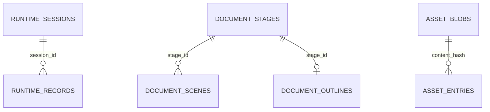
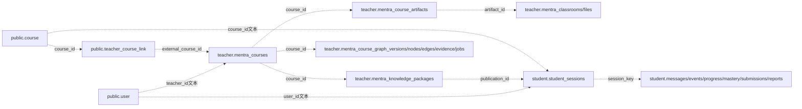

# Agentic Class Pilot 数据库架构说明

> 维护状态：代码结构基线，2026-10-22，分支 `decouple-implementation`。**不是生产数据库实测快照，也不是已完成数据解耦的声明。** 本机 `education` 的只读实测结果见[2026-10-22 核验记录](database-audit-2026-10-22.md)：本机 Alembic 仍为 `final06`，本文按代码迁移 head `final09` 列出的字段不能直接视为本机已上线字段。上线前仍须与目标环境逐项比对。本文不包含连接串、密码或真实用户数据。

## 1. 阅读顺序与权威来源

1. 本文说明“数据在哪里、谁可改、如何流动”。跨服务的 HTTP 字段以 [`contracts/README.md`](../contracts/README.md) 指向的契约为准；本文不代替接口契约。
2. `public` 业务表以 [`platform/backend/app/models.py`](../platform/backend/app/models.py) 和 [`platform/backend/app/alembic/versions/`](../platform/backend/app/alembic/versions/) 为准；`teacher` 核心表以 `final02`、`final03`、`final04` 为准；`student` 表以 `final05`、`final08`、`final09` 为准。变更列时先看完整迁移链，不能只看建表迁移。
3. “领域所有权”不等于“DDL 执行者”或“数据库角色权限”。平台 Alembic 创建三个 Schema 的多数业务表；迁移意图给教师/学生服务授 DML，但本地初始化脚本以各服务角色为 Schema owner，**实际仍可能具备该 Schema 的 DDL 权限**；平台当前仍跨 Schema 直读。权限结论须以目标库核验为准。
4. 表内 `payload`、`data`、`stage`、`scenes` 等 JSONB 的内部字段不在 SQL 列字典内；需另查类型定义与契约。文中 `→` 标记**真实 FK**，`⇢` 标记**仅业务逻辑关联**。

## 2. 数据库与 Schema 总清单

| 运行形态 | 数据库 / Schema | 表及用途 | DDL 来源 / 运行责任 |
| --- | --- | --- | --- |
| 本地统一栈 | PostgreSQL `education` / `public` | `user` 用户、`emailverification` 邮箱验证码、`browser_session` 浏览器会话、`user_model_config` 用户模型配置；`course` 平台课程、`chapter` 章节、`enrollment` 选课、`chapterprogress` 章节完成；`teacher_course_link` 两端课程 ID 映射；`agentsession` 平台 Agent 会话索引；`item` 模板遗留示例 | 平台 Alembic；平台业务写入 |
| 本地统一栈 | 同库 / `teacher` | `mentra_courses` 课程内容；`mentra_material_extractions` 资料提取；`mentra_artifact_jobs` 课件任务；`mentra_course_artifacts` 课件；`mentra_course_lesson_files` 课时文件；`mentra_classrooms` 课堂；`mentra_artifact_files`、`mentra_course_material_files` 文件元数据/可选字节；`mentra_knowledge_packages` 发布知识包；`mentra_course_graph_versions`、`mentra_course_graph_jobs`、`mentra_course_graph_nodes`、`mentra_course_graph_edges`、`mentra_course_graph_evidence` 知识图谱；`mentra_course_access_grants` 访问授权；`mentra_teacher_agent_sessions`、`mentra_teacher_agent_events`、`mentra_teacher_agent_entries`、`mentra_teacher_agent_owner_counters`、`mentra_teacher_agent_owner_events`、`mentra_teacher_agent_urls` 教师 Agent 会话及事件 | 平台迁移 `final02/03/04`；教师端 DML。独立教师库模式下，教师端可自行建同名核心表/会话表 |
| 本地统一栈 | 同库 / `student` | `student_sessions` 会话、`student_messages` 消息、`learning_events` 事件、`playback_progress` 播放进度、`knowledge_mastery` 掌握度、`task_submissions` 任务提交、`after_class_reports` 课后报告 | 平台迁移 `final05/08/09`；学生端 DML |
| 条件性：平台 Agent 启动 | 平台 `DATABASE_URL` 的默认 `search_path`（通常 `public`） | `checkpoints`、`checkpoint_blobs`、`checkpoint_writes` 和 `checkpoint_migrations`；LangGraph checkpoint/版本记录 | 第三方 `AsyncPostgresSaver.setup()` 自动管理，**不在 Alembic**；具体列/约束以安装版本及实库目录为准 |
| 条件性：教师 OpenMAIC 持久化启用 | 教师 `DATABASE_URL` 的默认 `search_path`，可能是独立库，不能假定为统一库的 `teacher` | `runtime_sessions`、`runtime_records`；`document_folders`、`document_stages`、`document_scenes`、`document_outlines`、`document_stage_revision`、`document_scene_revision`；`asset_blobs`、`asset_entries` | `teacher_agent/lib/persistence/server-provider.ts` 调用 `@openmaic/storage` 的 `ensure*Schema`，非平台 Alembic。是否与 `COURSE_DATABASE_URL` 指向同一数据库，取决于部署配置 |
| 代码具备、部署需核验 | 教师端配置的库/Schema | `agent_session_materials`、`agent_user_skill` 等上游库定义的可选表 | 上游 storage 包定义；未从统一栈迁移链证明已创建，不能计入已部署表 |
| 开发/测试或旧部署 | `app`、`app_test`、独立教师 `openmaic` 等 | 同一代码可能落在不同物理库；`app_test` 是测试库，不是业务副本 | `platform/compose.yml`、`platform/compose.local.yml`、`teacher_agent/docker-compose.yml` 的拓扑不同。**不得凭本地清单推断服务器实际库数** |

PostgreSQL 之外还有 MinIO 对象存储（教师文件可将 `bytes` 留空，实际字节存对象存储）、教师端 JSON 文件回退模式，以及学生端会话层内存状态。这些不是 PostgreSQL 表，却影响备份、恢复和多实例一致性。教师课程是否落库取决于 `COURSE_STORAGE_MODE=postgres`；其默认值是 `json`，统一栈必须核对实际环境。

特别注意：教师课程使用 `COURSE_DATABASE_URL`（回退到 `DATABASE_URL`）并可指定 `COURSE_DATABASE_SCHEMA=teacher`；上游 OpenMAIC 文档/资源持久化另读 `DATABASE_URL`，不自动继承课程 Schema。若两者同指统一库却使用 `teacher` 角色和默认 `public` 搜索路径，上游自动建表可能因 `public` 无 CREATE 权限失败。必须逐 DSN、逐角色核验，不能把两套持久化当成一个开关。

## 3. 数据字典：平台 `public`

记法：`字段 类型`；`PK(...)` 主键、`UQ(...)` 唯一键/唯一索引；`→` 后为真实 FK 及删除动作。未写 `NOT NULL` 的字段仍以迁移 DDL 为准；下表重点完整列出字段、类型、键与关系。`varchar(n)` 是迁移限定长度，未限定字符串为 `text/varchar`。

| 表 | 全部字段（迁移最终状态） | 键和真实外键 |
| --- | --- | --- |
| `user` | `id uuid`, `email varchar(255)`, `is_active boolean`, `is_superuser boolean`, `full_name varchar(255)?`, `hashed_password varchar`, `created_at timestamptz?`, `role varchar(20)` | PK(`id`); UQ(`email`) |
| `item` | `id uuid`, `title varchar(255)`, `description varchar(255)?`, `owner_id uuid`, `created_at timestamptz?` | PK(`id`); `owner_id → user.id` CASCADE；模板示例，业务用途待确认 |
| `emailverification` | `id uuid`, `email varchar(255)`, `code_hash varchar(64)`, `attempts integer`, `created_at timestamptz?`, `expires_at timestamptz?` | PK(`id`); `email` 普通索引，**不唯一** |
| `course` | `id uuid`, `title varchar(255)`, `description varchar(2000)?`, `created_at timestamptz?`, `owner_id uuid`, `enroll_code varchar(8)?` | PK(`id`); UQ(`enroll_code`); `owner_id → user.id` CASCADE |
| `chapter` | `id uuid`, `title varchar(255)`, `description varchar(2000)?`, `order_index integer`, `created_at timestamptz?`, `course_id uuid` | PK(`id`); `course_id → course.id` CASCADE |
| `enrollment` | `id uuid`, `course_id uuid`, `student_id uuid`, `created_at timestamptz?` | PK(`id`); `course_id → course.id` CASCADE; `student_id → user.id` CASCADE；**无** `(course_id,student_id)` DB 唯一约束 |
| `chapterprogress` | `id uuid`, `chapter_id uuid`, `student_id uuid`, `completed_at timestamptz?` | PK(`id`); `chapter_id → chapter.id` CASCADE; `student_id → user.id` CASCADE；**无** `(chapter_id,student_id)` DB 唯一约束 |
| `agentsession` | `id uuid`, `thread_id varchar(100)`, `user_id uuid`, `agent_key varchar(50)`, `scope_type varchar(50)`, `scope_id varchar(64)`, `title varchar(255)`, `status varchar(20)`, `state_version integer`, `idempotency_key varchar(100)?`, `run_token varchar(64)?`, `run_expires_at timestamptz?`, `created_at timestamptz?`, `updated_at timestamptz?` | PK(`id`); UQ(`thread_id`); 条件 UQ(`user_id,agent_key,scope_type,scope_id,idempotency_key`) 当 key 非空；`user_id → user.id` CASCADE；`scope_id` 不是 FK |
| `browser_session` | `token_hash varchar(64)`, `user_id uuid`, `expires_at timestamptz` | PK(`token_hash`); `user_id → user.id` CASCADE |
| `teacher_course_link` | `course_id uuid`, `external_course_id text` | PK(`course_id`); UQ(`external_course_id`); `course_id → course.id` CASCADE；`external_course_id ⇢ teacher.mentra_courses.id` **无 FK** |
| `user_model_config` | `user_id uuid`, `config jsonb`, `updated_at timestamptz` | PK(`user_id`); `user_id → user.id` CASCADE；配置中的凭证由应用层加密 |

另有 `alembic_version`（迁移工具元数据，不归业务服务）。历史 `generationjob`、`chatsession` 已在迁移链中删除；不要把旧迁移的 `CREATE TABLE` 当成当前表。

## 4. 数据字典：教师 `teacher`

此组时间字段多数为 Unix 毫秒 `bigint`，与平台 `timestamptz`、文档持久化 `double precision` 不同。`final02` 的 15 张核心表**没有真实 FK**，下列 `course_id` 等均是逻辑关联。`final04` 后两个文件表的 `bytes` 可为空。

| 表 | 全部字段 | 主键、唯一约束和真实 FK |
| --- | --- | --- |
| `mentra_courses` | `id text`, `teacher_id text`, `status text`, `title text`, `payload jsonb`, `created_at bigint`, `updated_at bigint` | PK(`id`) |
| `mentra_material_extractions` | `material_id text`, `course_id text`, `source_sha256 text`, `payload jsonb`, `created_at bigint`, `updated_at bigint` | PK(`material_id`) |
| `mentra_artifact_jobs` | `id text`, `course_id text`, `teacher_id text`, `artifact_type text`, `status text`, `payload jsonb`, `created_at bigint`, `updated_at bigint` | PK(`id`) |
| `mentra_course_artifacts` | `id text`, `job_id text`, `course_id text`, `teacher_id text`, `artifact_type text`, `status text`, `payload jsonb`, `created_at bigint`, `updated_at bigint` | PK(`id`) |
| `mentra_course_lesson_files` | `id text`, `course_id text`, `module_id text`, `lesson_id text`, `file_type text`, `title text`, `status text`, `content text`, `payload jsonb`, `created_at bigint`, `updated_at bigint` | PK(`id`) |
| `mentra_classrooms` | `id text`, `course_id text?`, `artifact_id text?`, `stage jsonb`, `scenes jsonb`, `payload jsonb`, `created_at bigint`, `updated_at bigint` | PK(`id`) |
| `mentra_artifact_files` | `storage_key text`, `artifact_id text`, `file_name text`, `mime_type text`, `size_bytes bigint`, `sha256 text`, `bytes bytea?`, `created_at bigint`, `updated_at bigint` | PK(`storage_key`) |
| `mentra_course_material_files` | `storage_key text`, `material_id text`, `course_id text`, `file_name text`, `mime_type text`, `size_bytes bigint`, `sha256 text`, `bytes bytea?`, `created_at bigint`, `updated_at bigint` | PK(`storage_key`) |
| `mentra_knowledge_packages` | `id text`, `course_id text`, `teacher_id text`, `version integer`, `status text`, `payload jsonb`, `created_at bigint`, `published_at bigint?` | PK(`id`); UQ(`course_id,version`) |
| `mentra_course_graph_versions` | `course_id text`, `version integer`, `status text`, `title text`, `summary text?`, `source_material_hashes jsonb`, `created_by text`, `created_at bigint`, `published_at bigint?` | PK(`course_id,version`) |
| `mentra_course_graph_jobs` | `id text`, `course_id text`, `teacher_id text`, `graph_version integer`, `session_id text`, `status text`, `phase text`, `progress integer`, `payload jsonb`, `created_at bigint`, `updated_at bigint` | PK(`id`) |
| `mentra_course_graph_nodes` | `course_id text`, `graph_version integer`, `id text`, `node_type text`, `title text`, `description text?`, `module_id text?`, `lesson_id text?`, `status text`, `properties jsonb`, `created_at bigint`, `updated_at bigint` | PK(`course_id,graph_version,id`) |
| `mentra_course_graph_edges` | `course_id text`, `graph_version integer`, `id text`, `source_node_id text`, `target_node_id text`, `relation_type text`, `properties jsonb`, `created_at bigint` | PK(`course_id,graph_version,id`) |
| `mentra_course_graph_evidence` | `course_id text`, `graph_version integer`, `id text`, `node_id text`, `material_id text`, `chunk_id text`, `page integer?`, `slide integer?`, `source_sha256 text`, `excerpt text?` | PK(`course_id,graph_version,id`) |
| `mentra_course_access_grants` | `id text`, `tenant_id text`, `course_id text`, `subject_type text`, `subject_id text`, `role text`, `created_at bigint`, `expires_at bigint?` | PK(`id`); UQ(`tenant_id,course_id,subject_type,subject_id`)；`tenant_id` 仅此表有列，不能据此宣称全系统已租户隔离 |
| `mentra_teacher_agent_sessions` | `id text`, `owner_id text`, `prompt text`, `title text?`, `title_state text`, `stage_id text`, `active_stage_id text?`, `skill_id text?`, `origin text?`, `existing_course boolean`, `status text`, `attempt integer`, `delivered_user_message_seq integer`, `lease_worker_id text?`, `lease_worker_pid integer?`, `lease_heartbeat_at bigint?`, `cancel_requested_at bigint?`, `error text?`, `created_at timestamptz`, `updated_at timestamptz`, `deleted_at timestamptz?` | PK(`id`); CHECK 状态/次数等 |
| `mentra_teacher_agent_events` | `session_id text`, `seq integer`, `ts bigint`, `attempt integer`, `type text`, `data jsonb?` | PK(`session_id,seq`); `session_id → mentra_teacher_agent_sessions.id` CASCADE |
| `mentra_teacher_agent_entries` | `session_id text`, `seq integer`, `entry_id text`, `parent_id text?`, `type text`, `data jsonb`, `ts timestamptz`, `attempt integer` | PK(`session_id,seq`); UQ(`session_id,entry_id`); `session_id → sessions.id` CASCADE; `(session_id,parent_id) → entries(session_id,entry_id)` 自引用 |
| `mentra_teacher_agent_owner_counters` | `owner_id text`, `n bigint` | PK(`owner_id`) |
| `mentra_teacher_agent_owner_events` | `owner_id text`, `id bigint`, `ts bigint`, `session_id text`, `type text`, `status text?`, `attempt integer?`, `data jsonb` | PK(`owner_id,id`); 无 session FK |
| `mentra_teacher_agent_urls` | `session_id text`, `url text`, `source text`, `created_at timestamptz` | PK(`session_id,url`); `session_id → sessions.id` CASCADE |

上面真实 FK 的简称 `sessions` / `entries` 均指本 Schema 的 `mentra_teacher_agent_sessions` / `mentra_teacher_agent_entries`。教师上游会话包的默认表名是 `agent_sessions` 等；当前适配器显式重命名为 `mentra_teacher_agent_*`，不能照抄上游默认表名。

## 5. 数据字典：学生 `student`

`final08` 把报告主键改为 `(session_key,report_kind,version)`；`final09` 又删掉 `knowledge_mastery.self_rating`。以下按迁移 head `final09` 记录。七张表之间**没有真实 FK**，即使 `session_key` 等值一致也只构成业务关联。

| 表 | 全部字段 | 主键与唯一约束 |
| --- | --- | --- |
| `student_sessions` | `session_key text`, `user_id text`, `course_id text`, `publication_id text`, `publication_version integer`, `classroom_id text?`, `student_name text?`, `started_at timestamptz`, `last_active_at timestamptz`, `ended_at timestamptz?` | PK(`session_key`) |
| `student_messages` | `id bigint identity`, `session_key text`, `user_id text`, `course_id text`, `publication_id text`, `seq integer`, `role text`, `phase text?`, `content text`, `created_at timestamptz` | PK(`id`); UQ(`session_key,seq`) |
| `learning_events` | `id bigint identity`, `session_key text`, `user_id text`, `course_id text`, `publication_id text`, `classroom_id text?`, `event_type text`, `event_id text?`, `payload jsonb`, `created_at timestamptz` | PK(`id`); UQ(`session_key,event_type,event_id`)；PostgreSQL 对 NULL `event_id` 不去重 |
| `playback_progress` | `session_key text`, `user_id text`, `course_id text`, `publication_id text`, `classroom_id text`, `scene_id text`, `segment_id text?`, `completed_at timestamptz` | PK(`session_key,scene_id`) |
| `knowledge_mastery` | `id bigint identity`, `session_key text`, `user_id text`, `course_id text`, `publication_id text`, `knowledge_point_id text`, `stars integer`, `status text`, `evidence text?`, `source text?`, `updated_at timestamptz` | PK(`id`); UQ(`user_id,course_id,publication_id,knowledge_point_id`) |
| `task_submissions` | `id bigint identity`, `session_key text`, `user_id text`, `course_id text`, `publication_id text`, `task_id text`, `content text`, `submitted_at timestamptz` | PK(`id`); UQ(`session_key,task_id`) |
| `after_class_reports` | `session_key text`, `user_id text`, `course_id text`, `publication_id text`, `payload jsonb`, `created_at timestamptz`, `version integer`, `report_kind text`, `teacher_summary text?` | PK(`session_key,report_kind,version`) |

## 6. 条件性运行时表字典

这些表不是统一栈 Alembic 业务迁移的组成部分；只有对应持久化模块启用且 schema 初始化成功时才存在。独立库、默认 `search_path` 与其真实 DDL 需实库核验。

| 来源 | 表 | 字段、键与真实 FK（代码声明） |
| --- | --- | --- |
| 教师 runtime | `runtime_sessions` | `id text` PK, `stage_id text`, `learner_key text`, `kind text`, `status text`, `created_at text`, `updated_at text`, `data jsonb` |
| 教师 runtime | `runtime_records` | `id text`, `session_id text → runtime_sessions.id` CASCADE, `seq bigint`, `scene_id text?`, `created_at text`, `data jsonb`; UQ(`session_id,seq`)，**无声明主键** |
| 教师 document | `document_folders` | `owner_id text`, `id text`, `name text`, `normalized_name text`, `created_at double precision`, `updated_at double precision`, `folder_order double precision`; PK(`owner_id,id`), UQ(`owner_id,normalized_name`) |
| 教师 document | `document_stages` | `id text` PK, `name text`, `description text?`, `interactive_mode boolean?`, `task_engine_mode boolean?`, `created_at double precision`, `updated_at double precision`, `owner_id text?`, `folder_id text?`, `data jsonb`; `folder_id` **非 FK** |
| 教师 document | `document_scenes` | `stage_id text → document_stages.id` CASCADE, `id text`, `scene_order double precision`, `data jsonb`; PK(`stage_id,id`) |
| 教师 document | `document_outlines` | `stage_id text → document_stages.id` CASCADE, `data jsonb`; PK(`stage_id`) |
| 教师 document | `document_stage_revision` | `stage_id text` PK, `rev bigint`; 无 FK，触发器维护 |
| 教师 document | `document_scene_revision` | `stage_id text`, `scene_id text`, `rev bigint`; PK(`stage_id,scene_id`)，无 FK，触发器维护 |
| 教师 asset | `asset_blobs` | `content_hash text` PK, `byte_size bigint`, `bytes bytea?`, `unreferenced_at timestamptz?` |
| 教师 asset | `asset_entries` | `id text` PK, `principal text`, `content_hash text → asset_blobs.content_hash`, `mime text`, `meta jsonb`, `revision integer`, `created_at double precision` |
| 可选上游 material | `agent_session_materials` | `id text` PK, `session_id text → agent_sessions.id` CASCADE, `kind text`, `title text?`, `source_url text?`, `text_asset_id text?`, `raw_asset_id text?`, `text_chars integer`, `derived_from text? → agent_session_materials.id` CASCADE, `extraction_status text`, `extraction_attempts integer`, `extraction_error text?`, `extraction_stats jsonb?`, `extractor_version text?`, `extraction_lease_worker_id text?`, `extraction_lease_worker_pid integer?`, `extraction_lease_heartbeat_at bigint?`, `created_at timestamptz`；**上游默认名与当前 `mentra_teacher_agent_sessions` 不兼容，不能不经映射直接建入统一库** |
| 可选上游 skill | `agent_user_skill` | `id text` PK, `owner_id text`, `name text`, `title text`, `description text`, `content text`, `version integer`, `created_at timestamptz`, `updated_at timestamptz`, `deleted_at timestamptz?`; 条件 UQ(`owner_id,name`) 当 `deleted_at IS NULL` |
| 平台 LangGraph | `checkpoints`, `checkpoint_blobs`, `checkpoint_writes`, `checkpoint_migrations` | 第三方库运行时 DDL；**未核对已安装包/实库，字段、PK、FK 暂不作推断**。不能用本表作为其完整数据字典；下一次连到只读测试库时补录版本化目录快照 |

条件性教师 OpenMAIC 表的已声明真实外键如下；它们不与统一栈 39 张迁移表混画，且实际是否同库需核验：



## 7. ER：物理约束与业务逻辑分开看

下图覆盖统一栈迁移基线的 39 张业务表；**实线只代表代码明确声明的真实 FK**，孤立实体表示数据库不强制关联。条件性运行时表另见第 6 节，不能在尚未核验物理库的情况下混成一张“已部署”ER。跨 Schema 的课程映射、学生会话、图谱等不得画成实线外键。

```mermaid
erDiagram
  EMAILVERIFICATION { uuid id PK }
  MENTRA_COURSES { text id PK }
  MENTRA_MATERIAL_EXTRACTIONS { text material_id PK }
  MENTRA_ARTIFACT_JOBS { text id PK }
  MENTRA_COURSE_ARTIFACTS { text id PK }
  MENTRA_COURSE_LESSON_FILES { text id PK }
  MENTRA_CLASSROOMS { text id PK }
  MENTRA_ARTIFACT_FILES { text storage_key PK }
  MENTRA_COURSE_MATERIAL_FILES { text storage_key PK }
  MENTRA_KNOWLEDGE_PACKAGES { text id PK }
  MENTRA_COURSE_GRAPH_VERSIONS {
    text course_id PK
    integer version PK
  }
  MENTRA_COURSE_GRAPH_JOBS { text id PK }
  MENTRA_COURSE_GRAPH_NODES {
    text course_id PK
    integer graph_version PK
    text id PK
  }
  MENTRA_COURSE_GRAPH_EDGES {
    text course_id PK
    integer graph_version PK
    text id PK
  }
  MENTRA_COURSE_GRAPH_EVIDENCE {
    text course_id PK
    integer graph_version PK
    text id PK
  }
  MENTRA_COURSE_ACCESS_GRANTS { text id PK }
  MENTRA_TEACHER_AGENT_OWNER_COUNTERS { text owner_id PK }
  MENTRA_TEACHER_AGENT_OWNER_EVENTS {
    text owner_id PK
    bigint id PK
  }
  STUDENT_SESSIONS { text session_key PK }
  STUDENT_MESSAGES { bigint id PK }
  LEARNING_EVENTS { bigint id PK }
  PLAYBACK_PROGRESS {
    text session_key PK
    text scene_id PK
  }
  KNOWLEDGE_MASTERY { bigint id PK }
  TASK_SUBMISSIONS { bigint id PK }
  AFTER_CLASS_REPORTS {
    text session_key PK
    text report_kind PK
    integer version PK
  }
  USER ||--o{ ITEM : owner_id
  USER ||--o{ COURSE : owner_id
  USER ||--o{ ENROLLMENT : student_id
  USER ||--o{ CHAPTERPROGRESS : student_id
  USER ||--o{ AGENTSESSION : user_id
  USER ||--o{ BROWSER_SESSION : user_id
  USER ||--o| USER_MODEL_CONFIG : user_id
  COURSE ||--o{ CHAPTER : course_id
  COURSE ||--o{ ENROLLMENT : course_id
  COURSE ||--o| TEACHER_COURSE_LINK : course_id
  CHAPTER ||--o{ CHAPTERPROGRESS : chapter_id
  MENTRA_TEACHER_AGENT_SESSIONS ||--o{ MENTRA_TEACHER_AGENT_EVENTS : session_id
  MENTRA_TEACHER_AGENT_SESSIONS ||--o{ MENTRA_TEACHER_AGENT_ENTRIES : session_id
  MENTRA_TEACHER_AGENT_SESSIONS ||--o{ MENTRA_TEACHER_AGENT_URLS : session_id
  MENTRA_TEACHER_AGENT_ENTRIES ||--o{ MENTRA_TEACHER_AGENT_ENTRIES : parent_id
```



逻辑关联（虚线，**无数据库 FK**；图中 `T_`/`S_` 分别代表 `teacher`/`student` Schema；只列关键节点族，族内每张表的关联字段见字典）：



`teacher_course_link.external_course_id` 可与 `teacher.mentra_courses.id` 对应，也有平台/教师课程同 UUID 的路径；**两种路径都不能推断存在 FK**。`publication_id` 必须按实际协议映射到知识包 ID，不能只比较版本号。教师图谱边的 `source_node_id`、`target_node_id`、证据的 `node_id` 都是逻辑引用；删除时无 DB 级联保护。

## 8. 数据所有权与当前读写矩阵

`R/W` 为服务业务进程当前能力或代码路径，`—` 为不应直接访问；`DDL` 为迁移/初始化者。平台高权限连接能物理修改更多表，但那不是领域授权。下表需要与生产角色 grants 再核对。

| 表族 | 领域权威写入者 | 当前平台 | 当前教师端 | 当前学生端 | 期望跨端访问 |
| --- | --- | --- | --- | --- | --- |
| `public.user/browser_session/emailverification/user_model_config` | 平台 | R/W | 通过平台 API 取身份/配置 | 通过平台 API 取身份 | 不共享原表；配置/密钥最小披露 |
| `public.course/chapter/enrollment/chapterprogress/teacher_course_link/agentsession` | 平台 | R/W | 通过平台 API；另写教师课程内容 | 通过平台签发上下文 | 选课/身份由平台判定；不要在教师表复制为权威 |
| `teacher.mentra_*` 课程/发布/图谱/课堂 | 教师端 | **R：跨 Schema 直查** `teacher_bridge.py`、`student_bridge.py`、`course_publication.py` | R/W | 经平台 API 取被授权发布视图 | 教师提供版本化发布视图；平台先影子对比后切读 |
| `teacher.mentra_teacher_agent_*` | 教师端 | 未发现常规业务直写 | R/W | — | 会话原始内容不跨端直查 |
| `student.*` 七表 | 学生端 | **R：跨 Schema 聚合** `student_bridge.py` | 经平台学情/进度 API | R/W | 学生端提供受限聚合或事件投影；平台不能把直查当永久边界 |
| 教师 `runtime/document/asset` 条件表 | 教师端或上游包 | — | 条件性 R/W，且可能启动时 DDL | — | 不在平台授权主链路直连 |
| 平台 checkpoint 四表 | 平台 LangGraph | R/W（第三方库） | — | — | 不当作公开会话 API；清理须与 `agentsession` 协调 |
| MinIO 对象 | 教师文件持有者 | 可能代理访问 | R/W | 经受控 URL/接口读 | 数据库元数据与对象生命周期对账 |

## 9. 四条跨服务数据流（当前状态）

| 流程 | 先后写入/读取 | 关键一致性点 |
| --- | --- | --- |
| 教师创建课程 | 平台验证教师身份；教师端创建/保存 `teacher.mentra_courses`（或 JSON 模式）；平台在 `public.course`、`teacher_course_link` 建身份/选课映射。`teacher_bridge.py` 还会直读教师课程以确认来源 | 跨服务没有共同事务。失败/重试可能产生单边课程或映射；以两端 ID、教师 ID 对账，不得简单双写覆盖 |
| 生成并发布课件 | 教师端 `mentra_artifact_jobs` → `mentra_course_artifacts` / `mentra_classrooms` / 文件与图谱 → `mentra_knowledge_packages` 的版本和状态；平台 `course_publication.py`、`student_bridge.py` 直读当前 published 包和 active 课程决定学习资格/内容 | 目前教师发布路径多步写入，不能假设天然原子；下架/撤销、版本切换必须优先正确。未来投影需同事务 outbox、幂等版本、补偿回填，未完成前旧查询保持权威 |
| 学生选课/进入课堂 | 平台 `public.enrollment` 记录选课；平台联查用户/课程/映射与教师发布状态；向学生端交付签名上下文；学生端据此写 `student.student_sessions` | 选课**不是**发布许可；教师下架、课程状态、版本、过期均须拒绝。`student.user_id/course_id/publication_id` 是文本引用，非跨 Schema FK |
| 学习与教师看学情 | 学生端追加 `student_messages`、`learning_events`、`playback_progress`、`knowledge_mastery`、`task_submissions`、`after_class_reports`；平台 `student_bridge.py` 直接聚合学生表和教师课件数，经平台接口给教师视图；另有向教师端推送班级学生列表的镜像路径 | 平台读聚合是当前实现，不等于学生数据已解耦。事件去重、迟到/乱序、班级镜像失败、报告版本与删除语义需设计补偿与对账 |

## 10. 风险清单与边界决策

| 风险 | 代码证据/现状 | 先做的决策或控制 |
| --- | --- | --- |
| 共享实例与直连 | 平台对 `teacher.*`、`student.*` 的 SQL 在桥接路由/发布服务中可见 | 先确定课程发布权威、学生学情权威及允许的只读适配器；不以撤销 DB 权限作为第一步 |
| 一套 DDL、多套初始化 | 平台 Alembic 管核心表；教师 course 模式及上游 persistence 还可自行建表；LangGraph 自动建 checkpoint；本地 `setup_local.py` 创建 `teacher`/`student` Schema 时指定服务角色为 owner，与“只授 DML”注释不等价 | 统一环境逐库列出迁移/初始化责任，核验 Schema owner 与 `CREATE`/`ALTER` 能力；停用冲突运行时 DDL 前核对版本，建立数据库变更审查清单 |
| 冗余与镜像 | `public.course` ↔ `teacher.mentra_courses`；教师课程中的学生列表/平台选课；发布包与课件 JSON；文件元数据与 MinIO | 明确每个字段权威方、投影时间与对账规则；不要把镜像读成权威 |
| 无 FK 的孤儿数据 | 教师课程/图谱/课件核心表、学生七表仅靠文本 ID；`teacher_course_link` 跨 Schema 也无 FK | 设计只读孤儿检查及可恢复清理；在证明删除语义前不补跨服务 FK 或级联 |
| 级联误删 | `user → course/enrollment/agentsession/browser_session`、`course → chapter/enrollment/teacher_course_link`、`chapter → chapterprogress`；教师会话子表自级联 | 用户/课程删除前列出跨 Schema 残留、对象存储、checkpoint；保留期、软删与 GDPR/学校要求需单独定案 |
| 并发与幂等 | `enrollment`、`chapterprogress` 无业务组合唯一键；`learning_events` 的 nullable `event_id` 使 UQ 不保证全部事件去重 | 在独立测试库做并发与重复请求测试；约定幂等键和冲突处理，再评估在线加约束 |
| 发布一致性 | 教师发布当前多次写，平台同步直读；未来异步投影可能滞后 | 首个只读试点先选非鉴权的学情摘要；发布鉴权切换须单列 fail-closed、撤销优先、最大滞后与回滚门槛 |
| SaaS 租户隔离 | 多数 `public`、`student`、教师核心表没有 `tenant_id`；仅授权表出现 tenant 列 | 在承诺多租户前先定租户模型、所有读写谓词、索引、迁移与越权测试；不能以 Schema 分离代替租户隔离 |
| 迁移/备份风险 | `final09` 清洗 JSON 并删列；`final08` 改报告主键；MinIO、文件回退、独立教师库不随单库快照恢复 | 生产迁移前备份、回放、耗时/锁评估；恢复演练覆盖 PG+对象+文件；破坏性降级不得自动执行 |

## 11. 下一步：先决策，再做一条只读试点

1. **边界决策**：平台管理身份、选课和课程 ID 映射；教师端管理课件内容/发布及撤销；学生端管理学习事件/掌握度。团队还须明确“学情摘要谁计算”和“发布投影最多可滞后多久”，并记录异常时究竟 fail closed 还是回旧读。
2. **优先试点**：先取教师查看课程的**非鉴权学情摘要**一条读路径。学生端定义按 `course_id`、授权教师/学校范围返回聚合的只读接口；平台保持原 SQL 返回权威结果。影子请求不得写学习数据、不得影响主请求时延/成功率；只记录脱敏差异及统计。
3. **验证门槛**：空课程、未选课、重复/迟到事件、报告多版本、删除用户、服务超时、不同学生并发、多租户越权（租户模型就绪后）逐项对比。差异归零且有回滚演练后，用**默认关闭**的开关切读；保留旧 SQL 观察一段约定窗口，再撤权限/删旧读。
4. **后续才碰发布鉴权**：发布/撤销需要可靠事件或同事务 outbox、版本化投影、历史回填、对账与失联关闭机制。不能把非鉴权摘要试点的成功等同于发布链路可切换。

本轮只形成分析文档，**未增加接口、投影、开关、迁移或数据库权限变更**；上述试点仍需单独实现和验收。

## 12. 长期维护与实库只读核验

每次迁移或跨端数据访问变更，PR 同时更新：本文件的清单/字典/ER/所有权/流程/风险，接口契约，数据回填与回滚方案。优先在隔离测试库跑迁移并保存目录差异；生产只做只读目录核验，不在生产跑破坏性“验证”。已做的本地只读聚合核验另存为[带日期的记录](database-audit-2026-10-22.md)，避免把环境实况和长期目标结构混在一起。

在获授权的目标 PostgreSQL 上，按以下查询导出**结构元数据**（不读取业务行/密码），对每个实际 DSN 分别执行，并记录 `current_database()`、`current_schema()`、`alembic_version` 及应用版本：

```sql
SELECT current_database(), current_schema(), current_setting('search_path');
SELECT table_schema, table_name, column_name, data_type, udt_name,
       is_nullable, column_default
FROM information_schema.columns
WHERE table_schema IN ('public','teacher','student')
ORDER BY table_schema, table_name, ordinal_position;

SELECT n.nspname AS schema_name, c.relname AS table_name, con.conname,
       con.contype, pg_get_constraintdef(con.oid) AS definition
FROM pg_constraint con
JOIN pg_class c ON c.oid = con.conrelid
JOIN pg_namespace n ON n.oid = c.relnamespace
WHERE n.nspname IN ('public','teacher','student')
ORDER BY n.nspname, c.relname, con.conname;

SELECT schemaname, tablename, indexname, indexdef
FROM pg_indexes WHERE schemaname IN ('public','teacher','student')
ORDER BY schemaname, tablename, indexname;
```

核验清单：① 有无额外 Schema/表/列、运行时自动建表、旧表残留；② FK/唯一索引是否与字典一致；③ 教师两个 DSN 是否同库、`COURSE_STORAGE_MODE` 是否真为 postgres；④ 三端 DB role 的 grants 与 `search_path`；⑤ 备份是否同时覆盖 MinIO、JSON 回退及可能的独立教师库。差异要先记录为“环境偏差”，不要直接改生产库来迎合本文。
