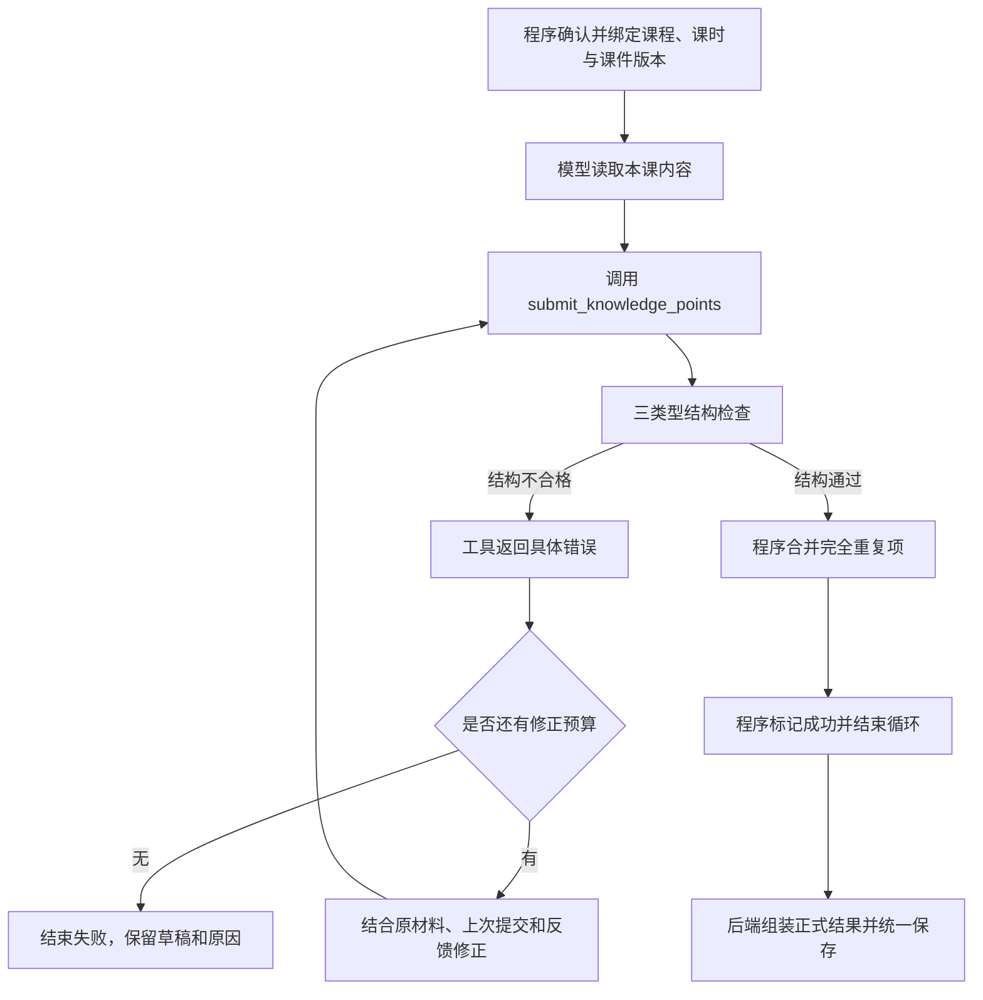

# 课时知识点结构化提取方案

> 更新日期：2026-11-05
> 状态：核心协议、create_agent 反馈修正及保存兼容已实施，尚未部署；验证范围见[实施记录](../implementation/changes-and-tests.md)。来源扩展和完整按类型教学策略仍属后续范围。
> 范围：教师端已发布课件的播放内容 → 具体课时的知识点 → 学生端使用。

## 1. 本版相较前面讨论的调整

| 项目 | 前面讨论 | 当前方案 |
| --- | --- | --- |
| 知识点类型 | 曾讨论更多类型 | 仅使用 `memory`、`concept`、`design` |
| 公式字段 | 曾建议独立 `formulas` | 本版不增加独立公式字段，也不展开公式识别改造 |
| 输出机制 | 提示词要求 JSON，或单次结构化输出 | 通过 LangChain 工具调用提交固定结构的知识点 |
| 修正流程 | 曾建议单独增加 LangGraph 修正工作流 | 直接在同一个 `create_agent` 循环内提交、检查、反馈、修正 |
| 课时归属 | 前面示例未完整列出 | 顶层必须有 `lessonId`，明确属于哪一堂课；同时保留 `courseId` |
| ID 与归属来源 | 容易与模型输出混在一起 | 课程、课时、版本、知识点 ID 均由程序管理 |
| 完成条件 | 曾同时设置结构、来源和业务门槛 | 模型输出结构通过后即可完成；课时归属由程序保证，完全重复项由程序合并 |
| 保存时机 | 提交与保存边界未明确 | 工具先检查，成功结束循环后由程序统一保存 |
| `design` 内容 | 曾直接放一道具体练习 | 知识点记录设计能力与标准，具体练习后续生成 |
| 来源校验 | 曾将来源位置作为提交门槛 | 仅在原文跳转、回看等功能实际使用来源时接入；暂不作为提取成功门槛 |
| 内容改写 | 容易与原文匹配要求混淆 | 知识点名称及 details 允许概括、归纳和改写 |
| 语义检查 | 上一版改为运行时生成非阻断提示 | 本期不运行独立语义检查、不生成无人处理的提示；先用离线样本评测 |
| 重复处理 | 曾作为业务错误退回模型 | 仅对规则明确的完全重复项直接合并，不要求模型重生成 |

本文作为这次改造的当前方案；[此前的替代方案调研](../research/alternative-approaches.md)仅作历史背景，不以其中的其他建议扩展本次范围。

## 2. 目标与边界

把课件播放内容提取为具有固定格式和明确学习类型的知识点，为后续按类型设置提问、提示、判答规则提供统一数据。

本次设计包含：

- 三种类型的数据协议。
- 同一个 `create_agent` 中的提交、检查与修正循环。
- 正式结果与具体课时的绑定。
- 完全重复项的确定性合并。
- 合格结果的版本化保存和下游字段传递。

不在本版展开：独立公式处理、外部知识库、额外多 Agent 系统，以及完整重写学生教学流程。后续按类型的教学规则另行细化；本次需保留足够字段供其使用。

每项检查必须说明判断标准、处理动作和实际用途。本期不额外运行独立语义检查，也不生成后续无人展示或处理的语义提示。来源追溯作为有实际消费者时才接入的扩展；没有明确的原文跳转或回看需求时，暂不建设片段映射、引用校验和对应提示机制。

## 3. 三种知识点类型

| type | 含义 | C 语言示例 | 后续规则方向 |
| --- | --- | --- | --- |
| `memory` | 准确记住并说出 | 说出 `for` 循环的基本语法 | 检查必答要素与准确性 |
| `concept` | 理解含义、原理、过程或区别 | 解释初始化、条件判断、更新的执行顺序 | 允许不同措辞，检查理解与推理 |
| `design` | 基于已学知识独立构造一个结果 | 自己编写循环，完成累加 | 检查要求、逻辑与结果，接受多种正确实现 |

分类依据是“希望学生完成什么学习任务”。同一主题可以对应不同类型，但不强制每个主题生成三种类型。

`design` 不要求学术创新，可以是编写代码、构造例子、设计步骤或提出方案。提取时要求依据课件的讲解、方法或示例，避免只因出现某个术语就自行扩展要求。这作为提取要求和离线评测目标，本期不再增加独立模型调用来逐项裁定或生成语义提示。

## 4. 数据协议

### 4.1 正式结果的顶层字段

| 字段 | 含义 | 来源 |
| --- | --- | --- |
| `schemaVersion` | 数据协议版本；新协议暂以 `2` 表示 | 程序 |
| `courseId` | 整门课程的 ID | 当前任务绑定的课程 |
| `lessonId` | 具体那一堂课的 ID，非整门课程 ID | 当前任务绑定的课时 |
| `points` | 当前课时的知识点列表 | 经检查通过的工具提交结果 |

一批结果只对应一个 `lessonId`，其中所有知识点继承该归属。单独查询、传递知识点时，也应能够明确其 `lessonId`。

课件来源版本继续绑定现有的 `sourceRevision` / `videoRevision` 机制，避免同一课时修改课件后误用旧结果。该版本属于程序维护的元数据，不由模型填写。

### 4.2 知识点公共字段

| 字段 | 含义 | 来源 |
| --- | --- | --- |
| `id` | 知识点标识 | 后端生成 |
| `title` | 学生看到的知识点名称 | 模型 |
| `type` | 只能取三个已定义值 | 模型选择，程序校验 |
| `details` | 与 `type` 对应的内容结构 | 模型 |
| `sourceRefs`（可选扩展） | 有实际来源展示需求时使用的定位信息；不属于本期核心必填字段 | 扩展启用后，模型选择位置，程序处理有效引用 |

沿用现有 `points`、`title` 命名，不再引入另一套 `knowledge_points`、`name`。引用使用 `sourceRefs`，避免与现有学生回答评价中的 `evidence` 字段混用。

### 4.3 类型专属字段

| type | details 字段 | 要求 |
| --- | --- | --- |
| `memory` | `statement: string` | 需要记住的标准内容 |
| `memory` | `requiredElements: string[]` | 非空，列出必须答出的要素 |
| `concept` | `explanation: string` | 核心解释 |
| `concept` | `understandingPoints: string[]` | 非空，列出需理解的关系、原因、区别等 |
| `design` | `capability: string` | 能独立构造或完成什么 |
| `design` | `constraints: string[]` | 适用约束；确实没有特定约束时允许空数组 |
| `design` | `successCriteria: string[]` | 非空，列出可判断的完成标准 |

必填文本必须去除空白后仍有内容；禁止额外字段。三种类型使用各自的参数分支，不能混用 `details` 结构。长度和数量上限在实施时设定，不依靠提示词约束。

`title` 和 `details` 允许概括、归纳与改写，无需逐字出现在课件中。本期不要求模型提供或重抄引用原文，不通过文字匹配或相似度决定知识点能否保存。

`sourceRefs` 的可选扩展规则见第 6 节。未启用扩展时，不将该字段加入核心工具参数要求，也不要求每个知识点选择来源位置。输入仍然是本课课件，程序仍然绑定课时与课件版本；暂缓来源扩展不代表允许跨课时混用输入。

### 4.4 格式示例

以下为核心格式演示，非实际课件提取结果。示例不包含尚未启用的来源扩展，知识点内容可以采用不同于课件原文的表述。

```json
{
  "schemaVersion": 2,
  "courseId": "course_c_programming",
  "lessonId": "lesson_week3_02",
  "points": [
    {
      "id": "kp_for_accumulation",
      "title": "使用 for 循环完成累加",
      "type": "design",
      "details": {
        "capability": "根据给定范围，独立编写循环累加程序。",
        "constraints": [
          "使用 C 语言",
          "使用 for 循环"
        ],
        "successCriteria": [
          "累加变量正确初始化",
          "循环边界符合要求",
          "循环更新与累加逻辑正确"
        ]
      }
    }
  ]
}
```

核心工具参数只包含模型需要提交的 `points`，每项包含 `title`、`type`、`details`。正式结果中的 ID、课程归属、课时归属和版本由程序组装。来源扩展仅在明确用途并启用后增加相应参数。

### 4.5 设计能力与具体题目分开

知识点记录“能根据给定范围编写循环累加程序”。后续出题可以要求计算 1 到 100 的和，也可以要求计算某个范围内偶数的和。

具体题目和题目答案不作为提取阶段的必填字段。判答根据当前题目的要求与知识点的能力标准执行，不能只接受一种参考代码。

## 5. 同一个 create_agent 中完成闭环

### 5.1 工具职责

提供一个提交工具 `submit_knowledge_points`，接收整批知识点，执行结构检查，并对完全重复项做确定性合并。模型必须通过该工具提交，普通文本回复不作为正式提取结果。

- Pydantic 定义参数模型与三类型分支。
- LangChain 提供工具绑定、参数处理与 Agent 循环。
- 仅结构校验错误作为输出不合格的反馈送回同一个 Agent。
- `type` 与 `details` 分支一致属于结构要求，不能把它扩展为对分类是否恰当的语义裁定。
- 课程、课时和版本在调用前由程序绑定，任务自身归属异常则停止任务，不要求模型修复。
- 完全重复项直接由程序合并，不触发模型重生成；本期不运行独立语义检查。
- 不额外包一层独立的 LangGraph 修正工作流。

LangChain 的 `ToolStrategy` 能处理结构化输出错误反馈；实际提交工具也须将参数校验错误接回同一个循环。实施时明确结构错误的反馈处理和成功终止方式，不在其后新增来源或语义层面的提交门槛。

### 5.2 执行流程



工具调用本身不写正式结果。结构通过并完成程序去重后，程序控制结束循环，绑定已确认的归属并统一保存。模型说“完成了”不能作为结束成功的依据。来源扩展未启用时跳过相关处理；即使以后启用，也不以来源定位失败要求模型重新生成整批知识点。

实现时须明确配置成功终止和错误处理行为，不能假定任意工具返回值都能自动让 `create_agent` 停止。失败反馈继续循环；成功终止后不再让模型改写合格数据。

### 5.3 反馈内容

错误应包含候选位置、错误码、原因及修改要求，例如：

```json
{
  "ok": false,
  "errors": [
    {
      "path": "points[2].details.successCriteria",
      "code": "required_non_empty",
      "message": "design 类型的 successCriteria 必须是包含非空文本的非空数组。请补充该字段。"
    }
  ]
}
```

模型能够看到原材料、上一轮提交和反馈，修正后重新提交完整批次。新批次重新检查，不直接拼接未经复查的局部补丁。

`errors` 仅用于结构错误。完全重复项由程序处理，不反馈为生成失败；本期不运行语义检查，也不生成 `possible_insufficient_support` 等无人处理的运行时提示。

### 5.4 次数与失败处理

- 首次生成，加最多两轮修正；总模型调用预算统一管理。
- 没有调用提交工具也不算成功，并消耗本轮预算。
- 配置总超时，避免 SDK 重试、工具错误反馈和 Agent 循环各自叠加，形成失控重试。
- 记录提交结果、错误、修正次数和耗时，供排查使用；不要求模型输出内部思考过程。
- 超限后保留草稿和错误，不能将最后一次不合格数据作为正式结果。
- 空响应、超时、输出截断和接口错误单独记录，不能解释为“本课没有知识点”。
- 结构错误反馈模型修正；重复项由程序合并，来源与语义问题不触发整批重生成。认证、配置或任务归属错误应明确失败，不能要求模型反复修改内容来解决。

若模型提交空列表，应区分“明确未发现可提取内容”和“请求或解析失败”。空列表不自动生成成功知识包；给出可检查的无内容状态，不能为凑数补知识点。

## 6. 检查规则与保证范围

| 项目 | 判断标准 | 处理动作及用途 | 本期范围 |
| --- | --- | --- | --- |
| 输出结构 | 合法 type、必填字段、字段类型、额外字段、空白内容、列表要求，以及 type 与 details 分支一致 | 不合格反馈模型修正，保证下游能按协议读取 | 纳入；唯一的模型输出硬门槛 |
| 课程、课时与版本 | 任务绑定的 lessonId 属于 courseId，输入课件与任务来源版本一致 | 程序调用前确认并绑定；任务归属异常则停止，避免串课或误用版本 | 纳入；不交给模型判断或修改 |
| 完全重复项 | 同一批次内，type、规范化 title 与 details 完全一致 | 程序合并，避免重复展示和重复学习，不要求模型重生成 | 纳入；不阻断整批结果 |
| 来源位置 | 只有来源扩展启用后，才检查场景/片段 ID 是否在本课时本版本映射内，且归属对应 | 为原文跳转和回看提供有效引用；定位失败标记不可定位，不生成有效链接或虚假原文 | 有实际来源消费者时再接入；不阻断知识点保存 |
| 语义与教学质量 | 是否分类恰当、解释准确、语义重复、遗漏或能力要求超出材料 | 本期用教师确认样本离线评测，统计真实错误并决定后续改进 | 不接入运行时独立检查或提示机制 |

### 6.1 完全重复项的确定性处理

仅处理同一批次内完全重复的内容，不能只凭标题相同合并。比较键为 `type + title + details`：

- 文本仅去除首尾空白并统一换行编码，不删除内部空格、标点、数字或代码字符。
- 对象键顺序不影响比较，数组顺序和元素内容保留，不进行语义改写或近义归一化。
- 相同键保留第一次出现的位置，合并后再由程序生成正式 ID。
- 同一主题的 memory 与 design 不合并；同名但内容不同的知识点不合并。

不对表达不同但含义相近的知识点自动合并。去重只作用于本次候选，不删除旧版本或其他课时的知识点。可记录实际合并数量用于核对，这是已执行动作的结果，而非无人处理的质量告警。

### 6.2 来源扩展的启用条件

只有本期明确实现并使用“点击知识点回看课件片段”等功能，才接入 `sourceRefs` 和片段映射；在该需求未确定前，本期核心提取不要求引用字段，不建设单独的来源检查流程。

扩展启用后，模型选择 `sourceId`、`blockId`，程序根据本课时、本版本的映射读取 `quote`，不让模型重抄。有效位置用于展示原文和跳转；无效位置标记为不可定位，界面不生成有效链接，知识点本身仍可保存和使用。不强制人工确认，不因引用失败重生成整批知识点。

如果没有对应的展示或处理入口，就不运行该检查，也不额外保存无人使用的来源错误提示。不得把其他课时或其他版本的片段误标为有效引用。

### 6.3 内容改写与离线评测

取消“标题必须逐字出现在引用中”和“模型提交的 quote 必须匹配原文”这两项接收要求。名称和 details 可以改写，例如将初始化、遍历和累加的讲解概括为“使用 for 循环完成累加”。

位置有效只说明来源可追溯，不说明语义正确。本期不额外调用模型生成运行时语义评分或警告，而是用教师确认样本离线评测分类、漏提、误提和粒度；评测结果用于决定提示词、模型或协议的改进，不作为单次提取的保存门槛。

后续若增加在线语义检查，必须先定义清晰标准、误判评测和实际处理动作，不能仅添加一条日志或提示。新增硬性门槛需另行讨论。

严格工具参数有助于在生成时约束格式，具体能力取决于实际模型服务。实施前验证当前接口是否支持所需参数和 Schema；不支持时不能静默回退为普通文本输出。

可以保证：正式接收的数据符合统一结构，归属由程序绑定，完全重复项按明确规则合并。保存成功不代表已通过语义验证；来源扩展不属于核心成功条件。

不能仅靠框架保证：每次模型调用都成功、所有知识点都不漏提、分类与教学内容百分之百正确。

## 7. 结合现有代码的修改位置

以下是计划中的改动，不是已完成改动。

| 位置 | 当前情况 | 计划修改 |
| --- | --- | --- |
| `student_agent/backend/infrastructure/model.py` | 主要提供普通文本调用与 JSON 解析 | 接入现有 LangChain 模型的工具调用能力，保留所需响应状态 |
| `student_agent/backend/content/knowledge.py` | 名称与原文检查，输出通用知识点；支持保留部分通过项 | 接入三类型结构、提交工具及结构反馈闭环；程序合并完全重复项，取消原文文字匹配门槛，不增加运行时语义检查 |
| `student_agent/backend/content/context.py` | 将场景文字与旁白组合为来源文本 | 保证输入与任务课时、来源版本一致；片段 ID 映射仅在来源回看功能启用时增加 |
| `student_agent/backend/content/prompts.py` | 教学粒度与引用要求主要靠提示词 | 保留教学判断说明，格式由数据模型和工具参数定义 |
| `student_agent/backend/content/lesson_content.py` | 字段白名单会过滤新增字段；从正文反查引用 | 完整保存类型和 details，支持核心结果不携带来源扩展；不得用旧引用校验重新阻断新结果；来源扩展启用后才保存有效定位或不可定位状态 |
| `student_agent/backend/infrastructure/published_knowledge.py` | 发布任务、提取器版本与内容版本已有机制 | 承接新协议与失败信息，更新提取器版本，成功后保存 |
| 学生端读取与教学入口 | 目前以统一复述流程处理知识点 | 保留类型和专属内容；后续按类型接入教学规则 |

旧的 `content` / `description` 若仍被下游使用，可由后端生成兼容表示；它们不能成为与新结构分别编辑的第二份权威内容。正式教学内容以类型化数据为准；可选来源仅负责追溯，不作为教学内容的替代。

协议版本、提取器版本和课件来源版本分别管理。旧结果保留，新结果生成新版本；已开始的学习会话继续绑定原内容。不能将旧知识点全部默认成 `concept` 来完成迁移。

## 8. 验收标准

### 格式与闭环

- 三种合法类型都能提交、保存、读取，新增字段不会被过滤。
- 非法类型、缺字段、混用 details、空白必填内容和多余字段都不能进入正式结果。
- 第一次提交失败时，模型能收到具体错误并再次提交。
- 知识点名称和 details 合理改写后，不因与原文文字不同而被拒绝。
- 同类型且名称、内容完全一致的候选由程序合并，保持第一次出现的顺序，不触发模型重生成。
- 不同类型、同名不同内容或仅语义相近的候选不会被该规则误合并。
- 未启用来源扩展时，核心参数和保存均不依赖 sourceRefs。
- 本期运行链路没有独立语义检查调用或无人处理的语义提示。
- 成功后立即进入程序保存阶段；失败轮次不产生正式知识包。
- 达到统一次数或超时限制时明确结束，不无限循环。
- 普通文本“完成了”不能绕过提交工具与检查。

### 课时与版本

- 每批正式结果都有正确的 `lessonId`，与当前任务绑定一致。
- 模型无法修改课程、课时及来源版本。
- 任务课时与输入版本不一致时由程序停止任务，不能让模型猜测或修复归属。
- 新格式不会覆盖已被学习会话绑定的旧内容版本。

### 可选来源扩展（仅启用时验收）

- 有效来源能够实际跳转或展示对应片段，位置必须属于本课时本版本。
- 无效来源不能生成有效链接或伪造原文，但不会阻断知识点保存或触发整批重生成。
- 原文由程序回填，不要求模型重抄，不与改写后的知识内容做文字匹配。
- 没有来源展示或处理消费者时，不运行来源检查，不新增无人使用的告警。

### 教学效果

- 用教师确认的小样本比较漏提、误提、类型和内容粒度。
- 验证同一主题多类型，以及只有一种适用类型的情况。
- 验证 design 提取能力要求，而非只复制一份固定练习。
- 验证不因格式合格就认定教学内容正确。
- 离线评测用于发现真实内容问题并指导改进，不在生产提取中增加未明确用途的判断步骤。

## 9. 已确认与待实施核对

已确认：三种类型、不增加 formulas、绑定具体 lessonId、同一 create_agent 中仅对结构不合格反馈修正；归属由程序保证，完全重复项由程序合并；内容允许改写；来源按实际功能需求接入且不作为保存门槛；本期不运行独立语义检查或无人处理的提示，教学质量先做离线评测。

实施前仍需核对：当前依赖版本与模型接口能力、成功终止方式、结构异常回传配置、统一预算实现、旧消费者的字段兼容，以及下游类型规则的具体接入范围。来源扩展须先明确是否存在本期实际使用的回看/展示功能；未明确则暂缓，不作为核心提取的依赖。这些是落地核对项，不表示需要另建一套工具框架。

## 10. 参考

- [LangChain 工具](https://docs.langchain.com/oss/python/langchain/tools)
- [LangChain 结构化输出与错误反馈](https://docs.langchain.com/oss/python/langchain/structured-output)
- [Pydantic 类型分支](https://docs.pydantic.dev/latest/concepts/unions/)
- [Pydantic 严格校验](https://docs.pydantic.dev/latest/concepts/strict_mode/)

## 修订记录

| 日期 | 修订 |
| --- | --- |
| 2026-11-03 | 首次整理当前确认方案；顶部列出相较前面讨论的主要调整。后续修改继续在本节登记，并由 Git diff 展示具体文本变化。 |
| 2026-11-04 | 来源改为仅校验场景/片段位置并回填原文，取消模型抄写原文及标题匹配要求；允许内容改写，语义检查仅提示且不触发强制修正或阻止保存；同步调整字段、示例、闭环、检查表、计划改动与验收标准。仅更新方案文档，未修改代码。 |
| 2026-11-04（第二次修订，当前方案） | 按判断标准、处理动作和实际用途重新收敛：仅结构不合格进入模型修正；归属由程序保证；完全重复项由程序合并；来源字段改为有实际回看用途才接入的可选扩展，不作为保存门槛；删除运行时独立语义检查及无人处理的提示机制，改为离线评测。同步调整协议、示例、流程、改动范围和验收。仅修改文档。 |
| 2026-11-05 | 在 lzm2 独立工作树实施三类型协议、同一 create_agent 结构反馈修正、课时绑定与版本兼容；详细范围和测试结果见实施记录，未部署。 |
