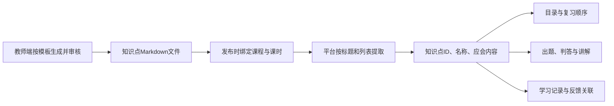

# 知识点文件模板 V1 与提取结果用途

> 状态：教师端协作的 V1 对接草案。文件格式兼容当前提取器，示例已通过实际代码核验；教师端尚未强制按此模板生成，发布前格式校验也尚未实现。本轮交付文档与模板，不修改业务代码或生产数据。
> 核查日期：2026-10-22。源码路径相对于仓库根目录。按所选课时筛选的本地更新见机制文档第3章，不代表已部署。

## 1. 这次约定什么

教师端负责生成并审核一份符合模板的知识点文件；平台按固定文字规则提取；学生端使用提取结果展示目录、出题、判答、讲解和关联学习记录。

V1 文件中只有两种业务内容：**知识点名称**与**该知识点的应会内容**。应会内容是学生应当掌握的事实、条件、过程、区别或应用依据，要写出内容本身，例如“n个终端全互连需要n(n-1)/2对线路”，不能只写“掌握线路数公式”。



模板提取这一步不需要调用 LLM。教师端生成正文、学生端出题与讲解、学生端语义判答仍可使用 LLM。

## 2. 交付文件

| 文件 | 给谁用 | 怎么使用 |
| --- | --- | --- |
| [知识点模板](templates/knowledge-points.v1.template.md) | 教师端生成模块与教师 | 按需重复知识点区块，替换全部占位符，再审核发布 |
| [现代交换原理格式示例](examples/knowledge-points.v1.example.md) | 双方开发与审核人员 | 演示两个具体知识点及完整应会内容；仅作格式示例，正式课程的材料依据由教师核对 |
| [示例实际提取结果](examples/knowledge-points.v1.parsed.json) | 平台与学生端开发 | 当前真实解析器生成的 `rubric`，可作接口对照样例 |
| 本文 | 双方开发与产品人员 | 查输入约定、提取规则、字段用途及待配合事项 |

模板文件中的 `{{...}}` 是占位符，不能原样发布。模板本身只包含可生成的正文，不把使用说明混进知识点目录。

## 3. 教师端需要输出的固定格式

````markdown
# 课时名称知识点

## 第一个知识点名称
- 完整的应会内容1。
- 完整的应会内容2。
- 完整的应会内容3。

## 第二个知识点名称
- 完整的应会内容1。
- 完整的应会内容2。
````

### 3.1 V1 必须遵守的规则

| 部分 | 约定 | 原因 |
| --- | --- | --- |
| 文件范围 | 一份文件对应一个课时的正式知识点清单 | 避免把不同周次或不同课时的评价内容混在一起 |
| 文件总标题 | 使用一个 `#`，写课时名称 | 供人阅读；当前提取器不把一级标题登记为知识点 |
| 知识点标题 | 每个知识点只用 `## 名称`；标题前后不加装饰性符号 | 固定对应一个目录项，便于生成稳定 ID |
| 知识点层级 | 所有知识点平铺，不添加三级及以下标题 | 当前提取器会取末级标题；再加字段栏目会改变目录含义 |
| 知识点名称 | 同一文件内名称唯一，使用明确的学科概念 | “知识点1”“应会要点”“课程定位”“资料来源”等不作为概念名称 |
| 应会内容 | 每点至少1条、最多6条，建议3–6条；每条单独一行，用 `- ` 开头 | 学生适配器当前最多接收前6条；空要点会削弱出题与判答依据 |
| 每条长度 | 不超过200个字符，包含标点与出处 | 当前平台会截断超过200字符的列表项，模板要求源头就控制长度 |
| 内容表达 | 写出定义、条件、步骤、关系、公式或解释依据；公式明确变量含义与条件 | 为讲解和判答提供实际内容，不只给学习任务口号 |
| 内容顺序 | 最核心的定义和判断依据优先，补充例子与边界随后 | 当前不会时的确定性讲解最多取前3条，其余仍可供出题与判答使用 |
| 材料出处 | 有真实出处时，附在对应应会内容末尾，例如 `（来源：材料ID，第12页）` | 当前按普通文本保留；不生成单独的来源结构或跳转链接 |
| 其他栏目 | 文件内不额外放教学目标、课程介绍、评分标准、参考答案、题库或说明章节 | 当前解析器没有区分这些栏目与知识点的语义能力 |
| 发布顺序 | `##` 区块的先后就是默认教学顺序 | 学生目录编号按此顺序生成，复习时可以调整顺序但不改编号 |

这里的“必须”是 V1 的对接约定，**当前系统尚无完整的发布校验来强制执行**。在校验接入前，需要教师端生成约束与人工审核共同保证。

### 3.2 不要这样写

````markdown
## 第1周知识点
### 应会要点
- 内容……
### 常见误解
- 内容……
````

当前提取器会把“应会要点”“常见误解”当作末级知识点，无法知道它们是字段名。

下面这种表达也不够支撑判答：

```text
- 掌握全互连。
- 了解交换机。
```

需要写成可以据此判断学生回答的内容，例如“n个终端采用全互连时需要n(n-1)/2对线路，终端数增加时线路数量迅速增长”。

## 4. 不需要写进正文的发布信息

知识点正文描述教学内容。课程归属、身份与发布版本由平台的正式发布信息携带，不从正文猜测。

| 发布信息 | 谁提供 | 用途 | 当前情况 |
| --- | --- | --- | --- |
| `courseId` | 平台课程关系 | 关联课程、学情及访问范围 | 已有 |
| `lessonId` | 教师确认的发布归属 | 选择本课时对应的知识点文件 | 与学生请求的 `lesson_id` 匹配；无匹配不跨课时借用 |
| `resourceType=knowledge-points` | 教师端发布归属；历史课时文件可由 `type` 兼容 | 标识这是知识点文件，而非课件或普通材料 | 已有，桥接已修复类型透传 |
| `classVisible=true` 与 `classPublicationId` | 显式发布流程 | 判断内容是否已经允许学生使用 | 已有；仅生成或保存草稿不等于学生可用 |
| `publication.id / version` | 平台发布包 | 标识学习上下文与学情所依据的发布版本 | 已有 |
| 文件名 | 教师端或上传工具 | 方便人查找与归档 | 当前不参与知识点文件识别；不能靠文件名代替类型和发布归属 |

教师生成模块需要生成正文；发布模块需要正确填写以上归属信息。两部分都齐全，学生端才能拿到正确的教学内容。

## 5. 程序按什么规则提取

V1 约束为平铺二级标题，提取过程可以确定地执行：

1. 按文档顺序读取每个 `##` 知识点区块。
2. 将标题规范化为知识点名称，去掉已有中文或数字序号。V1 推荐源文件直接不写序号。
3. 用规范化名称生成 `kp-` 加 SHA1 前10位的知识点 ID。
4. 读取该区块的 `- ` 列表项，按原顺序作为应会内容。
5. 平台输出 `id / title / expectedConcepts`；学生适配后进入课时教学计划。
6. 学生界面使用目录位置生成从1开始的编号。

当前兼容提取器还支持二级至六级末级标题、`* ` 列表、中文与阿拉伯序号去除、同名去重及代码围栏跳过。**这些兼容能力不作为教师端新文件的可选写法**，新文件统一按第3节生成。

### 5.1 同一份数据在三层的字段名称

| 内容 | 平台响应中的名称 | 学生内部模型中的名称 | 课时教学计划中的名称 |
| --- | --- | --- | --- |
| 知识点集合 | `knowledgePackage.rubric.knowledgePoints` | `evaluation.knowledge_points` | `lesson_plan.knowledge_points` |
| 知识点标识 | `id` | `id` | `id` |
| 知识点名称 | `title` | `title` | `title` |
| 学生应会内容 | `expectedConcepts` | `expected_concepts` | `expected` |

它们是同一组知识点的不同表示。原始 Markdown 也会作为已发布材料正文进入 `knowledge_sources`，用于补充教学背景。

### 5.2 目录编号与知识点 ID 的区别

- 学生看到的“1、2、3”来自文件顺序，便于说“先复习第2个”。调整复习顺序时，固定编号不变。
- `kp-...` 用于关联题目、评分和记录，由程序生成，不需要教师或 LLM 填写。
- 名称不变、仅改标题层级或序号时，规范化后的 ID 可保持稳定；改变名称会产生新 ID。
- 正式掌握度记录还按用户、课程和发布 ID 区分。ID 稳定不代表改名或跨发布 ID 后自动合并旧学情。

## 6. 提取出来的每项，具体给哪里用

### 6.1 字段用途总表

| 提取或生成的内容 | 具体消费者 | 产生的作用或输出 | 当前已使用 |
| --- | --- | --- | --- |
| 知识点顺序 | 辅导目录与复习编排 | 固定目录编号、默认复习顺序、“下一个”的目标 | 是；学生可另行指定复习顺序 |
| `title` 名称 | 开场、课时详情、掌握条、题目、反馈页 | 显示学生能读懂的知识点名称，确定本轮教学主题 | 是 |
| `id` 标识 | 挂起检测题、当前活动知识点、星级、逐题证据、正式数据库 | 将“这道题”“这次表现”“这条记录”关联到同一个知识点 | 是 |
| `expected` 全部应会内容 | 辅导出题 `_tutoring_generate_question` | 与标题、题目类型、已见题一起交给模型，限定要考什么 | 是；模型失败会使用通用题池 |
| `expected` 全部应会内容 | 辅导判答 `_tutoring_judge` | 与题干和学生回答一起交给模型，判断说对、说错、缺什么及表现类别 | 是；不是逐字关键词命中就判对 |
| `expected` 前3条 | 明确不会时的基础讲解 | 学生说“不知道”等时，提供当前知识点的课程依据；模型不可用时也有基础解释 | 是；保留原题并标记已提示 |
| `expected` 与名称 | `prompt_context.tutor_context` 与提示辅助 | 进入教学背景、解释与追问依据 | 是；通用上下文有长度限制，不保证所有正文每轮全部送入模型 |
| 原始知识点正文 | `knowledge_sources` → `lesson_sources` | 提供相关正文片段，辅助模型解释本课内容 | 是；会按相关性选取和裁剪 |
| 名称及应会内容 | 课件场景段落关联 | 用文本匹配为段落填写 `knowledge_point_ids` | 是；当前是文字匹配，不能视为教师确认过的精确场景映射 |

### 6.2 从一次实际学习看这些数据怎么用

以示例的“点对点通信与全互连问题”为例：

| 学习环节 | 输入了什么 | 使用模板里的什么 | 输出或更新 |
| --- | --- | --- | --- |
| 辅导开场 | 本课知识点清单 | 顺序、名称、ID | 显示“1. 点对点通信与全互连问题” |
| 学生开始复习 | 当前知识点与已见题 | 名称、应会内容 | 可以问“5个终端全互连需要多少对线路，为什么？”；具体题干由模型生成 |
| 学生回答 | 题干、学生回答、当前题状态 | 应会内容中的公式与解释依据 | 模型返回判答、表现类别和依据；程序校验后决定是否记录评分或继续引导 |
| 学生说“不知道” | 明确不会表达 | 当前点的应会内容 | 留在当前点，先解释，不当作答对或跳过；原题标记有提示 |
| 讲解后再答对 | 新回答及提示标记 | 同一套应会内容 | 本次按提示后表现记录，不能凭这次回答证明独立掌握 |
| 学生说“下一个” | 明确导航请求 | 知识点顺序、ID、名称 | 直接交付下一知识点的新题，不给跳过的知识点加星 |
| 查看反馈 | 已发生的作答与评分记录 | ID和名称用于关联与显示 | 展示当前星级、证据和建议；应会内容本身不直接变成已掌握证据 |

这里的题目例子用于说明数据关系，并不是从模板自动逐字拼出的固定题干。

### 6.3 模板不提供学生成绩

知识点文件回答“教什么、围绕什么出题、按哪些内容判断回答”。它不能写入某学生的星级、自评、正确次数、提示状态或当前进度。

当前评分链是：学生作答 → 模型基于应会内容给出表现类别与依据 → 程序结合是否提示、题目是否为应用题、是否为未见新题等条件计算星级 → 关联到该知识点 ID。通用量规来自系统评分配置，不由教师正文中的一个分数覆盖。

### 6.4 当前没有从文件里提取的字段

| 内容 | 当前状态 | V1怎么处理 |
| --- | --- | --- |
| `misconceptions` 常见误解 | 内部模型与通用教学上下文有字段，但当前 Markdown 提取器没有生成它；专用判答直接接收的是应会内容 | 不增设“常见误解”子标题。必要的边界可写成完整应会内容；以后如需单独字段，升级模板与解析器 |
| 单独的 `examples`、`sourceRefs`、`prerequisites` | 当前没有从知识点 Markdown 分别提取这些字段 | 例子和必要先修条件可写进应会内容；真实出处随文字保留，不能宣称已结构化或自动核验 |
| `completion_rule` | 评价模型有默认标记，当前辅导不靠文件中的这个字符串决定判答或推进 | 不要求教师填写 |
| 难度、分值、每点用时、固定题库 | 不是当前知识点文件的独立提取项 | 不增加这些栏目；有新需求时再定义字段、消费者和版本 |

## 7. 教师端配合时需要补齐哪些环节

| 环节 | 教师端需要做 | 平台／学生侧需要做 | 当前状态 |
| --- | --- | --- | --- |
| 生成 | 把V1模板和内容约束传给生成模块，输出可审核正文 | 保持按确定规则提取，不用模型临时猜字段 | 教师端当前只要求Markdown字符串，尚未固定该模板 |
| 编辑 | 教师修改后仍保留标题与列表结构 | 提供或接收校验反馈 | 当前保存主要检查正文非空，缺完整格式校验 |
| 发布校验 | 校验正文只含许可结构、无占位符、标题唯一、每点1–6条且每条≤200字符 | 建议发布前调用同一套解析与校验规则，返回清晰问题 | 待双方实现；当前代码存在去重、截断等兼容处理 |
| 发布预览 | 展示真正会下发的知识点名称、顺序与应会内容，供教师确认 | 返回提取后的实际结果，而非另外生成一份预览 | 待双方实现 |
| 发布归属 | 确认课时与知识点资源类型，显式发布 | 按学生选中的课时筛选并核对归属 | 本地已贯通课时ID；历史无归属文件仍需教师确认归属 |
| 消费 | 保留教师审核过的正文与发布标记 | 统一目录、出题、判答、讲解、反馈的数据来源 | 当前主链已接入；不代表模板约束已自动生效 |

建议发布时遇到格式错误就返回具体问题，让生成模块或教师修改后再提交。例如“第2个知识点没有应会内容”“存在重复标题”“发现未替换的占位符”。不要把无效模板静默发布成空目录。这是后续发布校验的要求，当前尚未上线。

## 8. 对接验收清单与现有边界

教师端配合完成后，用以下结果验收，而不是只检查“文件已生成”：

- 用V1模板生成的正文能得到预期数量的知识点，标题与顺序准确。
- 每条应会内容在平台输出、学生内部模型和教学计划中一致，没有被截断或丢失。
- 草稿及未发布文件不进入学生目录，已发布文件的课时和类型正确。
- 多课时分别选择时，各自使用本课时的文件、课件和知识点。`StartIn.lesson_id` 已贯通平台与学生端；不传课时仅返回目录摘要，错误课时报错。即使全课程只有一份知识点文件，也必须匹配所选课时。
- 重复标题、空区块、额外三级栏目、表格式要点、超过6条、超长内容、未替换占位符能在发布前得到明确校验错误。当前宽松解析器并不全部拒绝这些情况。
- 学生开场、掌握条、出题、判答、不会时讲解、课后反馈使用同一份目录与ID。
- 学生说“不知道”时留在当前点讲解；说“跳过”时切换且不加星。
- 重新发布、改名与旧会话恢复按版本策略处理，不把新旧目录或证据随意拼接。

模板的作用是固定正文结构。发布归属、版本选择、发布校验和学生会话绑定也需要正确，才能保证整条链路稳定。

## 9. 开发定位

| 用途 | 当前代码 |
| --- | --- |
| 教师生成知识点正文 | `teacher_agent/lib/server/teacher-course-operations.ts`：generateLessonFileContent |
| 教师课时文件及发布 | `teacher_agent/lib/server/lesson-review-files.ts`；`teacher_agent/lib/server/course-resource-publication.ts` |
| 提取标题和列表、选课时文件 | `platform/backend/app/api/routes/student_bridge.py`：_knowledge_points_from_markdown、_knowledge_artifact_rubric、published_course_entries |
| 评价字段适配 | `student_agent/apps/integration/evaluation.py`：from_platform_context |
| 进入教学计划及段落关联 | `student_agent/apps/integration/course_adapter.py`：load_plan_for_session |
| 出题、判答、不会时讲解、目录与反馈 | `student_agent/orchestrator/agent.py`：_tutoring_expected_for、_tutoring_generate_question、_tutoring_judge、teach、tutoring_public、tutoring_feedback_payload |
| 评分条件与逐题证据 | `student_agent/apps/integration/mastery.py`：assessed_stars、record_assessment |
| 正式学情写入 | `student_agent/apps/server.py` 与 `student_agent/apps/integration/persistence.py` |

更完整的课堂机制见[学生端运行机制](student-runtime-mechanism.md)。
