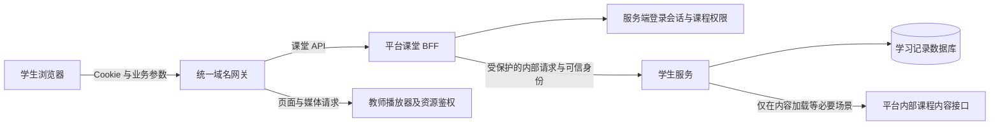

# 学生课堂统一使用平台登录会话：完整实施方案

日期：2026-11-04。状态：2026-11-05 已配套发布生产，见 [生产发布记录](production-release-20261105.md)。

本方案随后已获授权实施。当前以同步 main 后的 lzm2=0b30b39 为基线，在专用工作树完成本地代码、配置模板和测试改动，未修改数据库结构；2026-11-05 已完成生产发布。下文保留设计与发布验收要求；实际模块落点、验证结果和未完成的实机验收见 [实施记录](implementation.md)。

## 1. 目标与范围

当前同源部署下，学生浏览器统一使用平台服务端登录会话。平台后端作为课堂 BFF（面向学生页面的后端入口），完成身份、课程权限和请求来源检查，再调用学生服务。学生服务校验记录归属并执行学习业务，数据库持续保存学习进度。

正式课堂不再依赖浏览器持有或维护 `launch_token`。登录过期、退出登录和重新登录不删除学习记录，不重置课堂，也不改变已经受理的命令结果。

本次范围包括：平台会话鉴权、课堂 BFF、内部调用契约、学生服务入口与内容读取、平台课程入口、学生前端、网关、测试和发布切换。保留现有教学规则、知识点准备机制、内容版本、命令编号与持久化事务。首期不引入新的登录系统、不更换数据库、不重做模型执行模式、不扩大动态教学试点。

## 2. 已核对的现状与问题

| 当前模块 | 源码事实 | 对实施的影响 |
| --- | --- | --- |
| 平台登录 | `browser_sessions.py` 已有服务端 Cookie 会话，绝对有效期 12 小时，退出登录删除服务端会话 | 复用现有登录体系 |
| 平台通用身份依赖 | `deps.py` 的 `get_current_user` 优先接受 Bearer JWT，再尝试 Cookie | 新课堂入口必须采用专用 Cookie 依赖，不能直接复用其双凭证行为 |
| 课程进入学习 | 平台签发默认 600 秒的启动令牌，返回带令牌的学习 URL | 改为不含凭证的课程定位 URL |
| 网关 | 本地及生产候选模板将 `/api/session/*` 直接转发学生服务 | 需要改变 API 路由，单纯同域名不会自动经过平台鉴权 |
| 学生服务 | 开始、恢复、换版、回看与命令鉴权均有启动令牌依赖 | 不能只修改按钮或 `command_runtime.authorize` |
| 学习记录 | 正式会话、命令、消息、反馈、内容引用已经持久化；目录阶段还有内存中的 idle 会话 | 正式记录按数据库恢复；尚未开始的目录会话可安全重建 |
| 课堂接口 | `/commands` 与旧 `/discussion`、`/message`、`/end` 等入口并存 | 必须有完整入口清单，避免旧接口绕过新鉴权 |
| 播放器 | 教师播放器有平台 Cookie 校验及独立播放授权；播放签名暂复用 `_launch_signature` | 保留资源授权和签名兼容，不能随启动令牌一起删除 |
| 命令执行 | 有可靠命令、租约、状态查询、幂等保存；请求内仍可能同步等待模型 | BFF 要正确处理超时和未知执行结果 |

前轮在隔离脚本中复现：同一启动令牌在 599 秒时通过，在 601 秒时进入讨论返回 401，错误文案与截图一致。截图那一次线上请求的实际状态及服务器配置尚未核实。本文是针对已确认代码缺陷的改造方案，不将隔离复现等同于生产请求取证。

## 3. 目标请求链路与职责

| 职责 | 平台 BFF | 学生服务 |
| --- | --- | --- |
| 当前用户身份 | 查询平台 Cookie 会话，检查账号可用、学生角色 | 只接受经过验证的内部调用身份，不自行解释浏览器 Cookie |
| 课程权限 | 每次请求检查课程访问权、当前选课和发布可见性 | 核对可信课程范围与本地记录一致 |
| 记录归属 | 按可信 scope 选择课程；不相信浏览器填入的用户身份 | 从服务端记录检查 user、course、lesson、classroom 归属 |
| 教学阶段与内容版本 | 透传业务错误，不计算教学状态 | 校验阶段、stateVersion、contentGeneration、固定内容引用 |
| 数据写入 | 不保存课堂消息或直接修改学生表 | 使用现有命令和持久化事务写入 |
| 登录失效 | 返回明确的 401 | 不清理或重置学习状态 |

平台不直接读取或修改学生业务表来实现课堂逻辑。学生服务仍拥有学习记录领域。数据库事务、行锁和连接不能跨服务 HTTP 等待长期持有。

## 4. 身份与内部调用契约

### 4.1 浏览器登录会话

复用 `agentedu_session`：生产 HTTPS 下设置 `HttpOnly`、`Secure`、`SameSite=Lax`、`Path=/`，保留不设置宽泛 Domain 的主机 Cookie。HTTP 本地开发使用明确的环境例外，不把生产配置降级。

新建课堂专用身份依赖，例如 `CurrentBrowserStudent`：

1. 只根据 Cookie 查询 `browser_session`；Bearer JWT 和启动令牌不参与身份判定。即使带有效 JWT，没有有效 Cookie 仍返回 401。
2. 检查会话存在、未过期、账号存在且未停用，并校验学生角色。管理员测试访问按显式规则单独覆盖，不允许普通教师借此进入学生课堂。
3. 首期沿用 12 小时绝对有效期，不因轮询、播放事件或页面焦点自动延长。该数值是项目策略，并非 OWASP 指定值。
4. 退出登录撤销当前 Cookie 对应的服务端会话；同一浏览器其他标签页后续请求也失效。其他设备的独立登录会话不因本次退出自动撤销；账号停用与撤销选课应影响所有设备的后续请求。
5. 现有平台非课堂 API 的 JWT 兼容行为暂不在本次全面改造范围；课堂 BFF、课程进入学习入口以及课堂身份查询必须使用专用 Cookie 依赖。

### 4.2 CSRF 与缓存

所有课堂 POST、PUT、PATCH、DELETE 使用统一来源校验和会话绑定的 CSRF 校验；同样应用于相关退出登录调用。建议新增 bootstrap 身份接口返回 CSRF 值，前端仅在内存保存，并使用 `X-CSRF-Token` 发送。

首期 CSRF 值采用绑定当前登录会话的服务端 HMAC：对会话散列与固定用途标识计算，使用平台服务端密钥，比较时使用常量时间比较。它不能证明身份，必须与有效 Cookie 共同验证；不增加课堂访问令牌，也不把登录 Cookie 暴露给 JavaScript。来源必须精确匹配部署允许的 scheme、host、port，不能信任浏览器提供的任意转发头。此设计无需新增数据库列。

`SameSite` 是附加防护，不能代替完整的请求来源与 CSRF 机制。CORS 携凭据的来源限于明确允许清单，不反射任意 Origin。身份、课堂状态、反馈和业务错误响应统一 `Cache-Control: no-store`；共享代理不能缓存学生私有响应。GET 只读取状态，不触发新课堂、重置、显式重试或用户命令；现有 GET 中的准备同步改为只读投影，正式绑定在对应 POST 事务完成，见 7.1，避免依赖读取请求改变学习业务状态。[OWASP CSRF 指南](https://cheatsheetseries.owasp.org/cheatsheets/Cross-Site_Request_Forgery_Prevention_Cheat_Sheet.html)

### 4.3 平台到学生服务

新增独立的 `PLATFORM_TO_STUDENT_KEY`，仅配置于平台和学生服务；不要复用浏览器会话、Bearer JWT 或启动令牌。现有学生服务访问平台的 `STUDENT_SERVICE_KEY` 保留其原有方向和用途。

平台构造内部上下文，建议包含 `userId`、经校验的 `courseId`、需要时的 `lessonId`、`requestId` 与 `authProtocol=platform-cookie-v1`。使用固定内部头与类型化结构承载；具体头名称在第一阶段冻结。学生服务先验证内部密钥及协议，再读取这些字段。浏览器传入同名身份头、服务密钥、userId 或角色字段，不能进入可信上下文。

平台向学生服务发请求时使用头部允许清单，重新生成身份头；不转发浏览器 Cookie、Authorization、任意 `X-Platform-*`、任意代理头或任意目标地址。服务仅监听受保护的回环或私网接口；跨机器内部传输采用受保护的 TLS 通道。内部密钥禁止进入前端构建、URL、日志或错误响应。

学生服务正式模式下，除无敏感内容的健康检查和静态页面资源外，所有学习 API 都需要受验证的内部身份。即便客户端直连服务端口、带有平台 Cookie 或猜中 sessionId，也不能调用正式学习接口。独立演示模式只允许本地隔离启用，生产配置与就绪检查应拒绝启用。

### 4.4 只有 sessionId 时如何确定课程

对于 `/api/session/{sid}/...`，BFF 不能只使用浏览器额外提交的 courseId 作为权限范围。新增只读内部 scope 接口，例如 `GET /internal/platform/sessions/{sid}/scope`：

1. BFF 先完成 Cookie 身份验证，将可信 userId 交给 scope 接口。
2. 学生服务验证内部调用凭据，读取该记录的最小归属信息，先检查 userId 再返回 course、lesson、classroom、publication 标识。不存在或属于他人统一返回不泄露归属的 404。
3. BFF 按返回的课程检查当前权限，再发送具体业务请求。
4. 学生服务在执行或提交事务中再次核对归属、撤销状态和版本。scope 不是一次永久授权，也不能替代事务中的检查。

正式学习记录的 scope 从数据库取；目录阶段尚未持久化的 idle 会话可从服务端内存读取其已绑定的 user/course。服务重启导致 idle 丢失时，只重建课程目录；已开始课堂必须按数据库恢复，不得降级为“新课”。

scope 只读最小字段，不加载历史消息、不调用模型、不返回整份课堂内容。首期不缓存可绕过退出或撤权的鉴权结果；评估额外 scope 调用的延迟后再考虑优化。

scope 应能为本人解析已经重置但保留命令回执的记录，不能因为 revoked_at 非空就提前阻止所有状态查询。对已完成 reset_lesson 的状态查询及同编号重试，沿用既有回执恢复新目录视图；其他已撤销记录操作返回 SESSION_RESET。这个例外只恢复本人已完成命令，不重新授予旧课堂写权限。

## 5. 浏览器接口与兼容规则

以下为拟定公共契约。现有学习状态返回结构尽量保留；只调整身份传递和明确的错误语义。

| 公共接口 | 拟定行为 |
| --- | --- |
| `GET /api/session/identity`（新增） | Cookie 鉴权；返回 userId、角色、会话 expiresAt、CSRF 值、协议版本和平台返回地址；不创建学习记录 |
| `GET /api/session/platform-entry` | 保留无敏感信息的入口配置，生产 demoEnabled=false；不代替 identity 的鉴权结论 |
| `POST /api/v1/courses/{course_id}/student-workspace` | Cookie + 来源/CSRF 校验；返回 `/app?course_id=...` 等不含凭证的定位 URL，不返回 launchToken |
| `POST /api/session/start` | 请求体只包含 course_id；检查课程后返回目录与用户绑定的 idle LearningView；目录不加载其他课时正文 |
| `POST /api/session/resume` | course_id + lesson_id；按当前用户和课程权限从数据库恢复，查无历史返回专用错误码 |
| `POST /api/session/{sid}/begin/{lesson_id}` | 保留路径；校验 scope 与课时关系；优先恢复同课时历史，否则首次开始 |
| `GET /api/session/{sid}` | 鉴权后读取数据库权威状态；不信任浏览器快照 |
| `POST /api/session/{sid}/commands` | 保留 commandId、expectedStateVersion、contentGeneration、type、payload；移除 launch_token |
| `POST /api/session/{sid}/commands/{command_id}/status` | 保留现有路径和方法；同样鉴权与 CSRF 校验，不重新创建命令 |
| `POST /api/session/{sid}/learning-records` | 保留现有路径和方法；读取当前用户记录，不因“只读”跳过身份与归属检查 |
| `POST /api/session/{sid}/prepare` | 允许当前阶段重试准备；鉴权后调用共享准备机制 |
| `POST /api/session/{sid}/playback` | 根据记录绑定返回当前用户可访问的播放信息；不依赖启动令牌、不重置课堂 |
| `GET /api/session/{sid}/feedback` | 鉴权后读取当前用户反馈 |
| 旧 `/discussion`、`/message`、`/end`、`/reset`、`/postclass/start`、`/postclass/message` | 正式环境关闭直接业务写入，经过身份检查后返回 410 `LEGACY_ENDPOINT_DISABLED`；正式前端统一走 /commands；reset 保留原确认交互 |
| `POST /api/session/browser-restore` | 正式环境返回 410 `LEGACY_RESTORE_DISABLED`；浏览器快照不得恢复正式业务状态；独立本地 demo 才保留原实现 |
| 内部 scope、内部内容接口和运维接口 | 不属于浏览器白名单，网关禁止公开访问；健康检查按部署白名单处理 |

BFF 只为表中允许的 method/path 注册路由，不使用不受限的通配代理。平台当前 `api_router` 整体挂在 `/api/v1` 下；课堂路由必须在 `app/main.py` 单独挂载 `/api/session`，并位于 SPA catch-all 之前，不能误变成 `/api/v1/api/session`。

入口 URL 中的 course_id、lesson_id 仅是定位参数，不是授权。用户修改它们时必须重新校验权限。

## 6. 需要修改的模块与文件

表中“新增”路径是建议落点，尚不存在；现有路径已按仓库核对。实现时可依仓库命名规则小幅调整，职责不能合并回页面或教学图。

| 编号 | 模块 | 文件或目录 | 具体改动 |
| --- | --- | --- | --- |
| M1 | 平台浏览器会话 | `platform/backend/app/services/browser_sessions.py`、`app/api/deps.py`、`app/api/routes/login.py` | 抽取 Cookie-only 学生身份依赖；统一会话错误；补会话绑定 CSRF 能力、退出校验和必要的请求关联标识；保留现有绝对过期和撤销语义 |
| M2 | 课堂 BFF | 新增 `platform/backend/app/api/routes/student_learning.py`、`app/services/student_learning_gateway.py`、`app/services/student_service_client.py`；修改 `app/main.py` | 显式路由白名单、身份/权限依赖、scope 解析、内部客户端连接池、错误透传、缓存和超时；独立挂载 /api/session |
| M3 | 平台内容与课程入口 | `platform/backend/app/api/routes/student_bridge.py`；新增或提取 `app/services/student_learning_context.py`；复用 `app/services/course_access.py` | student-workspace 改无凭证 URL；抽出按可信 user/course/lesson 读取内容的纯服务契约；新增受服务密钥保护的 context-v2，保留目录/所选课时隔离；终止正式 launch_token 授权路径 |
| M4 | 内部协议与配置 | `platform/backend/app/core/config.py`、`student_agent/backend/contracts.py`；新增 `student_agent/backend/infrastructure/platform_identity.py`；相关启动脚本及环境示例 | 增加 PLATFORM_TO_STUDENT_KEY 和协议声明；学生侧统一内部身份依赖、scope 响应类型与就绪检查；正式/演示模式严格分离 |
| M5 | 学生 HTTP 入口 | `student_agent/backend/main.py` | 正式学习入口统一接受可信 actor；增加内部 scope；停止从请求体取 launch_token；关闭正式旧写接口和 browser-restore；错误带 code/requestId |
| M6 | 会话与命令编排 | `student_agent/backend/session/service.py`、`session/command_runtime.py`、`infrastructure/commands.py`、`infrastructure/persistence.py` | start/resume/begin/refresh_lesson/replay/reset 改用可信身份；替换 launchToken 检查；查询和提交均检查归属；保留原命令事务和版本规则；正式恢复不依赖 fresh_session_mode 或内存命中 |
| M7 | 学生访问平台 Adapter | `student_agent/backend/infrastructure/platform_access.py` | 增加可信服务 context-v2 调用，不发送 launch_token；保留 report_learning_progress；错误按受控 code 分类，不统一改写成令牌过期 |
| M8 | 平台前端入口 | `platform/frontend/src/routes/_layout/student.tsx`、`routes/_layout/courses.$courseId.tsx`、`hooks/useAuth.ts` 及共享请求封装 | 两处课程入口适配无凭证 URL；统一获取/发送必要 CSRF 值；退出登录以服务端成功撤销为准，失败时不假装已退出；不新增课堂令牌 |
| M9 | 学生前端交互 | `student_agent/frontend/src/integration/session-http.mjs`、`session-commands.mjs`、`session-browser.mjs`、`session-recovery.mjs`、`learning-session.mjs`；`components/StudentApp.js` | identity/bootstrap；移除令牌解析、tokens Map 与附带字段；统一 Cookie/CSRF 请求；鉴权错误处理；用户隔离的定位/草稿/待提交恢复；保留 commandId 和状态订阅 |
| M10 | 播放与资源 | `student_agent/frontend/src/integration/platform-player-adapter.js`、平台 `_issue_playback_grant`、`teacher_agent/lib/server/platform-auth.ts`、`platform/backend/app/api/routes/teacher_bridge.py` | 核对现有 Cookie 资源授权链路；保留独立播放授权及签名兼容；刷新播放地址通过新鉴权接口；仅在测试发现必要时改播放器实现，不扩大教师业务改造 |
| M11 | 网关与部署 | `platform/deployment/Caddyfile.local`、`Caddyfile.dev`、`Caddyfile`、`platform/scripts/local-gateway.mjs`、`scripts/mainland/Caddyfile.production-candidate`；实际生效的网关与部署工作流 | /api/session 指向平台；/app 静态页仍指向学生；禁止公网内部路径；健康接口显式例外；更新 key、就绪检查和版本绑定；核对生产实际配置而非直接套模板 |
| M12 | 测试与使用说明 | 平台/学生现有测试目录、`platform/scripts/local-gateway.test.mjs`、学生 README 与部署说明 | 补契约、鉴权、幂等、恢复、路由及浏览器回归；删除正式文档中依赖启动令牌的操作说明 |

配置和发布入口至少核对 `student_agent/start-platform.ps1`、`platform/deployment/production.env.example`、相关 Compose 配置、`.github/workflows/student-deploy.yml`、`platform-deploy.yml` 和 `mainland-web-release.yml`。新增密钥只写受保护的运行配置，示例文件只列变量名和占位值。实际服务若通过公网域名调用平台内部接口，须先将 PLATFORM_AUTH_URL 等内部地址改为可达的回环或私网地址，再封锁公网内部路径，避免同时影响教师播放器等既有内部调用。

学生会话改造需要逐一处理 `start`、`resume`、`restore_lesson`、`refresh_lesson`、`begin`、`replay_playback`、`get_session/read`、`reset_lesson`、命令 `authorize/status/read_records`。旧快照中残留的 launchToken 字段只忽略，不解释为访问权；不批量改写历史快照。

## 7. 内容读取、版本与数据策略

### 7.1 平台内部内容接口

拟新增 `POST /api/v1/internal/student/learning-context-v2`，由学生服务使用既有 STUDENT_SERVICE_KEY 调用。请求使用经内部校验的 user_id、course_id 和可选 lesson_id，不携带浏览器 Cookie 或启动令牌。平台重新检查账号可用、课程访问和发布可见性，复用提取后的内容服务。

目录请求只给目录摘要；选中课时才返回该课时正文、场景、旁白与播放信息。其他课时内容和其他学生数据不能混入。学习中的正常回答不额外请求全量平台内容；只有开始、恢复、既定换版或播放地址刷新等必要场景调用。

平台 BFF 与内部内容接口共享课程检查和内容服务，避免两套发布过滤规则。调用内部内容接口不能转向 BFF 公共入口，否则会形成递归。

知识点整理仍由现有 `infrastructure/published_knowledge.py` worker 处理。正式课堂 GET 可读取共享结果并投影 preparation 就绪情况，但不调用 `sync_published_preparation` 提交学习状态。首次 begin、显式 prepare 和 start_discussion 命令在各自受保护流程中按需绑定共享结果。命令的准备校验必须使用同一份共享就绪事实，绑定与阶段变更落在原命令事务，不在预校验时提前增加 stateVersion；确保页面显示可进入后不会因缺少内存 dialogue 而被错误拒绝。独立演示准备维持本地专用路径，不对正式环境开放。

### 7.2 版本策略

- 首次进入或显式恢复时，沿用现有发布版本和视频 revision 检查；新版内容继续按现有 refresh_lesson 规则处理，并给学生明确提示。
- 进行中课堂固定 contentRef、videoRevision、flowVersion 和教学策略；每次命令核对记录内的 stateVersion/contentGeneration，不因平台出现更高发布版本就在回答中途切换材料。
- 当前撤权、下架或记录已重置必须拒绝新操作；“存在更新版本”与“已无访问权限”区分处理。
- 当前 scope 的 publication 取学习记录绑定值；不能每次用最新 publication 覆盖，否则会错误触发 CONTENT_CHANGED。
- 回看旧课堂仍执行现有绑定与资源可用性检查；不承诺访问已经下架或不再授权的历史视频。

### 7.3 数据与登录生命周期

| 数据 | 归属与处理 |
| --- | --- |
| browser_session | 平台维护；12 小时绝对有效；退出登录撤销当前会话 |
| student_sessions/messages/events/mastery/content | 沿用现有数据库权威记录；身份改造不清理、不重建、不批量迁移 |
| student_commands 及同步意图 | 保留既有编号、结果、状态版本与租约恢复；worker 按既有持久化任务运行 |
| 浏览器定位数据 | 仅作定位，按当前服务端确认的 userId/course/lesson 隔离 |
| 输入草稿与待提交命令 | 按 userId + sessionId 隔离；经数据库归属确认后才能显示或关联，绝不自动提交给另一个账号 |

预计本方案不需要数据库结构迁移。已有会话表包含所需身份和内容绑定，CSRF 值也可派生验证。若实现阶段发现必须加列，先说明用途并提供独立兼容迁移，不能暗中加入历史数据重写。

## 8. 登录失效、命令执行与错误约定

### 8.1 登录失效处理

任一课堂请求返回登录失效，前端停止业务发送和后台轮询，保留当前账号范围内的草稿与原命令标识，显示重新登录入口。登录返回地址只允许本站路径，避免开放跳转。

重新登录后先查询 identity，再按相同账号、课程与课时从数据库恢复。如果账号变化，先清空页面中的上一账号视图，不加载或提交其草稿，不向新账号展示旧消息；旧账号隔离存储的草稿可保留等待其本人再次登录。

`resume` 只有明确的 `HISTORY_NOT_FOUND` 才代表没有历史；401、403、数据库故障或他人 sessionId 的 404 都不能触发“新建课堂并覆盖原进度”。idle session 丢失使用专用 `CATALOG_SESSION_EXPIRED`，重建目录后重新按用户/课时查历史。

### 8.2 在途命令边界

以鉴权通过且命令持久化受理作为边界。受理前登录失效或撤权：拒绝新命令；已受理后会话到期或退出登录：原命令继续按现有事务完成，不因前端断开删除结果。退出登录不是取消模型任务的接口；后续状态查询需要重新鉴权。

BFF 不自动重试写请求，不根据代理超时把命令标记为业务失败。超时或丢失响应时，前端保留原 commandId，并在有权限后查询同一命令状态；若服务器确认未受理，才以相同编号和相同负载重试。已经完成的命令返回原结果，不再次计轮数或再次写消息。

重置命令完成后即使原会话已标记撤销，原命令结果仍须能经本人鉴权查询，返回已创建的新目录/会话定位。不能将丢失重置响应误判成“需要再重置一次”。

本次保留现有执行模式。BFF 内部客户端区分连接超时、只读接口超时和命令执行超时；命令超时预算须覆盖现有多次模型调用与重试预算，并与网关一致。实施阶段登记模型最坏预算与配置值，不凭单次 45 秒设置整个课堂命令的超时。用延迟 fixture 验证，不能把依赖真实模型的耗时当成确定性测试。

### 8.3 错误响应

统一使用可识别的 `code`、可展示的 `detail` 和非敏感 `requestId`；不向浏览器输出数据库异常、服务密钥或内部地址。

| HTTP / code | 页面处理 |
| --- | --- |
| 401 `AUTH_REQUIRED` / `SESSION_EXPIRED` | 停止新操作，保留输入，引导登录 |
| 403 `COURSE_ACCESS_DENIED` / `ACCOUNT_DISABLED` | 明确无权限，不尝试换令牌或重建课堂 |
| 403 `CSRF_REJECTED` / `ORIGIN_REJECTED` | 提示刷新或请求来源不符合要求，不当作模型失败 |
| 404 `LEARNING_RECORD_NOT_FOUND` | 不存在或不属于当前用户，避免暴露他人记录；不自动创建替代记录 |
| 404 `HISTORY_NOT_FOUND` | 仅用于已验证 user/course/lesson 的历史查找，可进入首次学习 |
| 409 `CONTENT_CHANGED` / `VERSION_CONFLICT` / `TASK_CHANGED` | 沿用权威状态刷新和现有内容处理规则，不能自动把原回答应用到新任务 |
| 410 `SESSION_RESET` | 明确本课已被重置，不恢复旧快照 |
| 410 `LEGACY_ENDPOINT_DISABLED` / `LEGACY_RESTORE_DISABLED` | 旧页面需要刷新，不走鉴权降级 |
| 426 `CLIENT_RELOAD_REQUIRED` | 识别旧协议或旧 launch_token 请求，要求刷新；不授予访问权 |
| 502/503/504 `UPSTREAM_UNAVAILABLE` / `STORAGE_UNAVAILABLE` / `COMMAND_RESULT_UNKNOWN` | 保留页面与原命令，允许受控重试或查询，不统一显示登录过期 |

## 9. 播放器与媒体访问

本次取消的是课堂启动令牌。教师播放器的 Cookie 身份校验、课程选课/发布检查与独立资源授权继续保留。现有播放授权默认 1800 秒，是否仍为实际请求必需，应按真实播放器链路验证，不能把该数字误认为课堂登录有效期。

平台返回的 iframe URL、课堂 JSON、媒体代理和对象存储访问需逐项核对。启动令牌签名函数如果被播放授权复用，应提取为独立共享签名函数并保持已签发播放授权的兼容；不能直接删除 `_launch_signature` 导致现有视频打不开。

回看或播放地址刷新走新的 Cookie BFF，之后由教师播放器继续执行自己的资源授权。播放授权不能用于调用课堂 /commands。撤销登录或课程权限后，后续受保护资源请求应失败；已经发送给浏览器或缓冲到本地的视频数据无法撤回，不能承诺即时清空已经播放的画面。

## 10. 实施顺序与阶段出口

以下顺序为依赖顺序，不是本轮执行指令。所有开发和测试先在本地或隔离环境进行，正式环境只在后续发布任务中操作。

| 阶段 | 工作内容 | 依赖与交付物 | 阶段出口 |
| --- | --- | --- | --- |
| P0 契约与基线 | 固定本方案接口、错误码、身份头、scope、版本语义；列出生产实际路由、密钥配置来源、基线版本和关键测试 | 接口清单、改动清单、验证基线；保留既有未提交文件 | 每个公开学习接口均有归属；正式/演示边界明确 |
| P1 平台身份底座 | M1、M4 的 Cookie-only 依赖、identity/CSRF、内部凭据配置；不切换公网路由 | 可独立测试的身份和 CSRF 能力 | 有 Cookie/无 Cookie、JWT-only、退出、停用和来源测试通过 |
| P2 学生内部边界与内容 | M3、M4、M5、M6、M7；新增 scope/context-v2，改完所有 launchToken 调用点，旧业务入口正式关闭 | 可信 actor 与服务接口；历史会话兼容 | 伪造身份/直连拒绝；数据库历史恢复、版本与幂等回归通过 |
| P3 BFF 编排 | M2；注册全部白名单、scope→权限→业务链路；实现错误、超时、连接池、缓存策略 | 可供新前端调用的 /api/session；非公网联调路由 | 完整链路契约通过；无递归、无长事务锁、无任意代理 |
| P4 前端迁移与播放验证 | M8、M9、必要的 M10；新入口、Cookie/CSRF、草稿隔离、旧缓存迁移和错误恢复 | 平台与学生前端候选构建 | 前端无课堂令牌维护；完整学习与播放用例通过 |
| P5 隔离集成与发布准备 | M11、M12；将测试网关切至 BFF，验证完整候选版本、性能与回退 | 版本清单、网关差异、验收记录、可回退候选 | 第 12 节全部必须项通过，正式配置不存在旁路 |
| P6 正式切换与观察 | 按下一节维护窗口统一切换平台、学生服务、两端前端和网关；受控验收后开放 | 同批版本、部署记录与观察结果 | 公网学习流程通过；无新增鉴权旁路和重复写入 |

P1 与 P2 可按代码依赖分开提交，但不让公网出现一半完成的 Cookie/token 混合授权。平台与学生的独立自动部署流程不能自行激活其中一半；发布候选需要一份统一版本清单。

## 11. 发布、兼容与回退

### 11.1 切换前

1. 核对真实线上网关、内部监听、版本、密钥来源和流量路径。生产候选模板只是仓库证据，不代表当前运行配置。
2. 候选环境执行全部必须验收项，准备平台/学生服务/平台前端/学生前端/网关/配置的版本与散列清单。
3. 先准备可回退的 Cookie/BFF 兼容版本及网关配置；确认既有备份恢复流程和数据库备份可用。本方案不要求恢复旧学习数据或执行破坏性迁移。
4. 关闭或协调涉及平台与学生的独立自动激活，避免维护窗口中其他流程覆盖候选。

### 11.2 统一切换

1. 在网关对课堂写入口进入可识别的维护状态，停止接收新命令，按既有命令机制排空或记录仍可恢复的已受理命令。不要直接杀掉持久化写入过程。
2. 安装同批平台、学生服务和前端候选，配置内部 key，完成内部健康和协议就绪检查。数据库进度表不重建。
3. 同步更新实际网关：`/api/session/*` → 平台 BFF；`/app` 和静态资源仍由学生服务提供；教师播放器及媒体路由保留；公网内部接口拒绝访问。先确认既有教师/学生内部请求均走私网，禁止出现封锁公网路径后内部服务仍调用该公网路径的断链。
4. 更新 HTML 的缓存策略，确保刷新获取新构建；旧标签页收到旧协议/旧字段请求时返回明确刷新提示，不能用 Cookie 缺失时回退 launch_token 的方式兼容。
5. 受控账户验证登录、恢复已有课时、观看、进入讨论、回答、重复命令、反馈、回看及退出；通过后开放新操作并观察。

### 11.3 浏览器与旧链接

新页面在最早入口移除 URL 中的 launch_token，不再解码它来获取身份。旧链接缺少 course_id 时，先完成 Cookie identity，再从当前用户可访问课程或其已验证定位中选择；无法确定则返回平台课程选择页，不能直接相信旧令牌中的 uid/cid。

清理本系统已知的旧 `student_browser_token:*` 凭据键；不清空整个 localStorage。原 `student_pending_command:${sid}` 只在服务端确认记录归属后迁移至用户隔离命名空间；保留原 commandId，不展示或提交他人缓存。正式学习恢复不再读取浏览器快照内容作为权威依据。

### 11.4 回退原则

回退触发条件：出现越权/鉴权旁路、重复写入、历史记录恢复错误，或课堂核心流程持续不可用。记录具体错误率、请求标识和受影响版本，不打印凭据或学生原始回答。

优先切回已经验证的 Cookie/BFF 兼容候选，应用、前端、网关和配置保持配套；数据库保留当前真实进度和已完成命令，不回放旧备份覆盖发布后数据。

首次上线若没有可用的 Cookie/BFF 回退候选，保持课堂维护状态，修复后再开放。不得为恢复访问而把公网路由直接改回无统一鉴权的旧接口，或恢复令牌免过期分支。确需回到旧认证架构属于另一个明确评审的发布决策，不是本方案的自动降级路径。

## 12. 验收标准

所有下列“必须”项通过后才允许正式切换。自动化时间类用例使用受控时钟或测试会话过期时间，不真实等待 12 小时；至少补一次测试环境真实浏览器连续观看超过 10 分钟的验证。测试仅使用隔离数据库和合成账户，不连接正式数据库运行清库 fixture。

| 编号 | 场景与操作 | 必须满足的结果 |
| --- | --- | --- |
| A01 | 登录后进入课程，正常看完超过 10 分钟视频再进入讨论 | 一次操作成功；请求不带 launch_token；进入正确课时和教学阶段 |
| A02 | 在目录停留超过 10 分钟、休眠恢复后再开始 | Cookie 有效则正常开始或恢复，不受旧令牌期限影响 |
| A03 | 同账号刷新、关闭后重开、清空定位缓存、另一设备登录后选择原课时 | 从数据库恢复相同正式记录，消息、反馈、stateVersion 和内容绑定一致 |
| A04 | 会话达到 12 小时绝对期限 | 新请求返回 SESSION_EXPIRED；轮询不能延长会话；不清理学习记录 |
| A05 | 一标签页退出，其他课堂标签页继续请求 | 后续请求拒绝；仅持有效旧 JWT 或 launch_token 同样不能访问课堂 BFF |
| A06 | 学生被撤销选课或账号停用 | 所有设备后续受保护学习请求拒绝；不复用先前权限缓存 |
| A07 | 修改 sessionId、commandId、course_id、lesson_id 或课堂 ID | 不能读取/修改其他学生、其他课程或不允许的课时，响应不泄露他人归属 |
| A08 | 浏览器伪造可信身份头、服务头；公网访问 /internal；直连学生端口；测试旧写接口 | 正式学习不能绕过 BFF；无内部 key 的直连被拒绝；旧业务入口不执行写入 |
| A09 | 无 Cookie、仅 JWT、仅启动令牌、仅播放授权调用课堂 API | 均不能鉴权成功；有效 Cookie 的访问结果不由附带 JWT 改变 |
| A10 | 跨站 POST、错误/缺失 CSRF、来自未允许 origin 的请求 | 请求被拒绝，课程入口、重置、回答与退出等均无业务副作用 |
| A11 | 登录过期时已有输入或待处理命令，重新登录同账号 | 输入与原编号可恢复；先确认权威状态，不能自动重复执行 |
| A12 | 过期后改登录另一个账号 | 新页面不显示旧账号消息/草稿，不自动提交原账号命令，定位缓存不授予权限 |
| A13 | 命令已受理后登录到期、退出、前端断连或 BFF 超时 | 命令按原事务完成或保留可恢复状态；再次获权后按原编号查询，不丢失、不重复写入 |
| A14 | 同一命令重复、并发重试、丢失完成响应后重试 | 只保存一次回答和一次阶段推进；不同负载复用编号被拒绝 |
| A15 | 另一设备更新状态或重置，当前页面发送旧版本/旧任务 | 保留既有 VERSION_CONFLICT/TASK_CHANGED/SESSION_RESET 规则，不应用旧回答或旧快照 |
| A16 | 教师发布新版本，学生正在回答或重新进入课堂 | 当前命令不静默换材料；显式恢复按既有换版规则处理；权限撤销与内容更新错误区分 |
| A17 | 平台、学生服务或数据库不可用，内部密钥错配 | 返回可区分的 5xx 或内部拒绝；无鉴权降级、不新建覆盖历史、不泄露内部异常 |
| A18 | 视频 iframe、课堂 JSON、媒体请求、超过播放授权期限后的回看/刷新 | 新学习身份链路正常，资源授权继续有效；不能凭播放授权访问课堂 API |
| A19 | 本地网关、Caddy 开发/本地模板、生产候选与实际生产 | /api/session 到平台，/app 到学生；非白名单和内部路径不可达；SPA fallback 不吞 API |
| A20 | 新页面、旧标签页、旧链接和旧 localStorage 数据混合出现 | 有明确刷新/选择课程路径，不恢复旧令牌授权、不丢数据库进度、不清除其他应用存储 |
| A21 | 正式服务重启、idle 丢失、后台 worker 恢复 | idle 可重建目录；正式课时从库恢复；worker 不需要学生 Cookie 或旧启动令牌继续处理已受理任务 |
| A22 | 访问其他课程目录与所选课时内容接口 | 目录只有摘要；正文只包含已授权的所选课时，没有其他学生或其他课时内容 |
| A23 | 检查响应、代理缓存、应用日志、构建产物 | 私有响应 no-store；服务密钥/Cookie/启动凭据不出现在日志或前端；草稿按账号隔离 |
| A24 | GET 状态读取、重复轮询及准备任务完成 | GET 不新建/重置课堂、不接收命令；准备状态仍可由 worker/已授权 POST 更新并被读到 |
| A25 | 重置已完成但响应丢失，旧记录已撤销；重新登录后按原命令编号查询或重试 | 本人可以恢复已完成回执及新目录视图；不重复重置，不允许旧课堂继续写入 |

### 12.1 测试落点

- 平台新增 Cookie BFF、内部调用和 CSRF 契约测试；扩展 `platform/backend/tests/services/test_browser_sessions.py`、`tests/api/routes/test_student_bridge.py`。测试夹具必须有真实 Cookie 登录路径，不能只使用 JWT 测试认证。
- 学生扩展 `test_platform_lesson_contract.py`、`test_history_recovery.py`、`test_replay_playback.py`、`test_lesson_video_update.py`；新增统一内部身份依赖及 scope 的用例。
- 真实隔离 PostgreSQL 用 `test_reliable_commands.py`、`test_dynamic_commands.py` 验证幂等、在途命令和恢复；保持既有独立测试库限制。
- 前端扩展 `session-http`、`session-commands`、`learning-session`、`session-recovery` 单测，补账号切换、Cookie/CSRF、旧缓存迁移与丢响应场景。
- Playwright 增加平台登录→同源 BFF→真实学生服务的隔离联调测试；现有 mock 接口浏览器测试继续保留，但不能单独证明鉴权链路通过。
- 网关扩展 `platform/scripts/local-gateway.test.mjs`，验证 API 路由目标与内部路径拒绝；Caddy 配置还须用对应版本的配置校验命令验证，不能只检查文本。

### 12.2 性能、可观测性与发布判定

首期建议目标：在同机隔离部署、无真实模型调用、10 个并发学生且每 5 秒轮询的基线下，identity 和状态读取 p95 ≤ 500ms；同输入下新增 BFF/scope 相对直连的 p95 增量 ≤ 200ms。该值为拟定工程目标，应在 P0 记录硬件与基线后冻结，不能当作已测结果。正式人数增长时再按实际规模扩展压测。

日志记录 requestId、接口类别、结果码、耗时、必要的内部关联标识及 commandId；不记录 Cookie、内部 key、CSRF 值、完整 URL 凭据和学生原始回答。观测登录拒绝、权限拒绝、内部鉴权失败、BFF 超时、命令重试与重复落库指标。

开放入口前 A01–A25 必须有明确通过证据；出现任何跨用户访问或重复写入立即阻止发布。对于慢模型导致的响应超时，必须证明命令状态可查询恢复，不以“重试后看起来正常”代替幂等证据。

## 13. 实施交付物与完成定义

实施阶段需交付：代码变更清单、公共/内部接口契约、配套版本清单、配置说明、A01–A25 验收记录、性能基线、切换及回退记录、更新后的学生使用与部署说明。

完成定义是：正式学生课堂只通过平台 Cookie/BFF 路径访问；浏览器无日常课堂启动令牌维护；身份/权限/归属/版本检查完整；既有进度、教学规则和命令幂等保持正确；12 小时登录到期或退出后可重新认证并恢复原课时。文档完成不代表代码改造或线上修复已经完成。

## 14. 参考与源码定位

以下相对链接均相对于本文位置。

- [平台服务端会话](../../platform/backend/app/services/browser_sessions.py)、[通用身份依赖](../../platform/backend/app/api/deps.py)、[登录与退出](../../platform/backend/app/api/routes/login.py)。
- [平台学生桥接](../../platform/backend/app/api/routes/student_bridge.py)、[课程访问规则](../../platform/backend/app/services/course_access.py)、[平台路由挂载](../../platform/backend/app/main.py)。
- [学生 HTTP 入口](../../student_agent/backend/main.py)、[会话编排](../../student_agent/backend/session/service.py)、[可靠命令运行](../../student_agent/backend/session/command_runtime.py)、[命令数据层](../../student_agent/backend/infrastructure/commands.py)、[平台 Adapter](../../student_agent/backend/infrastructure/platform_access.py)。
- [前端交互模块](../../student_agent/frontend/src/integration/learning-session.mjs)、[命令客户端](../../student_agent/frontend/src/integration/session-commands.mjs)、[浏览器定位](../../student_agent/frontend/src/integration/session-browser.mjs)、[播放器适配器](../../student_agent/frontend/src/integration/platform-player-adapter.js)。
- [本地网关](../../platform/scripts/local-gateway.mjs)、[生产候选网关](../../scripts/mainland/Caddyfile.production-candidate)、[现行发布记录](../student-production-release-20261103.md)。
- [OWASP 会话管理与服务端过期](https://cheatsheetseries.owasp.org/cheatsheets/Session_Management_Cheat_Sheet.html#session-expiration)：服务端控制过期和注销；具体 12 小时取自本项目现行实现。
- [OWASP CSRF 防护](https://cheatsheetseries.owasp.org/cheatsheets/Cross-Site_Request_Forgery_Prevention_Cheat_Sheet.html)：会话绑定校验、来源校验及 SameSite 的防护边界。
- [OWASP 授权检查](https://cheatsheetseries.owasp.org/cheatsheets/Authorization_Cheat_Sheet.html#validate-the-permissions-on-every-request)：每个受保护请求都应校验权限，避免遗留入口成为旁路。
