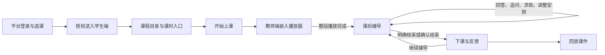
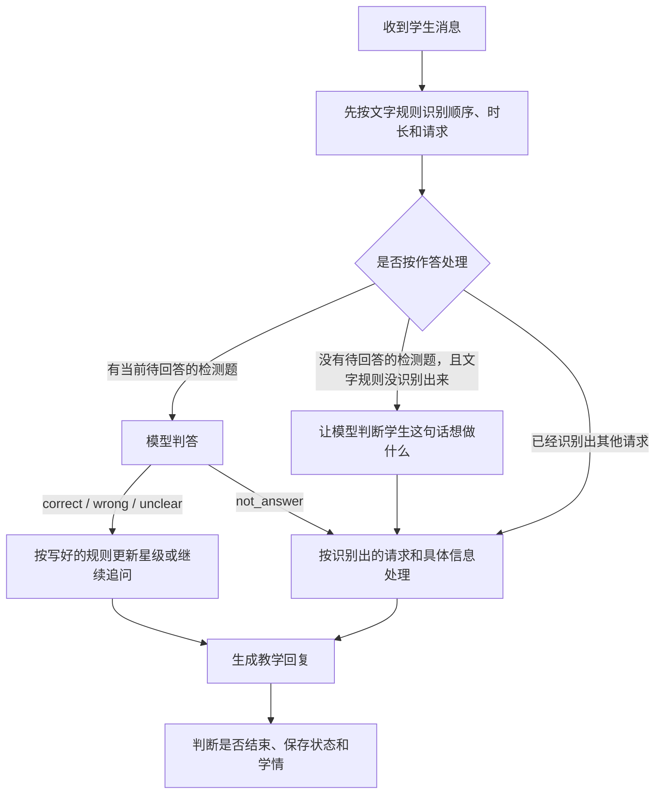

# 学生端运行机制：输入、输出与数据更新

> 核查日期：2026-10-22。依据当前工作区代码，包含按所选课时隔离上下文的更新；不代表这些本地改动已经部署。
> 本文描述实际实现。主流程之外的实现边界集中列在第 10 节；不把历史 README、旧机制草稿或代码注释直接视为已实现能力。
> 下文源码路径均相对于仓库根目录；定位优先使用函数名。

## 1. 整体机制

学生从平台进入已发布课程，观看教师端播放器中的课件，再与学生 Agent 一对一复习。后端保存课堂阶段、检测题、星级和计划时间；前端根据接口返回的状态显示对应页面。

阅读时可以先这样理解文中的几个词：

| 文中的说法 | 通俗解释 |
| --- | --- |
| 会话 | 学生这一次课堂学习的记录，包含聊天、进度和评分，用会话号找到它 |
| 学习上下文 | 系统收到的这门课资料：学谁的课、有哪些课件、讲什么、有哪些知识点 |
| 教学计划 | 把课程资料整理成程序可以执行的安排：选哪节课、有哪些段落、接下来做什么 |
| 当前待回答的检测题 | AI 已经问出来、正在等学生回答的那道题；代码字段是 `tutoring_question` |
| 按写好的规则处理 | 程序执行事先约定的动作，例如答对后按规则加星、答错后继续追问 |
| 判断学生想做什么 | 区分学生是在答题、求助、想跳过、改时长，还是想结束 |
| 心跳 | 后端每隔一段时间自动检查一次课堂，即使学生没有发消息也会检查 |
| 轮询 | 页面每隔一段时间向后端问一次：进度变了吗，有没有新消息 |
| 工件 | 教师端生成或整理的一份教学内容，例如知识点文件、课件等 |
| 前端／后端 | 前端是学生看到和操作的页面；后端是处理请求、执行规则和保存记录的服务 |

当前默认流程：



这里的“课后辅导”是 `host_phase=tutoring`，仍属于原课堂会话。默认计划 15 分钟，时间到不会自动结束。

| 部分 | 输入 | 主要输出 | 更新责任 |
| --- | --- | --- | --- |
| 平台 | 平台身份、选课关系、教师已发布内容 | 入口令牌、学习上下文、课程进度 | 校验访问资格，聚合学情，向教师端推送学习状态 |
| 教师端播放器 | 对应课时的课堂地址与场景 | 场景完成、整段完成、播放错误事件 | 播放课件，学生适配层把事件转成学习进度请求 |
| 学生端界面 | 用户操作、后端状态、消息和报告 | 页面、聊天、倒计时、掌握条、反馈卡 | 保存浏览器会话标记、切换页面、发送请求 |
| 学生会话服务 | 请求、播放器事件、定时心跳 | 状态快照、AI 回复、报告接口 | 管理会话与并发，调用教学流程控制程序，保存到本地文件和写学情库 |
| 教学流程控制程序 | 教学计划、当前状态、学生消息、时间 | 教学回复、检测题、评分、阶段变化 | 决定本轮怎么教、是否推进、哪些教学状态改变 |
| 大模型 | 不同调用各自的提示词与上下文 | 文案、消息类别（如求助、跳过）、判答结果、回答表现 | 返回候选结果，由代码校验并执行状态更新 |

后端有两条独立的状态轴：

| 状态轴 | 取值 | 含义 |
| --- | --- | --- |
| `lesson_status` | `idle / running / ended` | 等待开始、正在上课、已经结束；决定能否发消息及心跳是否运行 |
| `host_phase` | `uninitialized / intro / guided_learning / tutoring / ending` 等 | 当前教学环节；决定界面和教学安排 |

默认启用 `AGENT_POST_VIDEO_TUTORING`，会把复述、探究、讨论阶段替换为辅导。关闭后使用计划原有阶段；当前平台适配器生成的是“讲解 → 复述讨论 → 深入探究”，并非固定包含全班讨论。

## 2. 从平台进入：身份和会话怎么建立

### 2.1 平台签发入口

接口：`POST /api/v1/courses/{course_id}/student-workspace`。

| 项目 | 实际机制 |
| --- | --- |
| 输入 | 当前平台登录身份、课程 ID |
| 校验 | 课程可访问、选课关系、已有发布版；普通教师不能通过此接口建立学生会话，管理员有部分例外 |
| 输出 | `url`、`launchToken`、`publication`、可选 `classroomId / playerUrl` |
| 令牌内容 | `uid` 用户、`cid` 课程、`rid` 课堂、`pub` 发布信息、`exp` 到期时间、`nonce` 随机值 |
| 更新 | 此步骤签发令牌，不产生教学星级或答题记录 |
| 失败 | 未选课拒绝，课程未发布返回冲突错误 |

令牌采用 HMAC-SHA256 签名。当前验证的是签名与有效期，没有消费 nonce 的一次性核销机制，因此应称“短时效入口令牌”。

### 2.2 浏览器初始化

`StudentApp.js` 从 URL 读取 `launch_token`，保存到 `sessionStorage.__launch_token` 与内存，然后从地址栏移除令牌参数。无令牌时跳回 `/`。

随后调用 `/api/session/start`，把返回的入口会话号保存为 `sessionStorage.__studentSessionId`，再读取课程目录。初始化失败也会返回平台首页。

### 2.3 学生后端创建或恢复会话

接口：`POST /api/session/start`。

| 项目 | 实际机制 |
| --- | --- |
| 后端接收字段 | `launch_token`、可选 `session_id`、`lesson_id`、`time_scale`；不传课时仅创建目录入口 |
| 身份来源 | 只从已验证令牌取用户和课程；不接受浏览器自报学生身份 |
| 内容来源 | 调平台 `/internal/student/learning-context`，平台再次校验选课及发布状态 |
| 无显式会话号 | 用用户、课程及后端确定的 `lesson_id` 计算 `plat-<hash16>` |
| 有显式会话号 | 校验格式后优先采用；若已有状态属于另一学生或另一 `lesson_id`，返回 409 |
| 输出 | `session_id`、`status`、`phase`、`available_actions`，本身不开始教学 |
| 更新 | 内存会话、`platform` 身份上下文、`learning_context`、磁盘状态、正式会话行及 `session_started` 事件 |

**当前有两类会话号，不能混为一谈：**初始化入口使用后端派生号；进入具体课堂时，`legacy/app.js` 会读取或生成按课时保存在 localStorage 的 UUID，再显式传给 `/start`。因此后端派生号不等于所有课堂都具备跨设备续聊能力。

课时ID现在从前端贯穿 `/start`、平台取数、内部适配和计划生成。未选课时只返回目录摘要，不能开课；无效或未发布课时明确报错，不默认选择第一课时。旧会话若课时或计划版本不一致，返回409，前端使用新会话，保留旧记录。

## 3. 课程输入适配：从发布内容到教学计划

本章说明学生开始学习前，课程数据如何变成学生端可用的结构。整条链路按确定规则执行，不调用LLM；LLM如何出题、讲解与判答见第5章。

```text
教师已发布的课件、知识点文件和材料
  ↓ 学生先在目录选择课时，将lesson_id传给平台桥接
平台按所选课时筛选资源、解析本课时知识点
  ↓ 学习上下文JSON：所选课时内容 + 全课目录摘要
学生端再次核对课时、过滤资源、统一字段和讲稿
  ↓ 内部学习上下文存入state.learning_context
核对同一课时、匹配段落与知识点、添加流程配置
本次教学计划 lesson_plan
  ↓
课堂内容定位、辅导、教学提示词与报告
```

### 3.1 平台准备输入：学习上下文

“学习上下文”就是平台交给学生端的数据包，接口为 `/internal/student/learning-context`，格式版本为 `schemaVersion=1`。不传 `lesson_id` 时只返回 `lessonCatalog` 目录摘要，`lessons` 和材料为空、无默认课堂及知识点；传入有效课时后，`selectedLessonId` 标明选择，`lessons` 只含该课时。目录摘要不携带讲稿、材料或知识点正文。

平台负责两个准备动作：

- **筛选内容：**课程须为 `active`，且已有 `published` 知识包；独立工件还要求自身 `status=published`。工件、课时文件及材料均须 `classVisible=true`、`classPublicationId` 非空，课时文件和材料不额外检查自身 `status`。在这些发布条件之外，只下发归属所选课时的条目，以及明确 `scope.type=course` 且无课时归属的共享材料；无归属、其他课时及课程级知识点文件不混入。此处不判断正文质量。
- **提取知识点：**只解析归属所选课时、`resourceType=knowledge-points` 的文件，将标题、列表和生成的ID填入 `knowledgePackage.rubric.knowledgePoints`。没有匹配文件就保留空目录，即使全课程只有一份知识点文件也不跨课时借用。

知识点模板、末级标题兼容规则、长度限制和文件选择细则只在[知识点文件对接说明](student-knowledge-point-contract.md)中维护。本章从平台已提取的结果继续向下说明。

### 3.2 学生端统一格式：内部学习上下文

`course_adapter.py::from_platform_payload` 将平台JSON转成内部模型 `CourseLearningContext`，存为会话的 `learning_context`。主要完成三件事：

1. 校验格式版本、用户、课程、发布信息及 `selectedLessonId` 与请求课时是否一致，再次按课时归属过滤资源；整理无正文的目录摘要。
2. 仅整理选中课时的课堂；每个场景的 `speech` 讲稿合并为一个段落。选中课时没有有效课堂时明确报错，不借用其他课时，也不改用材料自动创建一节课。
3. 将平台结构化知识点转为内部 `evaluation.knowledge_points`。这里的 `evaluation` 保存教学要求及来源，尚未对学生作答进行评价。

结果转为字典保存到 `SESSIONS[sid]["state"]["learning_context"]`，供LangGraph读取，会话包装层另留副本；随state写入 `student_agent/runtime/sessions/<sid>.json`。其中 `lessons` 只含选中课时，`lesson_catalog` 保留全课目录摘要。目录入口两者分别为空列表和摘要列表，不生成题目或星级；当前不使用LangGraph checkpointer。

### 3.3 生成本次教学计划：字段去哪里用

`course_adapter.py::load_plan_for_session` 读取已按课时隔离的 `learning_context`，要求会话 `lesson_id` 与 `selected_lesson_id` 及唯一课时一致，不一致时拒绝生成计划。函数不再选择第一课时，只为已确认课时添加关联和流程配置，返回计划，经开课校验后写入 `lesson_plan`。

下面按同一项数据的完整去向说明，每项只列一次：

| 平台输入 | 内部整理／计划输出 | 使用位置 |
| --- | --- | --- |
| `schemaVersion` | 内部 `schema_version`；计划格式另固定为 `version=2` | 检查输入格式；平台格式版本、计划格式版本和课程发布版本互相独立 |
| `userId` | 内部 `user_id`，保留在身份与会话上下文，不复制进计划 | 绑定学生和学习记录 |
| `courseId / courseTitle` | 内部课程标识及名称；计划写 `course_id`，教学标题取已确认课时 | 课程归属、展示与报告 |
| `publication.id / version` | 计划 `publication_id / publication_version` | 标记内容版本，检查恢复、空目录修复的归属 |
| `selectedLessonId / lessonCatalog` | 内部 `selected_lesson_id / lesson_catalog`，后者只有课时摘要 | 锁定教学内容的课时归属；目录导航无需加载其他课时正文 |
| `lessons[].id / title` | 选中项写入计划 `lesson_id / lesson_title / title` | 本次课时归属、开场名称、报告名称 |
| `lessons[].classroom.scenes[].actions` | 合并讲稿成为内部段落，再写计划 `segments[]`，保留ID、标题、顺序、正文和场景来源 | 当前内容定位、教学提示词、播放内容与段落的对应 |
| `knowledgePackage.rubric.knowledgePoints[]` | 内部 `evaluation.knowledge_points[]` → 计划 `knowledge_points[]`；`expectedConcepts` → `expected_concepts` → `expected`，ID和名称保留 | 目录、出题、判答、讲解；用ID关联评分证据与学习记录 |
| 段落正文与上述知识点 | 程序匹配，写计划 `segments[].knowledge_point_ids` | 标识每个段落关联哪些知识点 |
| `knowledgePackage.entries[]` | 内部材料条目 → 计划 `knowledge_sources[]`，保留ID、标题、正文及来源名称 | 为教学提示词挑选相关正文；只有地址不代表已读取正文 |
| `knowledgePackage.title / summary` | 保留在内部材料包 | 课程包简介及目录展示，不用于创建回退课时 |
| `lessons[].week / lessonNumber / teachingHours` | 内部课时元信息；不直接复制为计划预算 | 课时目录信息；`teachingHours` 当前不决定计划时长 |
| `lessons[].classroom.playerUrl`、`classroom` | 均指向选中的同一课时；播放器地址不复制为计划顶层字段 | 前端先完成课时绑定，再按课堂会话ID读取详情和加载播放器 |
| `grounding` | 平台返回空对象，内部模型不承接 | 避免夹带未按课时筛选的课程级补充正文 |
| 程序添加的配置，无对应教师输入 | 计划 `source=platform-published`、`total_minutes`、`stages[]`、`advance_policy`；内部评价整体另存 `evaluation` | 识别平台计划、设置阶段与预算；评价来源随计划保留，辅导直接读取 `knowledge_points[].expected` |

段落关联使用文字匹配：完整知识点名称或某条完整应会内容出现在段落标题／正文中即关联，匹配前转小写。只有一个段落且没有匹配时，关联全部知识点；多段落未匹配的保留空关联。因此它不等于经过语义理解或教师确认的精确映射。

计划时长按 `max(20, 5 × 段落数)` 分钟估算，不等于视频时长。计划保留讲解、复述讨论和深入探究的阶段配置；默认开启课后辅导时，运行流程将后两个阶段替换为辅导，辅导倒计时独立安排，见第5章。

**更新范围：**此处写入课时学习上下文、教学计划并注册知识点名称。学生当前进度、回答、检测题和星级由后续教学产生。计划仅在流程未初始化时加载；重入时会重新校验课时和已有计划版本，不一致则返回409，不把新上下文与旧计划拼接。

开发时需要查嵌套字段、固定配置值、具体转换样例或历史修复记录，见[输入适配开发参考](student-input-adapter-reference.md)。

## 4. 课程页面与视频讲解

| 部分／触发 | 输入 | 输出 | 更新什么 |
| --- | --- | --- | --- |
| 课程目录 | 入口会话 ID | 课程、周次、课时标题、估算时长、知识点名称 | 读取已有上下文；不查询或生成新的课程内容 |
| 课时详情 | `lessonId + sessionId` | 课时摘要、段落、`classroomId / playerUrl` | 为界面和播放器准备数据 |
| 开始上课 | `POST /{sid}/begin` | `running`、首阶段及动作列表 | 加载并校验计划，设置开始时间、初始阶段、已有知识点掌握星级；记录 `lesson_began` 并通知平台 started |
| 嵌入视频 | 课时 `playerUrl` | iframe，附加 `embedded=player` | 显示教师端场景画布；学生端不再实现一套课件播放器 |
| 单场景播完 | `SCENE_COMPLETED` 的 sceneId、eventId | `media/done`，`final=false` | 写场景播放进度及事件；不运行教学推进 |
| 整段播完 | `PLAYBACK_ENDED` 或 `CLASSROOM_COMPLETED` | `media/done`，`final=true` | 将计划全部段落记入 `played_media`，进度位置置到段落总数，推进到辅导 |
| 视频中主动提问 | 学生消息 | 基于本课上下文的回答 | 记录对话；不改变视频进度或自动结束讲解 |
| 回放 | 已结束课时的回放入口 | iframe 附加 `replay=1` | 当前前端回放路径不向学生 Agent 上报完成事件，不推进辅导或加星 |

适配器核对 postMessage 的来源 origin 和 iframe window；整段结束在单次挂载内只触发一次。播放器错误交给界面显示，不当作视频已完成。

视频阶段不会因时间预算耗尽而跳走。AI 在心跳轮静默；只有学生主动提问才回答。辅导开场直接输出预先写好的开场文字，不等待模型润色。

## 5. 课后辅导：每条消息如何处理

### 5.1 进入辅导的初始化

整段播放完成后，后端把 `host_phase` 切为 `tutoring`，设置默认复习分钟数和 `tutoring_planned_end_at`，输出固定编号知识点列表，征询顺序、不懂的点和计划时长。学生可以省略全部安排。

辅导开场不调用模型，通常没有当场出检测题；后续学生消息触发安排和出题。

### 5.2 复习顺序和时长由谁识别、谁保存

**程序负责保存，模型只在需要时帮助理解学生的话。**具体过程：

1. 先用写好的文字匹配规则识别。例如“先 2 再 1”可直接提取知识点顺序，“复习 10 分钟”可直接提取时长，不必调用模型。
2. 文字规则没识别出来时，可以让模型返回“调整顺序”或“改时长”以及编号、分钟数；有待回答检测题时，也可能由同一次判答返回这些信息。
3. 程序校验编号是否存在、时长是否在 1–240 分钟内，再写入 `tutoring_order`、`tutoring_planned_minutes`、`tutoring_planned_end_at`。
4. 会话服务把状态保存到 `runtime/sessions/<sid>.json`，同一会话后续轮次读取这些字段安排复习、计算倒计时。模型自己不保存这些数据。

本次已移除星级自评功能：开场不再征询自评，消息规则和模型分类不再识别自评类别，掌握条与反馈卡不再展示自评，状态与反馈接口也不再返回自评字段。系统根据实际作答给出的星级继续保留。

历史自评不迁移保留：平台 `final09` 迁移删除掌握度表的自评列，并递归清除历史报告和事件中的结构化自评字段；`student_agent/scripts/remove_self_assessment.py` 清除本机 sessions、integration JSON 中的同类字段。旧状态保存、恢复以及旧报告读取也会过滤这些字段，避免重新返回。原始聊天文本和其他学情不在本次删除范围内。

### 5.3 一条消息的处理顺序

统一接口：`POST /api/session/{sid}/message`，请求体 `{ "text": "..." }`。



图中“按写好的规则更新星级或继续追问”，原先使用的技术说法是“确定性更新”。意思是：**模型先给出判断，程序再按事先写好的规则执行动作。**例如模型判断“答对”，程序按表现和提示情况记录掌握程度，并安排下一题；模型判断“答错”，程序再检查这是第几次答错；第一次就记录错误、保留原题并继续追问。模型判断本身可能出错，“确定性”不表示答案判断百分之百正确，也不表示最后的追问文字完全固定。

图中“让模型判断学生这句话想做什么”，原先叫“模型意图分类”。例如学生说“这题先放一下，换个讲讲”，模型需要判断这句话是在要求跳过，而不是在回答题目。模型返回“跳过”这个类别后，程序执行切换题目的规则。若学生说“我再学十分钟”，模型还可能提取“10 分钟”这个具体信息。程序会检查这些信息是否有效，再决定是否更新。

常见类别可以这样理解：

| 学生的话 | 要识别的请求 | 后续动作 |
| --- | --- | --- |
| “我不会，能再解释一下吗？” | 求助 | 讲解或引导，不直接算答错 |
| “这题跳过吧” | 跳过 | 转向下一个知识点，不加星 |
| “我想再复习十分钟” | 改时长 | 校验时长后更新计划结束时间 |
| “今天差不多了” | 可能想结束 | 如果由模型识别出结束请求，先让学生确认 |

这些例子用于说明类别含义，不保证每种说法都必须经过模型。程序会先用文字匹配规则识别常见表达；识别不出来时，才让模型补充判断。有当前待回答的检测题时，模型也可能在判答的同一次调用中返回“这不是作答，是其他请求”，从而省去一次单独分类。

按文字规则识别消息时，处理优先级为：结束 → 明确跳过 → 改时长 → 选顺序 → 求助（含“不知道”）→ 追问 → 都没识别出来时先按作答处理。顺序、时长在分流前分别提取，所以同一句可以先记录多项安排，再由优先级决定本轮主行为。“不知道下一步怎么回答”不属于跳过；“不知道，这题跳过吧”仍尊重明确导航。

### 5.4 各类输入、输出与更新

| 学生输入／想做的事 | 输出 | 更新字段 | 不会直接更新的内容 |
| --- | --- | --- | --- |
| “先 2 再 1”等顺序 | 确认顺序，余下目录按原序补齐 | `tutoring_order`、当前正在讲的知识点；后续按进度位置处理题目 | 系统星级 |
| “复习 10 分钟” | 确认新安排 | `tutoring_planned_minutes=10`，结束时间从本条消息重新计算 | 不累计在原结束时间后，也不直接下课 |
| 主动追问 | 模型讲解或答疑；失败时用预先写好的基础回复 | 对话记录，可能保留原来等待回答的检测题 | 不因提问直接加星 |
| 求助、要求再讲 | 模型提供帮助；明确不会时先解释当前知识点并举例，模型失败则使用已发布应会要点 | 对话记录，有待回答题时保留该题并标记 `hint_given=true` | 不直接算答错，不加星；“不知道、不会、想不起来、答不上来”等不送判答器，也不自动切换知识点 |
| 正在答检测题 | 判为 correct、wrong、unclear 或 not_answer | 按下一节规则更新题、星级、统计 | 未通过判答不凭空加星 |
| “跳过”“下一个” | 直接交付下一知识点及其新题，不再询问是否执行这次切换；末尾则询问是否还有问题 | 进度位置、当前正在讲的知识点、当前待回答的检测题、已见题清单 | 不当作答题，不加星；导航回复由程序直接输出，防止模型把已切换改成待确认 |
| 明确结束短语 | 进入下课 | `ending / ended`，触发课时完成与辅导反馈 | 不受计划时长未到限制 |
| 仅模型识别为结束 | 先请求确认 | `tutoring_end_confirm_pending` | 不立即结束 |
| 确认结束 | 本轮下课 | `tutoring_end_confirmed` 被阶段切换程序使用 | 无需再等待一轮心跳 |
| 拒绝结束 | 继续原题或对话 | 清待确认标记 | 不清已有星级、证据和安排 |

程序会检查模型提取的具体信息，包括编号范围、时长 1–240 分钟等；无效值不用于对应状态更新。文字规则与模型识别的具体覆盖范围不同，不能认为任意自然语言安排都能准确识别。

### 5.5 出题、判答与推进

| 环节 | 输入 | 输出 | 更新规则 |
| --- | --- | --- | --- |
| 出题 | 当前知识点标题、应会要点、已见题干、基础／应用题类型 | 一道口头检测题 | 优先模型生成；失败从对应类型的备用题中选择，耗尽后允许复用旧题 |
| 新旧题判定 | 候选题干、`tutoring_asked` | `was_fresh` | 代码按题干精确字符串比较；语义相似性主要靠模型提示词约束 |
| 当前待回答的检测题 | 知识点、题干、时间、题目类型 | `tutoring_question` | 保存 `kp_id / question / kind / asked_at / hint_given / was_fresh / wrong_count`；题干加入已见清单 |
| 判答 | 原检测题文本、学生回答 | `correct / wrong / unclear / not_answer`、一句依据、可选的请求类别与具体信息 | 解析失败或模型不可用返回 unclear |
| 答对 | 原题及表现依据 | 说明当前掌握情况；通常继续下一知识点 | `correct` 计数加 1，有提示则 `hinted_correct` 加 1；掌握星按本次表现评估，不按次数相加；清原题，进度位置加 1，尚有知识点则出新题 |
| 第一次答错 | 当前题及表现依据 | 同题追问、提示；记录核心错误或部分理解 | `wrong` 加 1；`wrong_count=1`、`hint_given=true`；不降星 |
| 连续答错 | 已错过的原题 | 讲解后换同知识点的新题 | `wrong` 加 1；新题 `wrong_count=0`、`hint_given=false`，重新计算新旧题标记 |
| 无法判断 | 太简短或解析失败等 | 请学生说详细一点 | 保留原题，不加星、不计 correct/wrong |
| 并非作答 | 判答器返回 not_answer | 交给处理这类请求的代码 | 执行跳过、求助、改时间等，不强行判对错 |

**上下文范围要区分：**通用教学回复会使用已发布材料、场景正文及应会要点。普通辅导出题、连续答错换题和跳过后的出题均接收知识点应会要点；判答接收题干、题目类型、提示标记、应会要点和答案。这不代表每次都带上课程全部原文。

### 5.6 唯一的知识点掌握星级

**聊天中的下课小结、学情报告、辅导反馈卡和数据库，都使用 `kp_stars` 这一份记录。**不再维护独立的 `tutoring_stars`，下课也不再让模型另打一次分。课后辅导顶部知识点栏只显示编号和名称，保留当前知识点高亮，不显示“未检测”、星级、“需要再确认”或评分说明图标；倒计时继续显示。

下面每一档都分开说明两种依据：**教学上为什么算达到这个程度**，以及**当前程序实际检查什么条件**。二者不能混在一起：程序会检查模型返回的类别、说明文字和题目记录，但不会独立证明学科判断正确。

#### 5.6.1 评分依据从哪里来

| 依据 | 谁提供、保存在哪里 | 评分时具体用来判断什么 | 当前边界 |
| --- | --- | --- | --- |
| 教师发布的应会要点 | 教师知识点文件 → `lesson_plan.knowledge_points[].expected` | 这道题应理解哪些概念、条件、步骤；学生说对了什么、漏了什么、说反了什么 | 不是代码逐条打勾计分；由模型根据本题相关要点理解。缺少应会要点时仍可能按题干与模型知识判答，可靠性会下降 |
| 当前检测题题干 | 程序保存的 `tutoring_question.question` | 学生回答的是哪道题、该题要求解释还是应用 | 普通聊天中的随口提问不自动计入这一套评分 |
| 学生这一次回答 | 当前 `/message` 的原文 | 是否给出实质性回答、关键内容是否正确、有没有推理理由 | 判答调用接收这次回答，不是每轮重读整段聊天来重新评分 |
| 是否给过提示 | 程序维护 `hint_given` | 此次正确回答是否只能证明“在帮助下能完成” | 当前题第一次答错后追问，或求助／追问分支处理该题时，会置为 true；只记录系统内这一题的帮助，不证明学生在系统外没有得到帮助 |
| 题目类型 | 程序保存 `kind=basic / application` | 这次是在检验核心理解，还是新情境应用 | 普通选题时，当前不足 4 星通常出基础题；已有 4 星再次检测会选应用题。连续答错后换题使用基础题复核 |
| 是否已经问过 | 当前会话的 `tutoring_asked` 与 `was_fresh` | 能否把此次表现用于证明“未见过的新题应用” | 代码按题干完全相同来去重，不等于能检查语义重复，也不等于该学生一生从未见过同类题 |
| 模型的判断及理由 | 判答返回 `verdict / performance / note / reasoning` | 回答表现属于哪档、为什么这样判断 | `note` 应指出具体表现，`reasoning` 应摘录学生的实际推理；当前代码主要检查类别和文字是否存在，没有另一个独立的学科审核模型 |
| 此前已经证明的掌握程度 | 会话 `kp_stars`，开课也可能读取该发布版下的历史记录 | 决定本轮表现是否足以提高已显示的星级 | 本次表现较差不会直接覆盖此前更高星级；“本次评为几星”与“当前显示几星”需要区分 |

**不是依据：**学生自己说“我会了”、学习了多长时间、消息发得多、回复很长、看完视频或答对次数本身。这些信息不能单独证明更高掌握程度。

#### 5.6.2 先区分“本次回答证明了几星”和“页面现在显示几星”

每次有效评估先产生一个“本次回答所能证明的等级”，保存在证据的 `assessed_stars`；页面显示的 `kp_stars` 再按下面的规则更新：

```text
当前显示星级 = 此前显示星级与本次回答等级中较高的一个
```

例如，此前已经独立解释清楚、显示 4 星；后来一题在提示后答对，本次证据是 3 星，页面仍保留 4 星。不能把页面保留的 4 星理解成“这次提示后回答也得到了 4 星”。反过来，首次有效回答就独立解释清楚，可以从未检测直接到 4 星，不必先答对四题。

**依据：**`mastery.py::record_assessment` 保存 `old_stars`、`assessed_stars`、`new_stars`，并执行 `max(old, score)`。下面 0–5 星的例子，除特别说明外，都假设学生此前没有更高星级。

#### 5.6.3 共同示例：以“时间片轮转”为例

以下是为了理解机制而写的示例，不是程序里写死的标准答案。假设教师发布的相关要点包括：进程轮流获得时间片；尚未执行结束且没有阻塞的进程，用完时间片后重新进入就绪队列，等待后续调度。

基础题是：“一个尚未执行完、也没有阻塞的进程，用完时间片后会发生什么？为什么？”各档例子都需要结合这道题和上述教学要点判断，不能脱离题目单看几个关键词。

#### 5.6.4 0 星：未检测

- **判断依据：**目前没有足够的、可归属于这个知识点的有效作答证据，所以暂不判断掌握程度。0 星表示“还无法判断”，不是“确认不会”。
- **具体情况：**只看完视频；尚未出检测题；学生说“准备好了”；跳过该题；模型认为回答太模糊；模型不可用或返回格式不合要求。
- **程序条件：**没有该知识点的评分记录时，展示按 0 星处理。`unclear / not_answer` 不产生新评分；模型即使说 correct，缺少合法表现类别或非空依据，也不会因此给星。
- **示例：**学生只说“好像就是轮流吧”，如果不足以判断本题核心，模型应返回 unclear 并请其补充，而不是为了给分硬判 1 星或 2 星。
- **不能据此做的推断：**看完视频不自动变 1 星；有过 4 星的学生这次没回答，也不会被重置为 0 星。

#### 5.6.5 1 星：需要重新理解

- **判断依据：**学生已给出可判断的回答，但把本题核心概念、条件或因果关系说错了。这与“还没有足够信息判断”的 0 星不同。
- **示例回答：**“时间片用完，这个进程就直接结束，不会再参与调度。”
- **具体依据应怎么写：**“把时间片用完误认为进程执行结束，未区分抢占与完成。”不能只有“回答不好”这种空泛评价。
- **程序条件：**模型返回 `verdict=wrong`、`performance=incorrect`，并有非空 `note`；题目所属知识点必须存在于当前计划中。程序把本次回答映射为 1 星。
- **后续动作及依据：**第一次错时保留原题，记录已提示并继续引导；已有更高星级时先保留原值，因为一次失误不足以推翻之前的证据。

#### 5.6.6 2 星：理解了一部分

- **判断依据：**回答中有明确正确内容，但缺少本题要求的关键部分，尚不能证明已经理解核心。不是“说得少就给 2 星”，而是要指出哪部分对、哪部分缺。
- **示例回答：**“CPU 会交给别的进程。”这部分方向正确，但没有回答原进程接下来在哪里、是否还会继续执行。
- **具体依据应怎么写：**“知道处理机会让给其他进程，但遗漏未完成进程回到就绪队列、等待下一轮调度的过程。”
- **程序条件：**模型返回 `verdict=wrong`、`performance=partial`，并有非空 `note`。这里 wrong 是程序的“仍需引导”分支，partial 才表示它不属于全错；程序把本次回答映射为 2 星。
- **后续动作及依据：**继续围绕缺失部分追问，不因为已经说对一个点就直接当成完整掌握。当前没有“命中两个关键词就算 2 星”的计数公式，也没有固定的要点覆盖百分比。

#### 5.6.7 3 星：提示后能说清

- **判断依据：**这次回答已经正确，但此前针对这道题给过提示或讲解。因此它证明“在帮助下可以完成”，尚不能证明本次是独立完成。
- **示例过程：**学生先答错；AI 提醒“进程还没有完成，可以想想它应回到哪个队列”；学生再答“回到就绪队列末尾，等下一轮调度，CPU 先给下一个就绪进程”。
- **具体依据应怎么写：**“经队列方向提示后，说清了进程重新等待和 CPU 转交的过程。”提示记录与回答内容两方面都要有，不能只凭模型觉得“似乎给过帮助”。
- **程序条件：**模型返回 `verdict=correct`、`performance=understood` 或 `transfer`，有非空 `note`，且程序记录的 `hint_given=true`。只要本题已提示，本次正确回答最多按 3 星记录，即使它是应用题。
- **后续提高的依据：**之后换一道题，在没有针对新题提示的情况下独立作答，可以证明 4 星或 5 星。提示标记是按题保存，不能把“学生以前听过讲解”一概当作所有后续题都已提示。

#### 5.6.8 4 星：能独立说清

- **判断依据：**针对本题，学生在系统没有给提示的情况下，正确解释了核心内容。是否说清需要对照教师要点和问题要求，而不是只看最后结论对不对。
- **示例回答：**“它还没有完成，所以不会消失；时间片用完后被抢占，重新进入就绪队列等待，处理机先交给下一个就绪进程，这样各进程轮流获得运行机会。”
- **具体依据应怎么写：**“无提示区分了时间片到期和进程完成，并说明重新排队及轮流运行的原因。”
- **程序条件：**模型返回 correct，表现类别为 understood 或 transfer，有非空 note，且 `hint_given` 不为 true；若没有同时满足 5 星全部条件，本次按 4 星记录。旧题无提示答对也最多证明 4 星，不会因多答几次累计到 5 星。
- **不能据此做的推断：**解释清楚定义或流程，不能自动证明在新情境中也会应用。模型将表现写成 transfer，但题目是基础题、题目已见过或没有推理说明时，程序仍只能按 4 星记录。

#### 5.6.9 5 星：能灵活应用

- **判断依据：**学生不仅能复述，还能在题目改变条件或给出新情境后，正确选择或应用知识，并说明理由。这是在 4 星“独立解释”之外，增加应用与推理的证据。
- **示例应用题：**“交互任务和计算任务混合运行，把时间片从 20ms 改成 2ms，会怎样影响响应与切换开销？为什么不能只凭时间片更小就断言系统更好？”
- **示例回答：**“较短的时间片通常能让等待的任务更快轮到，但也增加上下文切换频率和开销。需要结合响应目标、切换成本和任务负载权衡，不能只看时间片大小。”
- **具体依据应怎么写：**`note` 说明学生正确分析了响应与开销的权衡；`reasoning` 摘录其“时间片变小 → 切换更频繁 → 开销上升，因此要结合目标权衡”的实际推理，而不是模型替学生补一段理由。
- **程序必须同时检查的条件：**correct；表现类别 transfer；非空 note；题目 `kind=application`；`was_fresh=true`；未提示；非空字符串 reasoning；知识点归属有效。缺少任一关键条件，都不能按本次 5 星记账。
- **不能据此做的推断：**只答一个正确结论但不说明理由，不应算灵活应用；模型单独返回“5 星”也不能让程序给 5 星。程序检查的是字段与记录条件，理由是否真的充分仍由模型理解，当前没有第二道自动学科审核。

#### 5.6.10 不同情况的“本次等级”与“最后显示”对照

| 此前显示 | 这次实际证据 | 本次回答等级 | 页面最后显示 | 依据 |
| --- | --- | --- | --- | --- |
| 0 | 只看完视频，没有有效作答 | 无新评估 | 0 | 观看完成是播放证据，不是掌握证据 |
| 0 | 核心概念明确说反 | 1 | 1 | 有错误作答证据，可判断需要重新理解 |
| 0 | 说对一部分，遗漏关键过程 | 2 | 2 | 模型需同时指出正确和缺失部分 |
| 0 | 提示后说清核心 | 3 | 3 | 正确回答与本题已提示记录同时存在 |
| 0 | 无提示解释清楚核心 | 4 | 4 | 不必累计答对四次，直接按表现记录 |
| 4 | 同一基础题再次独立答对 | 4 | 4 | 重复成功不是新情境应用证据 |
| 4 | 新的应用题，无提示，应用正确且理由充分 | 5 | 5 | 应用题、新题、独立、推理依据等条件同时满足 |
| 4 | 本题提示后答对 | 3 | 4 | 本次证据为 3，旧的 4 星证据仍保留 |
| 5 | 某题核心错误 | 1 | 5 | 本次记错误证据，不用一次失误直接抹掉历史表现 |
| 4 | 模型回复不符合格式或无法判断 | 无新评估 | 4 | 没有有效新证据，不随意改分 |

#### 5.6.11 “需要再确认”依据什么出现和消失

- **出现依据：**同一知识点已有 3 星及以上，随后连续两次有效判答为 wrong，说明近期表现与已有掌握记录有矛盾。程序保留原星级，同时把该知识点加入 `mastery_needs_review`；不是把它偷偷改成另一套分数。
- **计数范围：**这里的 wrong 包括核心错误 incorrect 和部分理解 partial；无效回答、跳过、无法判断不增加有效判错计数。一次有效 correct 会中断连续错误计数。
- **消失依据：**此后有一次未提示的正确回答，且本次回答等级达到或超过原显示星级，才清除“需要再确认”。例如原来 5 星，需要再次用符合 5 星门槛的证据确认；只在提示后答对一次，不能解除这一疑问。
- **展示及建议依据：**报告和反馈卡显示此标记；即使数字仍为 4 星或 5 星，也把它列为需要优先复核的点，不能仅因数字较高就给出“无需复习”的建议。顶部知识点栏不展示状态标记。
- **当前边界：**这不是按遗忘曲线自动降分，也没有过几天就扣星的时间公式。它只依据当前会话中实际记录的判答矛盾。

#### 5.6.12 星级更新后，具体保存哪些依据

每次有效评分将下面这些内容追加到会话 `mastery_history`，而不是只存一个最终数字：

| 保存字段 | 记录什么 | 以后如何核对 |
| --- | --- | --- |
| `kp_id / question / answer` | 属于哪个知识点、具体问了什么、学生原话是什么 | 防止把另一个知识点的回答当成本点证据 |
| `verdict / performance` | 模型判断对错、判断是哪一种回答表现 | 区分“核心错”“部分对”“独立理解”“应用” |
| `evidence / reasoning` | 具体评估说明、模型摘录的应用推理 | 对照学生原话检查理由是否被夸大或虚构；不是人工已审核的证明 |
| `hint_given / kind / was_fresh` | 本题是否提示、基础或应用、当前会话是否未见 | 核对为什么被限制在 3 星或 4 星、为什么有资格到 5 星 |
| `old_stars / assessed_stars / new_stars` | 原显示、本次回答等级、更新后的显示 | 解释为什么本次只证明 3 星，但页面仍保留原来的 4 星 |
| `occurred_at / stage / source` | 评估时间、阶段、评分机制来源 | 区分逐题评估与历史旧机制记录 |

**存储依据和范围：**完整逐题记录随 state 保存到 `runtime/sessions/<sid>.json`；当轮 `mastery_updates` 用于写正式掌握度表中的当前星级、最近依据和来源；学习事件记录判答事实。掌握度表本身不是全部历史证据的列表，不能只看这一行就声称读到了每一道题的原始记录。

**展示一致的依据：**`tutoring.stars` 只是把 `kp_stars` 的知识点 ID 转成目录编号；反馈的 `system_stars` 和导出的 `stars` 也读取同一记录。它们是不同接口中的字段名称，不是额外评分。历史版本报告是当时快照；学生“最新反馈”接口会按当前记录更新星级和建议，避免续聊后页面混用旧分。

#### 5.6.13 旧会话依据什么沿用星级

旧会话恢复时以原学情报告使用的 `kp_stars` 为准，移除旧独立辅导星字段，不将两套分数相加、不回溯调用模型改分。`student_agent/scripts/unify_mastery.py` 可批量转换本机旧会话。新记录采用 `knowledge-mastery/2` 标记。旧数字是沿用的历史记录，不能据此声称旧评估已重新按新版量规审核。

**沿用依据：**保护已有学习记录，同时选定一份现有记录作为唯一来源；这不是根据旧分重新推导一套新成绩。需要检验新版各档表现时，应使用尚未评估的知识点或新的测试学生，已有高星级不会因为这次测试先答错而立即降下来。

#### 5.6.14 当前机制能保证什么，不能保证什么

- **可以由程序检查的依据：**知识点是否存在；返回类别是否在允许范围；评分说明是否为非空文字；题目是否标为应用题；是否有本题提示记录；是否命中当前会话的已见题干；是否返回推理文字；最终数值是否遵守上述映射和历史保留规则。
- **仍由模型理解的依据：**学生究竟说对了哪些内容、遗漏的是否为关键点、这个情境是否真的需要迁移应用、学生给出的理由是否充分。它们不是 JSON 格式检查就能证明的。
- **没有实现的更强检查：**教师逐题标准答案逐项打分、固定要点覆盖比例、独立模型二次审核、语义去重或系统外帮助检测。不能把这些写成当前已经具备的评分保证。
- **评星结果应怎样解释：**这是依据已发生的答题表现作出的学习判断，附带可查看的原话与模型依据；它不是因为模型说了“正确”就无条件加一星，也不是对学生永久能力的精确测量。

#### 5.6.15 上述说明对应哪些代码

| 要核对的环节 | 实现位置与函数 | 可以核对的依据 |
| --- | --- | --- |
| 教师要求怎样进入判答 | `student_agent/orchestrator/agent.py`：`_tutoring_expected_for`、`_tutoring_judge` | 提取知识点应会要点，并和题目、当前回答、题型、提示记录一起交给模型 |
| 基础题、应用题和新题怎样确定 | 同文件的出题流程、`_tutoring_pick_question` | 当前星级达到 4 时选择应用题；题干和会话内已见题干做文字比较，重复回用题不会记为新题 |
| 本次回答为什么得到这一档 | `student_agent/apps/integration/mastery.py`：`assessed_stars` | 模型表现类别与程序记录的提示、题型、新题、推理字段共同决定本次等级 |
| 为什么保留旧星、标记再确认 | 同文件：`record_assessment` | 取历史与本次的较大值；统计已有高星后的有效判错；保存逐题依据 |
| 页面和报告为什么应显示一致 | `student_agent/orchestrator/agent.py`：`tutoring_public`、`tutoring_feedback_payload`；`student_agent/apps/server.py`：`_current_mastery_report` | 都从当前 `kp_stars` 生成各自展示结构，旧报告的当前展示也使用同一份掌握记录 |
| 下课是否另外评分 | `student_agent/orchestrator/agent.py`：`_ending_remark`、`_ending_summary` | 只读取已有结果组织文字，程序列出固定星级，不重新调用判答来评分 |

## 6. 时间、轮询与前端状态更新

| 机制 | 输入 | 输出／更新 | 触发频率 |
| --- | --- | --- | --- |
| 后端心跳 | 当前时间、旧状态，无学生消息 | 更新阶段用时、整课用时；必要时检查推进 | 默认 10 秒，`AGENT_TICK_SECONDS` 可改；只处理 running 会话 |
| 前端课堂轮询 | 当前课堂 sid、消息进度位置 | 读取 `/state` 与 `/messages`，更新阶段、消息、掌握条 | 课堂页面每 2 秒 |
| 消息增量 | `since` | 内存消息数组从 since 开始的切片及 total | 随轮询；前端依据 seq 与进度位置防止 POST 和轮询重复显示 |
| 辅导倒计时 | 服务端 `planned_end_at / remaining_seconds` | 本地每秒更新文本，下次轮询再校准 | 每秒显示、每两秒校准 |
| 阶段切换 | `/state.phase` 或请求返回 phase | 切对应面板；播完后移除播放行动条 | 接口成功或轮询发现变化时 |
| 本地完成标记 | 后端 ending 等信号 | localStorage 的 `ai-learn.lessonEnded.<lessonId>` | 影响课时入口去课堂还是报告页 |

`/state` 的 tutoring 块包含：固定编号目录、复习顺序、当前编号、知识点掌握星级、当前待回答的检测题、计划分钟数、计划结束时间、剩余秒数、评分量规。

界面判断当前正在讲哪个知识点时，优先读取 `tutoring_active_kp`；没有有效值，就看当前待回答的检测题属于哪个知识点；仍无法确定，再根据复习顺序和进度位置推算。因此设置空值并不始终意味着前端完全不高亮。

时间到以后，辅导心跳保持静默；提醒通常在学生下一条消息的回复里出现，不是到点自动弹消息。预算到期且没有当前待回答的检测题时，“没有了”“可以了”等特定短确认也能作为结束信号。

## 7. 下课、报告、继续辅导

### 7.1 结束有不同路径

| 路径 | 更新与输出 |
| --- | --- |
| 辅导对话中的明确结束／确认结束 | 阶段变 ending、课堂变 ended；生成课时报告，并由 `/message` 的阶段前后对比额外生成辅导反馈 |
| `POST /end` | 无条件直接进入 ending；保留的控制接口，不受最短阶段时间限制；不经过 `/message` 的辅导反馈生成分支 |
| `POST /stage/next` | 按剩余阶段切换；辅导通常剩余阶段为空，因此也可能下课 |
| `DELETE /{sid}` | 停掉心跳并将 lesson_status 记 ended；保留磁盘状态与导出能力；不等同于正常辅导结束反馈流程 |

因此“学生明确结束”是默认辅导对话主出口，不能扩展成“系统任何入口都不允许其他方式结束”。

### 7.2 下课小结如何生成

小结生成后单独保存到 `state.ending_summary`，随会话JSON持久化；结束消息响应、`/state` 和JSON报告导出都返回 `ending_summary`。结束页显示“下课小结”，报告页保留同一份文字；刷新从保存的结果恢复，不再次调用模型。旧结束会话缺少该字段时，兼容读取最后一条结束回复。继续辅导时清空上一轮小结，再次结束后生成新小结。当前LangGraph state因此为67个顶层字段。

结束时只读取已有掌握记录，不再用整课聊天重新评星。具体分工和依据如下：

| 小结里的内容 | 依据是什么 | 谁决定、会不会更新星级 |
| --- | --- | --- |
| 每个知识点的星级及等级名称 | 当前知识点目录与 `kp_stars`；未评估的点按 0 星 | 程序直接列出，名称按固定的 0—5 星对应表生成，不改分 |
| 优先复习哪些知识点 | 当前星级 ≤2，或者已有“需要再确认”标记 | 程序筛选，再提供给模型组织建议；未检测的 0 星也包含在内，因此不能一概说成“答错过” |
| 回顾这次回答的情况 | 最近 8 条 `mastery_history` 的知识点名称、表现类别、评分说明、是否提示 | 模型据此写 3—5 句回顾；这里提供的是已保存的判断摘要，并没有再次把全部原始对话交给它重新打分 |
| 模型生成的结束语 | 已有星级、上述复习清单、近期作答依据 | 提示词要求只解释、建议，禁止评星、改分或输出星级数字；这次调用不写入评分记录 |
| 模型不可用时的小结 | 同一份 `kp_stars`、阶段记录及已有课堂用时 | 程序模板生成，仍保留原星级；模板会列出低于 3 星的点作为补习建议，并在各知识点旁保留“需要再确认”标记 |

**程序如何避免结束语夹带另一套星级：**`_ending_remark` 检查模型文字；如果命中 0—5 的数字或中文数字加“星”、或星形符号，就放弃这段模型文字，改用程序模板。检查通过时，也由程序另附固定的知识点星级清单。依据是已有分数和文字格式检查，不是模型再做一次评分。

**这个检查的边界：**它针对特定星级写法，不是对结束语含义的完整审核。例如它不能保证模型每句学习建议都绝对准确；但模型这次生成的文字不会作为新分数写回 `kp_stars`。因此下课前后的数字一致，是由数据读写规则保证的。

### 7.3 两类报告

| 报告 | 输入 | 输出 | 存储更新 |
| --- | --- | --- | --- |
| 课时完成报告 `lesson` | 整课时间、`kp_stars`、阶段快照、播放素材、发布标记 | 课时学情摘要 | `after_class_reports` 中该会话的 lesson/version=1，重复写会覆盖；并写 ended_at、`lesson_ended`，通知平台 ended |
| 辅导反馈 `tutoring` | `kp_stars`、逐题证据、题目与统计、计划结束时间等 | 每点终值星级、证据、用时、出题数、对错统计、未完成题、建议、教师摘要 | 每次从 tutoring 经 `/message` 切到 ending 追加一个版本；续聊后再结束可产生下一版 |

反馈结构 `tutoring-feedback/2` 的主要字段：

| 字段 | 含义 |
| --- | --- |
| `knowledge_points[]` | `no / kp_id / title / system_stars / evidence / needs_review` |
| `planned_minutes / actual_minutes` | 计划时长与按计划剩余时间反推的用时 |
| `asked_questions` | 已见题清单长度；不是所有学生回答的次数 |
| `stats` | `correct / wrong / hinted_correct` |
| `unfinished_question` | 结束时仍未答完的检测题题干 |
| `advice` | 当前掌握星级 ≤2 或标记需要再确认的知识点优先复习；否则输出均衡建议 |
| `trigger / generated_at` | 结束触发文本与生成时间 |

`actual_minutes` 目前由“当前计划分钟数－剩余分钟数”计算，超时会封顶在计划时长；改时长会重设计算基准。它不是独立累计的真实聊天时长。

### 7.4 报告页与继续辅导

课后页分别读 `/export?fmt=json` 与 `/tutoring-report`。两者星级都取当前会话的 `kp_stars`；最新反馈即使是旧版本，也会按当前掌握记录投影知识点星级和建议，报告页每次进入重新读取，避免续聊后显示旧分；教师摘要保存在服务端及接口返回值中，当前学生反馈卡不渲染它。

“继续辅导”调用 `POST /resume-tutoring`：

- 要求原阶段是 ending，且有进入过辅导时设置的计划结束时间，否则返回 409。
- 将阶段拉回 tutoring、课堂恢复 running、学生状态恢复 active。
- 清待结束确认和已确认标志，更新本阶段开始时间。
- 保留顺序、星级、原计划结束时间、已见题、统计及当前待回答的检测题；已经到期的倒计时不会自动重新给 15 分钟。
- 前端清除本地结束标记，重置内存阶段后打开课堂。再次正常结束会生成新版反馈。

继续辅导时会复位完成保存标记，并在需要时重新启动心跳。再次结束会刷新课时完成报告、发送完成通知，并追加新版辅导反馈。

“查看课程反馈”入口受本地课时完成状态影响，当前用于打开课时反馈，不代表存在跨全部课时汇总的课程级综合报告。

## 8. 数据最终更新到哪里

### 8.1 三层存储

| 存储层 | 存什么 | 写入时机 | 恢复边界 |
| --- | --- | --- | --- |
| 浏览器 sessionStorage | 入口令牌、入口会话号、页面持续打开标记 | 初始化入口和页面加载 | 标签页会话范围；不是服务端学情真值 |
| 浏览器 localStorage | 每课时课堂 sid、本地已结束标记 | 选择课时、创建课堂、结束或重新打开 | 当前浏览器保存；换设备不会自动获得这些 UUID 与标记 |
| 服务端内存 `SESSIONS` | state、界面消息数组、锁、心跳、同步进度位置、反馈缓存 | 收请求及每轮教学处理 | 随进程结束丢失，部分数据可由下两层恢复 |
| `runtime/sessions/<sid>.json` | 完整 state，包括计划、题目、星级、整课 dialogue_log 等 | 创建、每轮教学处理、继续辅导、停课 | 能恢复教学进度与状态；不包含包装层 messages、反馈缓存、同步标记 |
| PostgreSQL `student` schema | 正式会话、消息、事件、播放、掌握度、报告 | 对应业务事件及本轮教学处理结束 | 报告有读取接口；界面消息没有自动从正式库回填的恢复路径 |
| `runtime/integration/*.json` | 显式 demo 模式的部分学情替代存储 | `STUDENT_DEMO_MODE=true` 时 | 开发用途，不应视为正式数据库失败后的自动替代方案 |

学生数据库连接既写学情，也会在计划初始化时读取已有知识点掌握度；它不承担课程内容读取。课程内容仍走平台 learning-context。

### 8.2 正式表与更新键

| 表 | 写什么 | 唯一键／更新规则 |
| --- | --- | --- |
| `student_sessions` | 用户、课程、发布版、课堂、活动与结束时间 | `session_key`；重入 upsert 主要更新 last_active_at，结束写 ended_at |
| `student_messages` | 学生与 AI 文本、阶段、序号 | `(session_key, seq)`，冲突忽略；同会话重建后读取库中最大 seq 接着写 |
| `learning_events` | session_started、lesson_began、student_message、media_done、lesson_ended、tutoring_question、tutoring_answer、tutoring_feedback 等 | `(session_key, event_type, event_id)`，冲突忽略 |
| `playback_progress` | 哪个场景完成、可选段落 | `(session_key, scene_id)`，冲突忽略；不是精确到秒的断点播放记录 |
| `knowledge_mastery` | 知识点掌握星级、状态、最近证据、来源 | `(user_id, course_id, publication_id, knowledge_point_id)`；星级取较大值 |
| `after_class_reports` | lesson 报告与 tutoring 多版本反馈、教师摘要 | `(session_key, report_kind, version)`；lesson 覆盖固定版，tutoring 追加版本 |
| `task_submissions` | 任务提交预留表 | 当前主课堂接口没有任务提交写入链路，不能把它算成每轮自动更新项 |

同标题稳定 ID 只解决知识点标识稳定；掌握度唯一键仍包含 publication_id，不能据此推断不同发布 ID 间自动继承全部星级。

写学情失败通常记录日志并继续课堂；当前没有统一的持久化重试队列。最新辅导反馈在当前进程内有缓存，若入库失败后进程又重启，不能保证仍可查询。

### 8.3 学生数据如何影响平台与教师端

开始和首次完成课堂时，学生服务调用平台 `/internal/student/learning-progress`。平台从 student 表重新统计，再调用教师端 `PUT /api/classes/{courseRef}/students` 更新授课管理镜像；推送失败不阻断课堂。

| 字段 | 当前计算方式 | 阅读时要注意 |
| --- | --- | --- |
| `totalLessons` | 课程下已发布且有关联 classroomId 的工件数 | 不完全等于学生目录中去重后的可见课时数 |
| `learnedLessons` | 学生会话中不同 classroom_id 数 | 建立会话就可能计入，不要求视频播完或课时 ended |
| `percent` | learnedLessons / totalLessons，四舍五入并封顶 100 | 属于当前平台课程进度口径，不是答题正确率或视频观看百分比 |
| `sessionCount / endedSessions` | 总会话数／ended_at 非空会话数 | 与不同课堂数不是同一指标 |
| `stars` | 课程掌握度表 stars 求和 | 正式库掌握记录求和，可能覆盖多个发布 ID；各知识点与学生端使用同一评分来源，但课程聚合范围不同 |
| 教师镜像 `status` | learnedLessons 达到 totalLessons 则 completed，否则 learning | 当前实现并非按所有课堂明确结束判完成 |

平台“我的课程”学习概览也复用这套统计。前端 localStorage 的课时完成标记是另一套页面导航依据，不能与平台进度混用。

## 9. 后端每轮执行链与接口速查

### 9.1 处理一条消息或一次定时检查的顺序

```text
会话服务 _step：获取会话锁，注入平台上下文、时间、消息或外部事件
  → load_plan：仅首次初始化课程计划
  → tick：更新时长，清本轮临时结果
  → load_context：组装教学背景
  → classify_turn：选择主持事件或教学轮
      → host_event → judge_advance
      → teach → judge_mastery → judge_advance
  → 如需推进，执行 advance_stage：写快照、换阶段或下课
  → write_state：当前为空占位节点
  → format_reply：组织回复，追加 AI 到 state.dialogue_log
会话服务：回收 state，追加界面消息，同步学情，保存 state JSON
```

会话锁防止心跳与发言并发覆盖教学进度与状态。用户主动停课后，正在执行的旧轮次会检查停止标记，避免把 ended 覆盖回 running。

平台个人模型配置在会话第一轮尝试获取，未配置或失败时使用 `AGENT_LLM_*` 环境配置。配置只对当前轮线程生效。

通用教学上下文从已发布正文挑最多 10 段相关片段，并控制序列化内容长度；不是每次都把平台响应里所有材料原样交给模型。

### 9.2 学生服务接口

以下路径以 `/api/session` 为前缀。

| 方法与路径 | 输入 | 输出 | 主要更新 |
| --- | --- | --- | --- |
| `POST /start` | token、可选 sid、倍速 | 会话 ID、状态、动作 | 建立／恢复并绑定学习上下文 |
| `GET /courses?sessionId=...` | 入口会话号 | 课程和课时列表 | 读取；可能预加载磁盘会话 |
| `GET /lesson?lessonId=...&sessionId=...` | 课时与上下文会话号 | 详情、播放器地址 | 读取 |
| `POST /{sid}/begin` | sid | 开始后的轮次结果 | 计划、时间、阶段、开始事件与平台通知 |
| `POST /{sid}/media/done` | scene_id、segment_id、event_id、final | 当前阶段与轮次结果 | 进度；final=true 额外运行推进 |
| `POST /{sid}/message` | text | 回复、phase、综合 stars、total | 对话、辅导状态、判答事件；结束时生成反馈 |
| `GET /{sid}/state` | sid | 完整界面状态及 tutoring 块 | 读取，不驱动新一轮教学 |
| `GET /{sid}/messages?since=0` | 消息进度位置 | 消息切片、total | 读取内存消息数组 |
| `POST /{sid}/stage/next` | sid | 下一阶段 | 强制推进 |
| `POST /{sid}/end` | sid | 下课结果 | 直接下课及课时完成 |
| `POST /{sid}/event` | type 及事件字段 | 对应事件结果 | 转发 begin/media_done/next_stage/end_lesson |
| `POST /{sid}/resume-tutoring` | sid | tutoring、running | 恢复辅导、清确认状态 |
| `GET /{sid}/tutoring-report` | sid | 最新 version、payload、teacher_summary | 优先读内存缓存，再读正式库或 demo 文件；无报告 404 |
| `GET /{sid}/export?fmt=json` | 格式，亦支持 Markdown | 当前会话学情导出 | 从当前 state 生成，不等同于直接读数据库 lesson 报告 |
| `DELETE /{sid}` | sid | stopped、ended | 停心跳、保存到本地文件并尝试课时完成 |
| `GET /health` | 无 | 健康信息 | 读取 |

### 9.3 失败时如何处理

| 失败位置 | 当前输出或行为 | 已有数据如何处理 |
| --- | --- | --- |
| 入口令牌无效或过期 | start 拒绝，前端初始化失败后返回平台 | 不以浏览器传入身份绕过校验；重新从平台进入获取令牌 |
| 平台不可用或课程资料的数据格式不符合要求 | 返回错误，不拿本地示例内容开课 | 保留已有会话文件；本次新课不能正常启动 |
| 计划段落为空、阶段预算等校验不通过 | 输出开课失败，进入结束状态 | 不继续正常授课 |
| 模型无法判断学生想做什么，或返回格式无法读取 | 按文字规则处理，并使用预先写好的基础回复 | 无可靠判答时不加星 |
| 辅导出题模型失败 | 轮换使用预先准备好的备用题目 | 已见题清单照常记录，新旧题标记照常计算 |
| 判答模型失败 | unclear，要求补充说明 | 原题保留，正确／错误计数不变 |
| 通用回复模型失败 | 辅导使用预先写好的基础回复；视频问答可能显示模型未接入提示 | 已由代码确定的状态变化仍可保存 |
| 正式学情写入失败 | 通常日志记录，继续课堂 | state 仍尝试保存到会话 JSON，但不代表正式库已补写成功 |
| 辅导报告查询失败或没有记录 | 404；前端可继续展示普通学情报告 | 不自动合成一份新辅导反馈 |
| 教师端状态推送失败 | 平台返回 pushedToTeacher=false 或记录日志 | 学生课堂继续，教师镜像可能滞后 |

## 10. 当前实现边界：后续改动需要特别留意

这些是当前代码仍存在的限制，用于准确解释输入、输出与更新范围；已完成的自评移除和统一掌握星级机制见第 5～7 节。

| 边界 | 代码依据 | 对当前机制的影响 |
| --- | --- | --- |
| 资源必须有明确归属 | 按 `lesson_id` 或明确课程共享标记筛选 | 历史无归属资源不会自动用于当前课时，需要教师端确认归属；缺知识点时保留空目录 |
| 会话恢复有两种 ID | StudentApp 入口取派生号；legacy 课堂按课时存本地 UUID | 同浏览器刷新可复用课堂 sid；不能保证换设备自动回到原课堂辅导 |
| 浏览器有主动换会话逻辑 | shouldRenewSession 对 ended、新页面打开的 running 或陈旧状态换号 | 新开标签页与刷新不是同一恢复语义，可能建立新课堂会话 |
| 旧版本没有自动迁移 | start拉取当前发布数据，已有计划版本不一致返回409 | 前端另建会话保留旧记录；不提供按历史发布版本重新取教学内容的能力 |
| 状态恢复不等于消息流恢复 | JSON 保存 state；_get/start 恢复包装层 messages=[] | dialogue_log 可保留，但 `/messages` 所读界面流水不会自动从正式库回填 |
| 模型判断仍可能有误 | 程序检查表现类别、依据和题目条件，不自动证明模型理解正确 | 评星依据可追溯，但学科判断质量仍取决于模型；新旧题精确去重也不等于语义去重 |
| 反馈用时不是精确累计时间 | actual_minutes 按计划剩余反推 | 逐题证据现已保存，但用时仍不等于精确累计聊天时长 |
| 无知识点只保证空目录与继续流程 | 出题失败后的备用题目可能使用“刚才视频的内容”及空 kp_id | 不应把这种情况描述成已经具备正式知识点评分与归档能力 |
| 纯文本课程未实现 | 选中课时须有有效已发布课堂 | 不再用普通材料自动组装回退课时；完整纯文本教学仍需单独设计 |

## 11. 主要配置与源码定位

| 配置 | 当前作用 |
| --- | --- |
| `AGENT_POST_VIDEO_TUTORING` | 默认开；视频之后使用 tutoring |
| `AGENT_TUTORING_DEFAULT_MINUTES` | 覆盖默认复习分钟数，否则读量规文件，通常为 15 |
| `orchestrator/rules/TUTORING-RUBRIC.json` | 统一 0–5 星说明与默认分钟数；评分门槛由 mastery.py 执行；进程内有缓存 |
| `AGENT_ALLOW_VIDEO_SKIP` | 默认关；开发时允许界面补发视频完成事件 |
| `AGENT_TICK_SECONDS` | 心跳间隔，默认 10 秒 |
| `AGENT_LLM_BASE_URL / AGENT_LLM_API_KEY / AGENT_LLM_MODEL` | 环境模型配置，平台个人配置可覆盖 |
| `PLATFORM_AUTH_URL / STUDENT_SERVICE_KEY` | 平台内部服务地址与签名／服务认证配置 |
| `STUDENT_DATABASE_URL` | 正式学情库连接；缺失不会自动换成 demo 数据 |
| `STUDENT_DEMO_MODE=true` | 显式开发学情 JSON 存储模式 |

| 想检查的机制 | 源码文件及主要符号 |
| --- | --- |
| 平台入口、上下文、知识点工件解析 | `platform/backend/app/api/routes/student_bridge.py`：open_student_workspace、student_learning_context、_knowledge_artifact_rubric、_knowledge_points_from_markdown |
| 平台课程进度及教师同步 | 同上：_course_learning_progress、report_learning_progress、_push_student_state_to_teacher |
| 入口令牌验证 | `student_agent/apps/integration/launch_context.py`：verify_launch_token、launch_identity |
| 学习上下文与计划 | `student_agent/apps/integration/course_adapter.py`：from_platform_payload、load_plan_for_session |
| 知识点知识点评价说明 | `student_agent/apps/integration/evaluation.py`：from_platform_context |
| 内部数据模型 | `student_agent/apps/integration/models.py`：CourseLearningContext、EvaluationContract、Lesson |
| 教学材料与提示词 | `student_agent/apps/integration/prompt_context.py`：lesson_sources、tutor_context |
| 会话、接口、轮询数据、报告触发 | `student_agent/apps/server.py`：start、_step、send、state、_generate_tutoring_feedback、resume_tutoring |
| 教学流程与辅导规则 | `student_agent/orchestrator/agent.py`：load_plan、teach、judge_mastery、judge_advance、advance_stage、tutoring_public、tutoring_feedback_payload |
| 唯一掌握星级规则 | `student_agent/apps/integration/mastery.py`：assessed_stars、record_assessment、normalize_mastery_state |
| 正式库写入与报告版本 | `student_agent/apps/integration/persistence.py`：各 upsert、append_report_version、read_latest_report |
| 前端平台初始化 | `student_agent/frontend/src/components/StudentApp.js` |
| 前端路由、会话号、轮询、续聊清标记 | `student_agent/frontend/src/legacy/app.js` |
| 前端接口字段映射 | `student_agent/frontend/src/legacy/api.js` |
| 播放器事件转换 | `student_agent/frontend/src/integration/platform-player-adapter.js` 与 `legacy/stage-class.js` |
| 掌握条与辅导反馈展示 | `student_agent/frontend/src/legacy/tutoring-mastery.js`、tutoring-report.js、view-review.js |

核查方式：沿当前代码调用链逐项对照字段与写入点；对关键分支做隔离检查，不调用真实平台或模型，不写入学习会话和学情库。未将本次阅读视为全链路浏览器验收。
