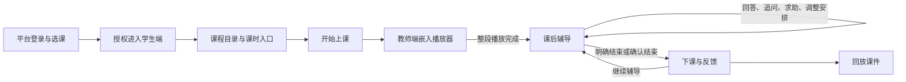
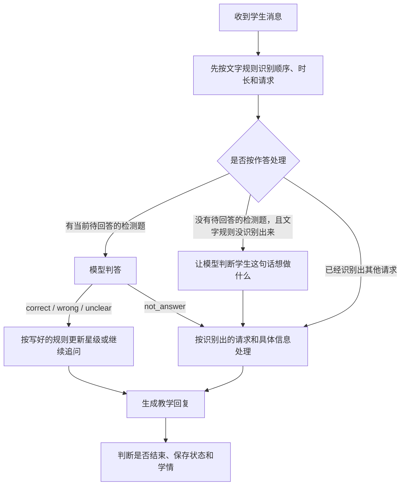

# 学生端运行机制：输入、输出与数据更新

> 核查日期：2026-10-21。依据当前工作区代码，包含尚未提交的学生桥接与评价适配更新。
> 本文描述实际实现。主流程之外的实现边界集中列在第 10 节；不把历史 README、旧机制草稿或代码注释直接视为已实现能力。
> 下文源码路径均相对于仓库根目录；定位优先使用函数名。

## 1. 整体机制

学生从平台进入已发布课程，观看教师端播放器中的课件，再与学生 Agent 一对一复习。后端保存课堂阶段、检测题、星级和计划时间；前端根据接口返回的状态显示对应页面。

阅读时可以先这样理解文中的几个词：

| 文中的说法 | 通俗解释 |
| --- | --- |
| 会话 | 学生这一次课堂学习的记录，包含聊天、进度和评分，用会话号找到它 |
| 学习上下文 | 系统收到的这门课资料：学谁的课、有哪些课件、讲什么、有哪些知识点 |
| 教学计划 | 把课程资料整理成程序可以执行的安排：选哪节课、有哪些段落、接下来做什么 |
| 当前待回答的检测题 | AI 已经问出来、正在等学生回答的那道题；代码字段是 `tutoring_question` |
| 按写好的规则处理 | 程序执行事先约定的动作，例如答对后按规则加星、答错后继续追问 |
| 判断学生想做什么 | 区分学生是在答题、求助、想跳过、改时长，还是想结束 |
| 心跳 | 后端每隔一段时间自动检查一次课堂，即使学生没有发消息也会检查 |
| 轮询 | 页面每隔一段时间向后端问一次：进度变了吗，有没有新消息 |
| 工件 | 教师端生成或整理的一份教学内容，例如知识点文件、课件等 |
| 前端／后端 | 前端是学生看到和操作的页面；后端是处理请求、执行规则和保存记录的服务 |

当前默认流程：



这里的“课后辅导”是 `host_phase=tutoring`，仍属于原课堂会话。默认计划 15 分钟，时间到不会自动结束。

| 部分 | 输入 | 主要输出 | 更新责任 |
| --- | --- | --- | --- |
| 平台 | 平台身份、选课关系、教师已发布内容 | 入口令牌、学习上下文、课程进度 | 校验访问资格，聚合学情，向教师端推送学习状态 |
| 教师端播放器 | 对应课时的课堂地址与场景 | 场景完成、整段完成、播放错误事件 | 播放课件，学生适配层把事件转成学习进度请求 |
| 学生端界面 | 用户操作、后端状态、消息和报告 | 页面、聊天、倒计时、掌握条、反馈卡 | 保存浏览器会话标记、切换页面、发送请求 |
| 学生会话服务 | 请求、播放器事件、定时心跳 | 状态快照、AI 回复、报告接口 | 管理会话与并发，调用教学流程控制程序，保存到本地文件和写学情库 |
| 教学流程控制程序 | 教学计划、当前状态、学生消息、时间 | 教学回复、检测题、评分、阶段变化 | 决定本轮怎么教、是否推进、哪些教学状态改变 |
| 大模型 | 不同调用各自的提示词与上下文 | 文案、消息类别（如求助、跳过）、判答结果、回答表现 | 返回候选结果，由代码校验并执行状态更新 |

后端有两条独立的状态轴：

| 状态轴 | 取值 | 含义 |
| --- | --- | --- |
| `lesson_status` | `idle / running / ended` | 等待开始、正在上课、已经结束；决定能否发消息及心跳是否运行 |
| `host_phase` | `uninitialized / intro / guided_learning / tutoring / ending` 等 | 当前教学环节；决定界面和教学安排 |

默认启用 `AGENT_POST_VIDEO_TUTORING`，会把复述、探究、讨论阶段替换为辅导。关闭后使用计划原有阶段；当前平台适配器生成的是“讲解 → 复述讨论 → 深入探究”，并非固定包含全班讨论。

## 2. 从平台进入：身份和会话怎么建立

### 2.1 平台签发入口

接口：`POST /api/v1/courses/{course_id}/student-workspace`。

| 项目 | 实际机制 |
| --- | --- |
| 输入 | 当前平台登录身份、课程 ID |
| 校验 | 课程可访问、选课关系、已有发布版；普通教师不能通过此接口建立学生会话，管理员有部分例外 |
| 输出 | `url`、`launchToken`、`publication`、可选 `classroomId / playerUrl` |
| 令牌内容 | `uid` 用户、`cid` 课程、`rid` 课堂、`pub` 发布信息、`exp` 到期时间、`nonce` 随机值 |
| 更新 | 此步骤签发令牌，不产生教学星级或答题记录 |
| 失败 | 未选课拒绝，课程未发布返回冲突错误 |

令牌采用 HMAC-SHA256 签名。当前验证的是签名与有效期，没有消费 nonce 的一次性核销机制，因此应称“短时效入口令牌”。

### 2.2 浏览器初始化

`StudentApp.js` 从 URL 读取 `launch_token`，保存到 `sessionStorage.__launch_token` 与内存，然后从地址栏移除令牌参数。无令牌时跳回 `/`。

随后调用 `/api/session/start`，把返回的入口会话号保存为 `sessionStorage.__studentSessionId`，再读取课程目录。初始化失败也会返回平台首页。

### 2.3 学生后端创建或恢复会话

接口：`POST /api/session/start`。

| 项目 | 实际机制 |
| --- | --- |
| 后端接收字段 | `launch_token`、可选 `session_id`、`time_scale` |
| 身份来源 | 只从已验证令牌取用户和课程；不接受浏览器自报学生身份 |
| 内容来源 | 调平台 `/internal/student/learning-context`，平台再次校验选课及发布状态 |
| 无显式会话号 | 用用户、课程及后端确定的 `lesson_id` 计算 `plat-<hash16>` |
| 有显式会话号 | 校验格式后优先采用；若已有状态属于另一学生或另一 `lesson_id`，返回 409 |
| 输出 | `session_id`、`status`、`phase`、`available_actions`，本身不开始教学 |
| 更新 | 内存会话、`platform` 身份上下文、`learning_context`、磁盘状态、正式会话行及 `session_started` 事件 |

**当前有两类会话号，不能混为一谈：**初始化入口使用后端派生号；进入具体课堂时，`legacy/app.js` 会读取或生成按课时保存在 localStorage 的 UUID，再显式传给 `/start`。因此后端派生号不等于所有课堂都具备跨设备续聊能力。

另一个当前限制是：前端提交 `lesson_id`，但后端 `StartIn` 没有声明该字段，默认会忽略它。后端匹配请求课时的逻辑因而拿不到该值，会把状态中的 `lesson_id` 设为课程 ID，教学计划再回退选择上下文中的第一个课时。第 10 节说明这对多课时的影响。

## 3. 教学内容和知识点从哪里来

### 3.1 学习上下文

平台返回 `schemaVersion=1` 的上下文：

| 数据 | 内容 | 学生端用途 |
| --- | --- | --- |
| `userId / courseId / courseTitle` | 用户与课程标识 | 绑定身份、展示课程、关联学情 |
| `publication` | 发布包 ID 与版本 | 计划及学情的版本标记 |
| `knowledgePackage.entries` | 显式发布且课堂可见的工件、课时文件、材料 | 提供课程事实材料；材料条目可能只有地址、没有正文 |
| `knowledgePackage.rubric` | 从知识点工件解析的结构化知识点 | 目录、知识点评价说明与辅导编号的来源 |
| `lessons` | 明确绑定课时且已发布的课堂目录 | 课程选课时、播放器地址、场景内容 |
| `classroom` | 当前桥接选择的课堂，现取 `lessons[0]` | 课程级默认课堂 |
| `grounding` | 材料摘录、已发布知识图谱等补充信息 | 平台会返回，但当前内部模型没有承接该字段，不能认为已进入教学提示词 |

只有 `status=published`、`classVisible=true` 且有 `classPublicationId` 的条目进入显式可见内容集合。课时课堂按发布绑定关系解析，不能把一个课时随意绑定到另一课堂。

### 3.2 知识点：当前仅来自已发布“知识点”文件

这是 2026-10-21 当前代码的重要更新。

```text
教师发布知识点课时文件或标记为 knowledge-points 的工件
  → 平台按课时归属选择工件
  → 解析 Markdown
  → knowledgePackage.rubric.knowledgePoints
  → EvaluationContract
  → lesson_plan.knowledge_points
  → 辅导开场、固定编号、掌握条、反馈目录
```

| 环节 | 输入 | 输出及更新规则 |
| --- | --- | --- |
| 选工件 | 已发布 entries 与桥接选定的课时 ID | 优先取 `scope.lessonId` 匹配的知识点工件；全课程只有一份时允许使用该份；有多份但都不匹配则不选 |
| 切分知识点 | Markdown 正文 | 识别二级到六级标题，只将无子标题的末级标题登记为知识点；周次和章节分组不占目录项；代码围栏内的示例忽略 |
| 规范标题 | 末级标题文本 | 去掉“一、二、”式中文序号和“3.1”等阿拉伯序号；同标题分节仅保留第一个 |
| 生成 ID | 规范后的标题 | `kp-` 加标题 SHA1 的前 10 位；同标题保持相同 ID，改标题会变 ID |
| 提取要点 | 该末级标题直接所属的 `-` 或 `*` 列表 | 形成 `expectedConcepts`；每项最多截 200 字符，学生评价适配最多接收前 6 项；不混入兄弟章节 |
| 形成知识点评价说明 | rubric | `knowledge_points`，包含 ID、标题、应会要点和可选常见误解 |
| 缺少有效工件 | 无匹配工件，或正文没有有效的二级至六级标题 | 知识点目录为空；开场明说“没有登记知识点”，按视频内容复习 |

课时文件通常存放在 `lesson.files`，类型在 `publicationPlacement.resourceType`，历史记录也可能只保留 `type=knowledge-points`。独立工件的显式发布类型同样保存在 `publicationPlacement`。桥接必须把两类来源的类型统一转为 entry.resourceType，不能只读取工件顶层字段。

2026-10-21 服务器核查确认：已发布的“现代交换原理”第1周知识点正文有 2466 字符，旧桥接漏传课时文件类型导致 rubric 为空，旧解析器又将全部细目合并为“第1周知识点”一个总标题。修复同时补齐类型转发和末级标题解析，不改教师原稿。

旧课堂重新进入时会重新绑定已验证的平台上下文。若计划目录原本为空，且课程、课时与发布 ID/版本均一致，补齐知识点、评价要点和段落关联；原有课件正文、计时、消息、星级及统计保留，仅清除旧空目录生成的无归属检测题。已有非空目录不自动重排，跨课时或跨发布版不迁移。

修复已通过 [PR #28](https://github.com/huanche/agentic-class-pilot/pull/28) 上线，服务器版本 `a7b3e26`。在线 learning-context 实测下发第1周的9个知识点，学生前端构建指纹一致；2份旧空目录会话副本均可补齐且保留原学情。本次验证没有写入测试学情。

**不会再用场景大纲、知识图谱、文件名、材料名或课程名补造一份知识点目录。**适配器兼容顶层 `evaluation` 评价说明，但当前平台正常链路下发的是上述工件解析出的 rubric。

例子：

```markdown
## 一、时间片轮转
- 每个就绪进程轮流获得一个时间片
- 时间片用完后重新进入就绪队列
```

输出为一个名为“时间片轮转”的知识点，含两个应会要点。学生看到的是目录编号“1”，内部保存的是标题生成的 `kp-...` ID。复习顺序变化不会给知识点重新编号。

### 3.3 学习上下文转教学计划

这一层负责把“平台给的课程资料”整理成“学生 Agent 可以执行的教学安排”，不是让 AI 重新备一遍课。例如平台给了 5 页课件和 3 个知识点，程序就整理出 5 个教学段落、3 个知识点及其要求，并安排视频之后进入哪个环节。播放器、辅导和报告再读取这些整理好的内容。

实现：`apps/integration/course_adapter.py::load_plan_for_session`。

| 输入 | 处理 | 输出／更新 |
| --- | --- | --- |
| 课时课堂的 scenes 和 actions | 按场景排序，提取 speech 文本 | 每场景一个 segment，带场景 ID、标题、讲解正文 |
| 没有有效课堂的知识包 entries | 转为文字段落 | 每条 entry 一个 segment；不代表当前前端具备完整纯文本授课体验 |
| 课时 ID | 优先匹配；匹配不到选第一个课时 | 决定计划的课时、场景与标题 |
| 结构化知识点 | 转为 `id/title/expected/misconceptions` | 写进计划；注册知识点标题，供回复与报告显示 |
| 段落标题和正文 | 匹配知识点标题或应会要点 | 写段落的 `knowledge_point_ids`；仅有一段且无匹配时，关联全部知识点 |
| 段落数量 | `max(20, 5 × 段落数)` | 得到估算总课时，再分配旧阶段预算 |
| 已发布 entries | 转为 `knowledge_sources` | 供教学提示词挑选相关正文 |

计划只在教学流程控制程序 `uninitialized` 时加载。正常轮询和发言不会重新从教师端取计划。再次 `/start` 会重新拉取学习上下文，因此“计划首轮缓存”与“所有内容严格冻结”应区分，见第 10 节。

## 4. 课程页面与视频讲解

| 部分／触发 | 输入 | 输出 | 更新什么 |
| --- | --- | --- | --- |
| 课程目录 | 入口会话 ID | 课程、周次、课时标题、估算时长、知识点名称 | 读取已有上下文；不查询或生成新的课程内容 |
| 课时详情 | `lessonId + sessionId` | 课时摘要、段落、`classroomId / playerUrl` | 为界面和播放器准备数据 |
| 开始上课 | `POST /{sid}/begin` | `running`、首阶段及动作列表 | 加载并校验计划，设置开始时间、初始阶段、已有知识点掌握星级；记录 `lesson_began` 并通知平台 started |
| 嵌入视频 | 课时 `playerUrl` | iframe，附加 `embedded=player` | 显示教师端场景画布；学生端不再实现一套课件播放器 |
| 单场景播完 | `SCENE_COMPLETED` 的 sceneId、eventId | `media/done`，`final=false` | 写场景播放进度及事件；不运行教学推进 |
| 整段播完 | `PLAYBACK_ENDED` 或 `CLASSROOM_COMPLETED` | `media/done`，`final=true` | 将计划全部段落记入 `played_media`，进度位置置到段落总数，推进到辅导 |
| 视频中主动提问 | 学生消息 | 基于本课上下文的回答 | 记录对话；不改变视频进度或自动结束讲解 |
| 回放 | 已结束课时的回放入口 | iframe 附加 `replay=1` | 当前前端回放路径不向学生 Agent 上报完成事件，不推进辅导或加星 |

适配器核对 postMessage 的来源 origin 和 iframe window；整段结束在单次挂载内只触发一次。播放器错误交给界面显示，不当作视频已完成。

视频阶段不会因时间预算耗尽而跳走。AI 在心跳轮静默；只有学生主动提问才回答。辅导开场直接输出预先写好的开场文字，不等待模型润色。

## 5. 课后辅导：每条消息如何处理

### 5.1 进入辅导的初始化

整段播放完成后，后端把 `host_phase` 切为 `tutoring`，设置默认复习分钟数和 `tutoring_planned_end_at`，输出固定编号知识点列表，征询顺序、不懂的点和计划时长。学生可以省略全部安排。

辅导开场不调用模型，通常没有当场出检测题；后续学生消息触发安排和出题。

### 5.2 复习顺序和时长由谁识别、谁保存

**程序负责保存，模型只在需要时帮助理解学生的话。**具体过程：

1. 先用写好的文字匹配规则识别。例如“先 2 再 1”可直接提取知识点顺序，“复习 10 分钟”可直接提取时长，不必调用模型。
2. 文字规则没识别出来时，可以让模型返回“调整顺序”或“改时长”以及编号、分钟数；有待回答检测题时，也可能由同一次判答返回这些信息。
3. 程序校验编号是否存在、时长是否在 1–240 分钟内，再写入 `tutoring_order`、`tutoring_planned_minutes`、`tutoring_planned_end_at`。
4. 会话服务把状态保存到 `runtime/sessions/<sid>.json`，同一会话后续轮次读取这些字段安排复习、计算倒计时。模型自己不保存这些数据。

本次已移除星级自评功能：开场不再征询自评，消息规则和模型分类不再识别自评类别，掌握条与反馈卡不再展示自评，状态与反馈接口也不再返回自评字段。系统根据实际作答给出的星级继续保留。

历史自评不迁移保留：平台 `final09` 迁移删除掌握度表的自评列，并递归清除历史报告和事件中的结构化自评字段；`student_agent/scripts/remove_self_assessment.py` 清除本机 sessions、integration JSON 中的同类字段。旧状态保存、恢复以及旧报告读取也会过滤这些字段，避免重新返回。原始聊天文本和其他学情不在本次删除范围内。

### 5.3 一条消息的处理顺序

统一接口：`POST /api/session/{sid}/message`，请求体 `{ "text": "..." }`。



图中“按写好的规则更新星级或继续追问”，原先使用的技术说法是“确定性更新”。意思是：**模型先给出判断，程序再按事先写好的规则执行动作。**例如模型判断“答对”，程序按表现和提示情况记录掌握程度，并安排下一题；模型判断“答错”，程序再检查这是第几次答错；第一次就记录错误、保留原题并继续追问。模型判断本身可能出错，“确定性”不表示答案判断百分之百正确，也不表示最后的追问文字完全固定。

图中“让模型判断学生这句话想做什么”，原先叫“模型意图分类”。例如学生说“这题先放一下，换个讲讲”，模型需要判断这句话是在要求跳过，而不是在回答题目。模型返回“跳过”这个类别后，程序执行切换题目的规则。若学生说“我再学十分钟”，模型还可能提取“10 分钟”这个具体信息。程序会检查这些信息是否有效，再决定是否更新。

常见类别可以这样理解：

| 学生的话 | 要识别的请求 | 后续动作 |
| --- | --- | --- |
| “我不会，能再解释一下吗？” | 求助 | 讲解或引导，不直接算答错 |
| “这题跳过吧” | 跳过 | 转向下一个知识点，不加星 |
| “我想再复习十分钟” | 改时长 | 校验时长后更新计划结束时间 |
| “今天差不多了” | 可能想结束 | 如果由模型识别出结束请求，先让学生确认 |

这些例子用于说明类别含义，不保证每种说法都必须经过模型。程序会先用文字匹配规则识别常见表达；识别不出来时，才让模型补充判断。有当前待回答的检测题时，模型也可能在判答的同一次调用中返回“这不是作答，是其他请求”，从而省去一次单独分类。

按文字规则识别消息时，处理优先级为：结束 → 跳过 → 改时长 → 选顺序 → 追问 → 求助 → 都没识别出来时先按作答处理。顺序、时长在分流前分别提取，所以同一句可以先记录多项安排，再由优先级决定本轮主行为。

### 5.4 各类输入、输出与更新

| 学生输入／想做的事 | 输出 | 更新字段 | 不会直接更新的内容 |
| --- | --- | --- | --- |
| “先 2 再 1”等顺序 | 确认顺序，余下目录按原序补齐 | `tutoring_order`、当前正在讲的知识点；后续按进度位置处理题目 | 系统星级 |
| “复习 10 分钟” | 确认新安排 | `tutoring_planned_minutes=10`，结束时间从本条消息重新计算 | 不累计在原结束时间后，也不直接下课 |
| 主动追问 | 模型讲解或答疑；失败时用预先写好的基础回复 | 对话记录，可能保留原来等待回答的检测题 | 不因提问直接加星 |
| 求助、要求再讲 | 模型提供帮助；失败时用预先写好的基础引导语 | 对话记录，原题通常保留 | 当前求助分支没有统一把 `hint_given` 改为 true，见第 10 节 |
| 正在答检测题 | 判为 correct、wrong、unclear 或 not_answer | 按下一节规则更新题、星级、统计 | 未通过判答不凭空加星 |
| “跳过”“下一个” | 下一知识点的新题；末尾则询问是否还有问题 | 进度位置、当前正在讲的知识点、当前待回答的检测题、已见题清单 | 不当作答题，不加星 |
| 明确结束短语 | 进入下课 | `ending / ended`，触发课时完成与辅导反馈 | 不受计划时长未到限制 |
| 仅模型识别为结束 | 先请求确认 | `tutoring_end_confirm_pending` | 不立即结束 |
| 确认结束 | 本轮下课 | `tutoring_end_confirmed` 被阶段切换程序使用 | 无需再等待一轮心跳 |
| 拒绝结束 | 继续原题或对话 | 清待确认标记 | 不清已有星级、证据和安排 |

程序会检查模型提取的具体信息，包括编号范围、时长 1–240 分钟等；无效值不用于对应状态更新。文字规则与模型识别的具体覆盖范围不同，不能认为任意自然语言安排都能准确识别。

### 5.5 出题、判答与推进

| 环节 | 输入 | 输出 | 更新规则 |
| --- | --- | --- | --- |
| 出题 | 当前知识点标题、应会要点、已见题干、基础／应用题类型 | 一道口头检测题 | 优先模型生成；失败从对应类型的备用题中选择，耗尽后允许复用旧题 |
| 新旧题判定 | 候选题干、`tutoring_asked` | `was_fresh` | 代码按题干精确字符串比较；语义相似性主要靠模型提示词约束 |
| 当前待回答的检测题 | 知识点、题干、时间、题目类型 | `tutoring_question` | 保存 `kp_id / question / kind / asked_at / hint_given / was_fresh / wrong_count`；题干加入已见清单 |
| 判答 | 原检测题文本、学生回答 | `correct / wrong / unclear / not_answer`、一句依据、可选的请求类别与具体信息 | 解析失败或模型不可用返回 unclear |
| 答对 | 原题及表现依据 | 说明当前掌握情况；通常继续下一知识点 | `correct` 计数加 1，有提示则 `hinted_correct` 加 1；掌握星按本次表现评估，不按次数相加；清原题，进度位置加 1，尚有知识点则出新题 |
| 第一次答错 | 当前题及表现依据 | 同题追问、提示；记录核心错误或部分理解 | `wrong` 加 1；`wrong_count=1`、`hint_given=true`；不降星 |
| 连续答错 | 已错过的原题 | 讲解后换同知识点的新题 | `wrong` 加 1；新题 `wrong_count=0`、`hint_given=false`，重新计算新旧题标记 |
| 无法判断 | 太简短或解析失败等 | 请学生说详细一点 | 保留原题，不加星、不计 correct/wrong |
| 并非作答 | 判答器返回 not_answer | 交给处理这类请求的代码 | 执行跳过、求助、改时间等，不强行判对错 |

**上下文范围要区分：**通用教学回复会使用已发布材料、场景正文及应会要点。普通辅导出题、连续答错换题和跳过后的出题均接收知识点应会要点；判答接收题干、题目类型、提示标记、应会要点和答案。这不代表每次都带上课程全部原文。

### 5.6 唯一的知识点掌握星级

**掌握条、聊天中的下课小结、学情报告、辅导反馈卡和数据库，都使用 `kp_stars` 这一份记录。**不再维护独立的 `tutoring_stars`，下课也不再让模型另打一次分。

星级表示掌握程度，不表示答对次数：

| 星级 | 表示什么 | 什么表现可以证明 |
| --- | --- | --- |
| 0 星 | 未检测 | 还没有足够的有效回答；观看视频不自动给掌握星 |
| 1 星 | 需要重新理解 | 学生尝试回答，但核心概念明显有误 |
| 2 星 | 理解了一部分 | 能说对部分内容，但缺少关键点 |
| 3 星 | 提示后能说清 | 经过提示或讲解，能够正确回答 |
| 4 星 | 能独立说清 | 无提示，能够正确解释核心内容 |
| 5 星 | 能灵活应用 | 在未见过的新情境中无提示应用知识，并说明理由 |

具体执行过程：

1. **程序选题。**当前知识点不足 4 星时通常出核心解释题；已有 4 星、再次选择或轮到该知识点时出新情境应用题。题目类型由程序保存为 `basic / application`，不是让模型临时自封应用题。
2. **模型判断回答表现。**在判答 JSON 中返回 `verdict`、`performance`、具体依据 `note`。表现类别为 `incorrect / partial / understood / transfer`；应用表现还需返回学生推理 `reasoning`。模型不直接决定或写入星级数字。
3. **程序检查并映射星级。**核心错误对应 1，部分理解对应 2，提示后正确对应 3，无提示解释清楚对应 4。要到 5 星，必须同时满足：应用题、未见题、无提示、模型判断应用正确且提供推理依据。
4. **无有效依据不评分。**无法判断、回答太短、输出格式不对、缺少合法表现类别或依据时，不改星级，不凭“correct”一个词就加分；无有效知识点也不写掌握记录。
5. **有过更好表现时不因一次失误扣星。**保存当前已有星级与本次表现中的较高值，不按答对次数累加。已有 3 星及以上后连续两次有效判错，会保留原星级并标记“需要再确认”；后续无提示表现达到原水平后清除此标记。
6. **提示必须记账。**学生求助或追问当前题后，原题会记为已提示；此题后续答对最多证明 3 星。以后独立回答另一道题仍可达到更高水平。
7. **证据随评分保存。**每次有效评估追加到 `mastery_history`，记录题目、学生回答、表现类别、评分依据、题目类型及是否提示。`mastery_updates` 用于写正式掌握度，不会再被下一步空结果覆盖。

例子：第一次就独立解释清楚，可以从未检测直接到 4 星；同样的基础题再答对一次仍是 4 星；只有后续的新情境应用证据满足条件，才达到 5 星。提示后答对可以达到 3 星，不需要连续答对三题。

`tutoring.stars` 为了供掌握条按固定编号显示，会把 `kp_stars` 的知识点 ID 转为目录编号；反馈的 `system_stars` 和导出的 `stars` 只是同一份数据在不同响应里的字段名，不是第二套分数。

旧会话恢复时以原学情报告使用的 `kp_stars` 为准，移除旧独立辅导星字段，不将两套分数相加、不回溯调用模型改分。`student_agent/scripts/unify_mastery.py` 可批量转换本机旧会话。新记录采用 `knowledge-mastery/2` 标记。旧数字是沿用的历史记录，不能据此声称旧评估已重新按新版量规审核。

## 6. 时间、轮询与前端状态更新

| 机制 | 输入 | 输出／更新 | 触发频率 |
| --- | --- | --- | --- |
| 后端心跳 | 当前时间、旧状态，无学生消息 | 更新阶段用时、整课用时；必要时检查推进 | 默认 10 秒，`AGENT_TICK_SECONDS` 可改；只处理 running 会话 |
| 前端课堂轮询 | 当前课堂 sid、消息进度位置 | 读取 `/state` 与 `/messages`，更新阶段、消息、掌握条 | 课堂页面每 2 秒 |
| 消息增量 | `since` | 内存消息数组从 since 开始的切片及 total | 随轮询；前端依据 seq 与进度位置防止 POST 和轮询重复显示 |
| 辅导倒计时 | 服务端 `planned_end_at / remaining_seconds` | 本地每秒更新文本，下次轮询再校准 | 每秒显示、每两秒校准 |
| 阶段切换 | `/state.phase` 或请求返回 phase | 切对应面板；播完后移除播放行动条 | 接口成功或轮询发现变化时 |
| 本地完成标记 | 后端 ending 等信号 | localStorage 的 `ai-learn.lessonEnded.<lessonId>` | 影响课时入口去课堂还是报告页 |

`/state` 的 tutoring 块包含：固定编号目录、复习顺序、当前编号、知识点掌握星级、当前待回答的检测题、计划分钟数、计划结束时间、剩余秒数、评分量规。

界面判断当前正在讲哪个知识点时，优先读取 `tutoring_active_kp`；没有有效值，就看当前待回答的检测题属于哪个知识点；仍无法确定，再根据复习顺序和进度位置推算。因此设置空值并不始终意味着前端完全不高亮。

时间到以后，辅导心跳保持静默；提醒通常在学生下一条消息的回复里出现，不是到点自动弹消息。预算到期且没有当前待回答的检测题时，“没有了”“可以了”等特定短确认也能作为结束信号。

## 7. 下课、报告、继续辅导

### 7.1 结束有不同路径

| 路径 | 更新与输出 |
| --- | --- |
| 辅导对话中的明确结束／确认结束 | 阶段变 ending、课堂变 ended；生成课时报告，并由 `/message` 的阶段前后对比额外生成辅导反馈 |
| `POST /end` | 无条件直接进入 ending；保留的控制接口，不受最短阶段时间限制；不经过 `/message` 的辅导反馈生成分支 |
| `POST /stage/next` | 按剩余阶段切换；辅导通常剩余阶段为空，因此也可能下课 |
| `DELETE /{sid}` | 停掉心跳并将 lesson_status 记 ended；保留磁盘状态与导出能力；不等同于正常辅导结束反馈流程 |

因此“学生明确结束”是默认辅导对话主出口，不能扩展成“系统任何入口都不允许其他方式结束”。

### 7.2 下课小结如何生成

结束时只读取当前掌握记录，不再调用整课重新评星函数。模型可以依据已有星级、薄弱点组织回顾和建议，但提示词明确禁止改分。数值星级由程序按 `kp_stars` 固定列出；模型若返回另一组星级文字，就退回程序生成的小结。模型不可用时也按已有记录生成小结，星级不变。

### 7.3 两类报告

| 报告 | 输入 | 输出 | 存储更新 |
| --- | --- | --- | --- |
| 课时完成报告 `lesson` | 整课时间、`kp_stars`、阶段快照、播放素材、发布标记 | 课时学情摘要 | `after_class_reports` 中该会话的 lesson/version=1，重复写会覆盖；并写 ended_at、`lesson_ended`，通知平台 ended |
| 辅导反馈 `tutoring` | `kp_stars`、逐题证据、题目与统计、计划结束时间等 | 每点终值星级、证据、用时、出题数、对错统计、未完成题、建议、教师摘要 | 每次从 tutoring 经 `/message` 切到 ending 追加一个版本；续聊后再结束可产生下一版 |

反馈结构 `tutoring-feedback/2` 的主要字段：

| 字段 | 含义 |
| --- | --- |
| `knowledge_points[]` | `no / kp_id / title / system_stars / evidence / needs_review` |
| `planned_minutes / actual_minutes` | 计划时长与按计划剩余时间反推的用时 |
| `asked_questions` | 已见题清单长度；不是所有学生回答的次数 |
| `stats` | `correct / wrong / hinted_correct` |
| `unfinished_question` | 结束时仍未答完的检测题题干 |
| `advice` | 当前掌握星级 ≤2 或标记需要再确认的知识点优先复习；否则输出均衡建议 |
| `trigger / generated_at` | 结束触发文本与生成时间 |

`actual_minutes` 目前由“当前计划分钟数－剩余分钟数”计算，超时会封顶在计划时长；改时长会重设计算基准。它不是独立累计的真实聊天时长。

### 7.4 报告页与继续辅导

课后页分别读 `/export?fmt=json` 与 `/tutoring-report`。两者星级都取当前会话的 `kp_stars`；最新反馈即使是旧版本，也会按当前掌握记录投影知识点星级和建议，报告页每次进入重新读取，避免续聊后显示旧分；教师摘要保存在服务端及接口返回值中，当前学生反馈卡不渲染它。

“继续辅导”调用 `POST /resume-tutoring`：

- 要求原阶段是 ending，且有进入过辅导时设置的计划结束时间，否则返回 409。
- 将阶段拉回 tutoring、课堂恢复 running、学生状态恢复 active。
- 清待结束确认和已确认标志，更新本阶段开始时间。
- 保留顺序、星级、原计划结束时间、已见题、统计及当前待回答的检测题；已经到期的倒计时不会自动重新给 15 分钟。
- 前端清除本地结束标记，重置内存阶段后打开课堂。再次正常结束会生成新版反馈。

继续辅导时会复位完成保存标记，并在需要时重新启动心跳。再次结束会刷新课时完成报告、发送完成通知，并追加新版辅导反馈。

“查看课程反馈”入口受本地课时完成状态影响，当前用于打开课时反馈，不代表存在跨全部课时汇总的课程级综合报告。

## 8. 数据最终更新到哪里

### 8.1 三层存储

| 存储层 | 存什么 | 写入时机 | 恢复边界 |
| --- | --- | --- | --- |
| 浏览器 sessionStorage | 入口令牌、入口会话号、页面持续打开标记 | 初始化入口和页面加载 | 标签页会话范围；不是服务端学情真值 |
| 浏览器 localStorage | 每课时课堂 sid、本地已结束标记 | 选择课时、创建课堂、结束或重新打开 | 当前浏览器保存；换设备不会自动获得这些 UUID 与标记 |
| 服务端内存 `SESSIONS` | state、界面消息数组、锁、心跳、同步进度位置、反馈缓存 | 收请求及每轮教学处理 | 随进程结束丢失，部分数据可由下两层恢复 |
| `runtime/sessions/<sid>.json` | 完整 state，包括计划、题目、星级、整课 dialogue_log 等 | 创建、每轮教学处理、继续辅导、停课 | 能恢复教学进度与状态；不包含包装层 messages、反馈缓存、同步标记 |
| PostgreSQL `student` schema | 正式会话、消息、事件、播放、掌握度、报告 | 对应业务事件及本轮教学处理结束 | 报告有读取接口；界面消息没有自动从正式库回填的恢复路径 |
| `runtime/integration/*.json` | 显式 demo 模式的部分学情替代存储 | `STUDENT_DEMO_MODE=true` 时 | 开发用途，不应视为正式数据库失败后的自动替代方案 |

学生数据库连接既写学情，也会在计划初始化时读取已有知识点掌握度；它不承担课程内容读取。课程内容仍走平台 learning-context。

### 8.2 正式表与更新键

| 表 | 写什么 | 唯一键／更新规则 |
| --- | --- | --- |
| `student_sessions` | 用户、课程、发布版、课堂、活动与结束时间 | `session_key`；重入 upsert 主要更新 last_active_at，结束写 ended_at |
| `student_messages` | 学生与 AI 文本、阶段、序号 | `(session_key, seq)`，冲突忽略；同会话重建后读取库中最大 seq 接着写 |
| `learning_events` | session_started、lesson_began、student_message、media_done、lesson_ended、tutoring_question、tutoring_answer、tutoring_feedback 等 | `(session_key, event_type, event_id)`，冲突忽略 |
| `playback_progress` | 哪个场景完成、可选段落 | `(session_key, scene_id)`，冲突忽略；不是精确到秒的断点播放记录 |
| `knowledge_mastery` | 知识点掌握星级、状态、最近证据、来源 | `(user_id, course_id, publication_id, knowledge_point_id)`；星级取较大值 |
| `after_class_reports` | lesson 报告与 tutoring 多版本反馈、教师摘要 | `(session_key, report_kind, version)`；lesson 覆盖固定版，tutoring 追加版本 |
| `task_submissions` | 任务提交预留表 | 当前主课堂接口没有任务提交写入链路，不能把它算成每轮自动更新项 |

同标题稳定 ID 只解决知识点标识稳定；掌握度唯一键仍包含 publication_id，不能据此推断不同发布 ID 间自动继承全部星级。

写学情失败通常记录日志并继续课堂；当前没有统一的持久化重试队列。最新辅导反馈在当前进程内有缓存，若入库失败后进程又重启，不能保证仍可查询。

### 8.3 学生数据如何影响平台与教师端

开始和首次完成课堂时，学生服务调用平台 `/internal/student/learning-progress`。平台从 student 表重新统计，再调用教师端 `PUT /api/classes/{courseRef}/students` 更新授课管理镜像；推送失败不阻断课堂。

| 字段 | 当前计算方式 | 阅读时要注意 |
| --- | --- | --- |
| `totalLessons` | 课程下已发布且有关联 classroomId 的工件数 | 不完全等于学生目录中去重后的可见课时数 |
| `learnedLessons` | 学生会话中不同 classroom_id 数 | 建立会话就可能计入，不要求视频播完或课时 ended |
| `percent` | learnedLessons / totalLessons，四舍五入并封顶 100 | 属于当前平台课程进度口径，不是答题正确率或视频观看百分比 |
| `sessionCount / endedSessions` | 总会话数／ended_at 非空会话数 | 与不同课堂数不是同一指标 |
| `stars` | 课程掌握度表 stars 求和 | 正式库掌握记录求和，可能覆盖多个发布 ID；各知识点与学生端使用同一评分来源，但课程聚合范围不同 |
| 教师镜像 `status` | learnedLessons 达到 totalLessons 则 completed，否则 learning | 当前实现并非按所有课堂明确结束判完成 |

平台“我的课程”学习概览也复用这套统计。前端 localStorage 的课时完成标记是另一套页面导航依据，不能与平台进度混用。

## 9. 后端每轮执行链与接口速查

### 9.1 处理一条消息或一次定时检查的顺序

```text
会话服务 _step：获取会话锁，注入平台上下文、时间、消息或外部事件
  → load_plan：仅首次初始化课程计划
  → tick：更新时长，清本轮临时结果
  → load_context：组装教学背景
  → classify_turn：选择主持事件或教学轮
      → host_event → judge_advance
      → teach → judge_mastery → judge_advance
  → 如需推进，执行 advance_stage：写快照、换阶段或下课
  → write_state：当前为空占位节点
  → format_reply：组织回复，追加 AI 到 state.dialogue_log
会话服务：回收 state，追加界面消息，同步学情，保存 state JSON
```

会话锁防止心跳与发言并发覆盖教学进度与状态。用户主动停课后，正在执行的旧轮次会检查停止标记，避免把 ended 覆盖回 running。

平台个人模型配置在会话第一轮尝试获取，未配置或失败时使用 `AGENT_LLM_*` 环境配置。配置只对当前轮线程生效。

通用教学上下文从已发布正文挑最多 10 段相关片段，并控制序列化内容长度；不是每次都把平台响应里所有材料原样交给模型。

### 9.2 学生服务接口

以下路径以 `/api/session` 为前缀。

| 方法与路径 | 输入 | 输出 | 主要更新 |
| --- | --- | --- | --- |
| `POST /start` | token、可选 sid、倍速 | 会话 ID、状态、动作 | 建立／恢复并绑定学习上下文 |
| `GET /courses?sessionId=...` | 入口会话号 | 课程和课时列表 | 读取；可能预加载磁盘会话 |
| `GET /lesson?lessonId=...&sessionId=...` | 课时与上下文会话号 | 详情、播放器地址 | 读取 |
| `POST /{sid}/begin` | sid | 开始后的轮次结果 | 计划、时间、阶段、开始事件与平台通知 |
| `POST /{sid}/media/done` | scene_id、segment_id、event_id、final | 当前阶段与轮次结果 | 进度；final=true 额外运行推进 |
| `POST /{sid}/message` | text | 回复、phase、综合 stars、total | 对话、辅导状态、判答事件；结束时生成反馈 |
| `GET /{sid}/state` | sid | 完整界面状态及 tutoring 块 | 读取，不驱动新一轮教学 |
| `GET /{sid}/messages?since=0` | 消息进度位置 | 消息切片、total | 读取内存消息数组 |
| `POST /{sid}/stage/next` | sid | 下一阶段 | 强制推进 |
| `POST /{sid}/end` | sid | 下课结果 | 直接下课及课时完成 |
| `POST /{sid}/event` | type 及事件字段 | 对应事件结果 | 转发 begin/media_done/next_stage/end_lesson |
| `POST /{sid}/resume-tutoring` | sid | tutoring、running | 恢复辅导、清确认状态 |
| `GET /{sid}/tutoring-report` | sid | 最新 version、payload、teacher_summary | 优先读内存缓存，再读正式库或 demo 文件；无报告 404 |
| `GET /{sid}/export?fmt=json` | 格式，亦支持 Markdown | 当前会话学情导出 | 从当前 state 生成，不等同于直接读数据库 lesson 报告 |
| `DELETE /{sid}` | sid | stopped、ended | 停心跳、保存到本地文件并尝试课时完成 |
| `GET /health` | 无 | 健康信息 | 读取 |

### 9.3 失败时如何处理

| 失败位置 | 当前输出或行为 | 已有数据如何处理 |
| --- | --- | --- |
| 入口令牌无效或过期 | start 拒绝，前端初始化失败后返回平台 | 不以浏览器传入身份绕过校验；重新从平台进入获取令牌 |
| 平台不可用或课程资料的数据格式不符合要求 | 返回错误，不拿本地示例内容开课 | 保留已有会话文件；本次新课不能正常启动 |
| 计划段落为空、阶段预算等校验不通过 | 输出开课失败，进入结束状态 | 不继续正常授课 |
| 模型无法判断学生想做什么，或返回格式无法读取 | 按文字规则处理，并使用预先写好的基础回复 | 无可靠判答时不加星 |
| 辅导出题模型失败 | 轮换使用预先准备好的备用题目 | 已见题清单照常记录，新旧题标记照常计算 |
| 判答模型失败 | unclear，要求补充说明 | 原题保留，正确／错误计数不变 |
| 通用回复模型失败 | 辅导使用预先写好的基础回复；视频问答可能显示模型未接入提示 | 已由代码确定的状态变化仍可保存 |
| 正式学情写入失败 | 通常日志记录，继续课堂 | state 仍尝试保存到会话 JSON，但不代表正式库已补写成功 |
| 辅导报告查询失败或没有记录 | 404；前端可继续展示普通学情报告 | 不自动合成一份新辅导反馈 |
| 教师端状态推送失败 | 平台返回 pushedToTeacher=false 或记录日志 | 学生课堂继续，教师镜像可能滞后 |

## 10. 当前实现边界：后续改动需要特别留意

这些是当前代码仍存在的限制，用于准确解释输入、输出与更新范围；已完成的自评移除和统一掌握星级机制见第 5～7 节。

| 边界 | 代码依据 | 对当前机制的影响 |
| --- | --- | --- |
| 课时选择尚未贯通 | 前端 startSession 发 lesson_id，后端 StartIn 无此字段；plan 匹配不到时取首课时 | 界面可能播放所选课时，但后端计划及桥接 rubric 仍锚定第一课时，不能宣称多课时内容完全对齐 |
| 会话恢复有两种 ID | StudentApp 入口取派生号；legacy 课堂按课时存本地 UUID | 同浏览器刷新可复用课堂 sid；不能保证换设备自动回到原课堂辅导 |
| 浏览器有主动换会话逻辑 | shouldRenewSession 对 ended、新页面打开的 running 或陈旧状态换号 | 新开标签页与刷新不是同一恢复语义，可能建立新课堂会话 |
| 内容版本仅部分固定 | load_plan 首轮缓存；start 又会取最新上下文，令牌 pub 与平台最新包分别使用 | 同一会话重新 start 后可能出现旧计划、新目录与不同发布标记，不能写成严格版本冻结 |
| 状态恢复不等于消息流恢复 | JSON 保存 state；_get/start 恢复包装层 messages=[] | dialogue_log 可保留，但 `/messages` 所读界面流水不会自动从正式库回填 |
| 模型判断仍可能有误 | 程序检查表现类别、依据和题目条件，不自动证明模型理解正确 | 评星依据可追溯，但学科判断质量仍取决于模型；新旧题精确去重也不等于语义去重 |
| 反馈用时不是精确累计时间 | actual_minutes 按计划剩余反推 | 逐题证据现已保存，但用时仍不等于精确累计聊天时长 |
| 无知识点只保证空目录与继续流程 | 出题失败后的备用题目可能使用“刚才视频的内容”及空 kp_id | 不应把这种情况描述成已经具备正式知识点评分与归档能力 |
| 有文字段落不等于完整文字授课 | plan 仍设 video delivery，播放器无 URL 会报错 | “无课堂也可组装上下文”与“纯文本课程完整可学”尚不是同一能力 |

## 11. 主要配置与源码定位

| 配置 | 当前作用 |
| --- | --- |
| `AGENT_POST_VIDEO_TUTORING` | 默认开；视频之后使用 tutoring |
| `AGENT_TUTORING_DEFAULT_MINUTES` | 覆盖默认复习分钟数，否则读量规文件，通常为 15 |
| `orchestrator/rules/TUTORING-RUBRIC.json` | 统一 0–5 星说明与默认分钟数；评分门槛由 mastery.py 执行；进程内有缓存 |
| `AGENT_ALLOW_VIDEO_SKIP` | 默认关；开发时允许界面补发视频完成事件 |
| `AGENT_TICK_SECONDS` | 心跳间隔，默认 10 秒 |
| `AGENT_LLM_BASE_URL / AGENT_LLM_API_KEY / AGENT_LLM_MODEL` | 环境模型配置，平台个人配置可覆盖 |
| `PLATFORM_AUTH_URL / STUDENT_SERVICE_KEY` | 平台内部服务地址与签名／服务认证配置 |
| `STUDENT_DATABASE_URL` | 正式学情库连接；缺失不会自动换成 demo 数据 |
| `STUDENT_DEMO_MODE=true` | 显式开发学情 JSON 存储模式 |

| 想检查的机制 | 源码文件及主要符号 |
| --- | --- |
| 平台入口、上下文、知识点工件解析 | `platform/backend/app/api/routes/student_bridge.py`：open_student_workspace、student_learning_context、_knowledge_artifact_rubric、_knowledge_points_from_markdown |
| 平台课程进度及教师同步 | 同上：_course_learning_progress、report_learning_progress、_push_student_state_to_teacher |
| 入口令牌验证 | `student_agent/apps/integration/launch_context.py`：verify_launch_token、launch_identity |
| 学习上下文与计划 | `student_agent/apps/integration/course_adapter.py`：from_platform_payload、load_plan_for_session |
| 知识点知识点评价说明 | `student_agent/apps/integration/evaluation.py`：from_platform_context |
| 内部数据模型 | `student_agent/apps/integration/models.py`：CourseLearningContext、EvaluationContract、Lesson |
| 教学材料与提示词 | `student_agent/apps/integration/prompt_context.py`：lesson_sources、tutor_context |
| 会话、接口、轮询数据、报告触发 | `student_agent/apps/server.py`：start、_step、send、state、_generate_tutoring_feedback、resume_tutoring |
| 教学流程与辅导规则 | `student_agent/orchestrator/agent.py`：load_plan、teach、judge_mastery、judge_advance、advance_stage、tutoring_public、tutoring_feedback_payload |
| 唯一掌握星级规则 | `student_agent/apps/integration/mastery.py`：assessed_stars、record_assessment、normalize_mastery_state |
| 正式库写入与报告版本 | `student_agent/apps/integration/persistence.py`：各 upsert、append_report_version、read_latest_report |
| 前端平台初始化 | `student_agent/frontend/src/components/StudentApp.js` |
| 前端路由、会话号、轮询、续聊清标记 | `student_agent/frontend/src/legacy/app.js` |
| 前端接口字段映射 | `student_agent/frontend/src/legacy/api.js` |
| 播放器事件转换 | `student_agent/frontend/src/integration/platform-player-adapter.js` 与 `legacy/stage-class.js` |
| 掌握条与辅导反馈展示 | `student_agent/frontend/src/legacy/tutoring-mastery.js`、tutoring-report.js、view-review.js |

核查方式：沿当前代码调用链逐项对照字段与写入点；对关键分支做隔离检查，不调用真实平台或模型，不写入学习会话和学情库。未将本次阅读视为全链路浏览器验收。
