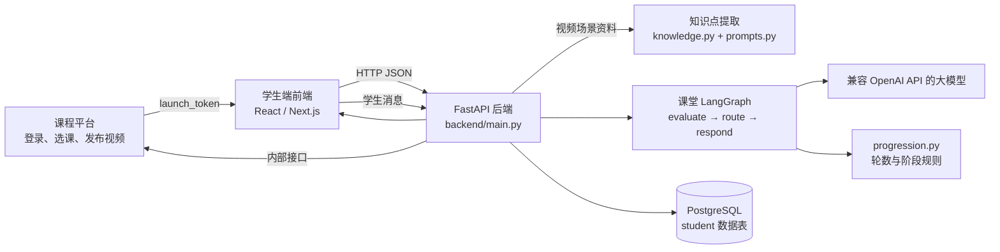
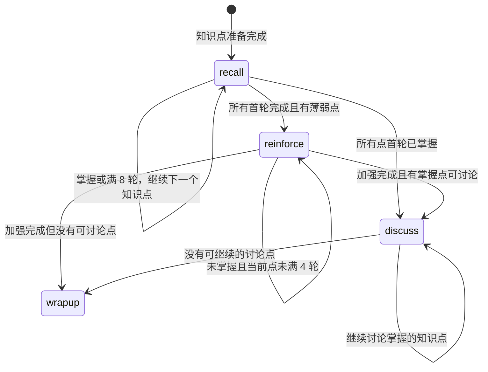

# 学生端 Agent 实现详解

> 面向刚开始读 Python、前端和 AI 项目的同学。本文解释的是当前仓库里的真实实现，代码引用均来自 `student_agent/`。内容重点是 Agent 如何取到课程资料、如何连接后端、每轮对话如何跑、状态怎样跳转，以及对话数据如何保存。

## 0. 先用一句话概括

学生端 Agent 不是一个单独的大模型提示词，而是一条由 **课程平台资料 + FastAPI 接口 + LangGraph 流程 + Python 学习进度规则 + 数据库快照** 组成的服务端教学链路：平台给出当前课时视频资料，后端在后台提取有视频依据的知识点，学生每发一条消息时 Agent 评估回答并生成回复，Python 规则更新阶段，后端最后保存会话和反馈。



## 1. 技术路线与为什么这样组合

### 后端运行技术

| 技术 | 在项目中的用途 | 新手理解 |
|---|---|---|
| Python | Agent、业务规则、API 实现语言 | 写后端程序的语言 |
| FastAPI | `backend/main.py` 提供 HTTP 接口 | 把 Python 函数变成浏览器可请求的地址 |
| LangGraph | 组织每轮 AI 多步骤流程 | 用节点和连线表达“先判断，再更新状态，再回复” |
| LangChain OpenAI Chat | `ChatOpenAI` 兼容客户端 | 统一调用 OpenAI 格式的模型服务；项目默认配置 DeepSeek 地址 |
| Pydantic | 校验请求数据，如消息长度 | 检查前端传来的数据是不是符合约定 |
| psycopg | PostgreSQL 驱动，通过旧持久层使用 | Python 连接 PostgreSQL 数据库的工具 |
| Next.js / React | 学生端前端 | 组织网页、组件和页面状态 |

依赖版本范围见 [`backend/requirements.txt`](../backend/requirements.txt)：FastAPI、Uvicorn、LangGraph、langchain-openai 和 psycopg。`Uvicorn` 负责运行 FastAPI Web 服务。

### 选择 LangGraph 的原因

普通的一次性 AI 问答通常是“收到问题 → 调模型 → 返回文字”。这里需要的不只是问答，还需要：

1. 逐个知识点进行复述；
2. 评估学生本轮是否掌握；
3. 记录已经问了多少轮；
4. 决定继续提示、跳到下一个知识点、进入加强阶段或允许深入讨论；
5. 每轮之后继续保留学生的学习状态。

LangGraph 把一轮拆成有顺序的节点。项目把“语言理解和自然语言生成”交给模型，把“轮数、顺序和跳转”交给 Python 规则。这样模型可以说得自然，但不能自己随意改课程流程。

**本项目没有启用 LangGraph 的 checkpointer。** 图每轮调用时，`main.py` 把数据库/会话里保存的状态传入 `dialogue_graph.invoke()`；得到新状态后，再由 `persistence.py` 保存快照。因此状态恢复由应用自己的会话快照负责，不是 LangGraph 自动存档。

## 2. 代码地图：Agent 相关文件各负责什么

| 文件 | 责任 |
|---|---|
| [`backend/main.py`](../backend/main.py) | 接收前端请求、读取平台上下文、开始后台准备、调用图、将状态交给持久层 |
| [`agent/context.py`](context.py) | 把视频场景的画面文字和讲解旁白整理成 Agent 输入材料 |
| [`agent/knowledge.py`](knowledge.py) | 调用模型提取视频知识点，并检查是否有原文证据 |
| [`agent/prompts.py`](prompts.py) | 规定知识点抽取、学生回答评估、课堂导师及各阶段的行为 |
| [`agent/graph.py`](graph.py) | 定义课堂图、模型调用、evaluate/route/respond 三个节点 |
| [`agent/progression.py`](progression.py) | 用确定性的代码更新知识点状态、轮数和阶段 |
| [`agent/postclass.py`](postclass.py) | 课后补完和自由提问的另一张 LangGraph 图 |
| [`agent/feedback.py`](feedback.py) | 从实际评估历史生成每课反馈 |
| [`agent/persistence.py`](persistence.py) | 保存 Agent 会话快照与学习记录，并在重启后恢复；SQL 函数位于 `database.py` |

命名中的 `agent` 文件夹代表服务端 AI 和教学流程代码。模型调用是在后端执行，浏览器不会直接拿到模型密钥。

## 3. 从平台登录到 Agent 获得视频资料

### 3.1 平台先做登录和课程授权

学生从平台登录、使用选课码加入课程并进入学习。平台将短期 `launch_token` 带到学生端。该 token 表示平台已经确认学生身份和可访问课程。

学生端前端把 token 发给新版后端的：

```http
POST /api/session/start
Content-Type: application/json

{"launch_token":"平台签发的短期令牌"}
```

`backend/main.py` 中 `platform_context()` 再请求平台内部服务：

```python
request = urllib.request.Request(
    base + "/internal/student/learning-context",
    data=json.dumps({"launch_token": token}).encode(),
    headers={
        "Content-Type": "application/json",
        "X-Student-Service-Key": key,
    },
    method="POST",
)
```

几个要点：

- `launch_token` 是学生登录后进入学习的短期凭证。
- `STUDENT_SERVICE_KEY` 是学生端后端访问平台内部接口的服务密钥。
- 服务密钥只保存在后端环境变量中，不能放到 React 前端。
- 平台返回该学生可以访问的已发布课程和课时；学生端后端把它整理成前端使用的 `courses`。

### 3.2 开始课时后读取当前视频场景

前端点“开始上课”调用：

```http
POST /api/session/{sid}/begin/{lesson_id}
```

`begin()` 从已验证的 session 课程列表找到课时，并从平台课堂 `scenes` 整理当前视频材料。正式平台会话走 `lesson_points(context, lesson_id)`：

```python
def lesson_points(context: dict, lesson_id: str) -> list[dict]:
    lesson = next(
        (item for item in context.get("lessons") or []
         if str(item.get("id")) == lesson_id),
        None,
    )
    scenes = ((lesson or {}).get("classroom") or {}).get("scenes") or []
    return classroom_materials(scenes)
```

`classroom_materials()` 对视频场景按 `order` 排序，收集：

- `visibleText`：播放器画面上学生看到的文字；如果缺失，则从场景画布文本元素提取。
- `actions` 中 `type == "speech"` 的文字：教师视频讲解旁白。
- 场景 ID 和场景标题：用于追溯原文证据。

它把每个场景变成如下结构：

```json
{
  "id": "scene:abc123",
  "title": "相干性",
  "content": "画面文字：……\n讲解旁白：……",
  "source": "published-classroom-scene"
}
```

来源字段 `published-classroom-scene` 是一个重要标记：知识点提取只接受当前已发布视频场景，不从其他资料源中凑知识点。

## 4. 知识点提取：模型提出，程序核验

### 4.1 为什么开始上课后不等 AI

在 `backend/main.py` 的 `begin()` 中，后端先保存 `phase="video"` 和 `preparation="pending"`，随后将 `prepare_in_background()` 放进 FastAPI `BackgroundTasks`。前端立即显示视频；后台任务独立执行知识点抽取。

核心结构如下：

```python
commit(session, {
    "lessonId": lesson_id,
    "phase": "video",
    "preparation": "pending",
    "preparationMaterials": materials,
})
schedule_preparation(session, background_tasks)
return state(session)
```

后台准备大致是：

```python
def prepare_in_background(session: dict) -> None:
    try:
        materials = current_materials(session)
        dialogue = prepared_dialogue(materials)
        with session["lock"]:
            commit(session, {
                "dialogue": dialogue,
                "preparation": "ready",
                "preparationMaterials": materials,
                "preparationError": "",
            })
    except Exception:
        # 保存准备失败状态，前端可以显示重试按钮
        ...
```

前端在 `phase == "video" && preparation == "pending"` 时每 2 秒请求 `GET /api/session/{sid}`。准备中不妨碍播放视频；准备完成后“进入复述与讨论”按钮可用。

### 4.2 提示词如何限定知识点

[`agent/prompts.py`](prompts.py) 的 `KNOWLEDGE_EXTRACTION_PROMPT` 要求模型：

- 只从视频画面文字和讲解旁白抽取内容；
- 抽取真正讲解过的概念、原理、关系、方法、条件或步骤；
- 排除导入故事、互动指令、课堂安排、过渡句、未回答的问题；
- 概念名必须来自视频正文，不能凭常识补写；
- 每个概念附上可在原视频材料中逐字找到的连续引用；
- 严格输出 JSON。

模型的输出只是候选结果。`knowledge.py` 的 `validated_points()` 会再次检查：

1. `points` 必须是列表，知识点对象格式正确；
2. `title` 是非空字符串；
3. 每个 evidence 的 `sourceId` 必须对应本课场景；
4. `quote` 必须是该场景 `content` 中逐字存在的连续文本；
5. 知识点 `title` 必须出现在引用原文中；
6. 原文长度要足以解释概念，避免只引用一个标题；
7. 同名知识点去重。

验证通过的知识点结构类似：

```json
{
  "id": "concept:一段稳定哈希",
  "title": "相干性",
  "content": "视频中包含定义或解释的原文片段",
  "description": "视频中包含定义或解释的原文片段",
  "source": "published-classroom-scene",
  "sourceIds": ["scene:abc123"]
}
```

`id` 由标题和来源场景生成，便于对话历史、掌握记录和反馈都指向同一个知识点。`content` / `description` 使用实际视频原文，Agent 不应将未讲过的知识编进本课资料。

如果没有视频场景材料或模型没有抽到有效点，准备会失败或返回空知识点错误；后端不会自行造出几个通用知识点。

## 5. Agent 的状态：整节会话状态和单个知识点状态

读 Agent 最容易混淆的是：**会话阶段**和**知识点掌握状态**是两件事。

### 5.1 会话阶段 `stage`

课堂 Agent 的 `stage` 有四个值：

| stage | 意思 | 当前要做什么 |
|---|---|---|
| `recall` | 首轮复述 | 顺序逐个询问所有知识点 |
| `reinforce` | 加强复述 | 只再询问首轮没有掌握的点 |
| `discuss` | 深入讨论 | 只对已掌握、未被排除的点提应用题或讨论问题 |
| `wrapup` | 课堂对话已完成 | 禁止继续发消息，提示结束本课查看反馈 |

这些值来自程序内部，不会直接当作 UI 页面跳转。前端讨论仍在同一聊天界面，页面标题统一是“复述与讨论”；变化的是后端返回的 Agent 提示词与 `agentStage` 状态。

### 5.2 每个知识点有自己的状态与计数

每个 `point` 会在初始状态里增加若干字段：

| 字段 | 意思 |
|---|---|
| `status` | 当前掌握情况：`unseen`、`mastered`、`partial`、`misconception`、`unanswered`、`unclear` 等 |
| `attempts` | 首轮和加强阶段的总尝试数 |
| `recall_attempts` | 首轮复述已经经过的学生回合数 |
| `reinforce_attempts` | 加强复述已经经过的学生回合数 |
| `recall_done` | 首轮是否处理完（掌握或达到轮数上限） |
| `reinforce_done` | 加强阶段是否处理完 |
| `mastered_in` | 首轮、加强阶段、课后补完等哪个阶段掌握 |
| `excluded_from_discussion` | 是否禁止在深入讨论或出题中使用 |
| `assessment_history` | 每次评估的阶段、轮数、结果、学生原话和证据 |
| `evidence` | 最近一次评估所依据的学生表达 |
| `extended_reinforcement` | 是否需要特别重新讲解概念 |

### 5.3 一份简化后的状态例子

```python
dialogue = {
    "stage": "recall",
    "points": [
        {
            "id": "concept:...",
            "title": "相干性",
            "status": "partial",
            "recall_attempts": 2,
            "reinforce_attempts": 0,
            "recall_done": False,
            "reinforce_done": False,
            "mastered_in": None,
            "excluded_from_discussion": False,
            "assessment_history": [...],
        }
    ],
    "student_text": "我知道它和相位有关系，但不太确定",
    "evaluation": {"intent": "answer", "assessments": [...]},
    "strategy": "hint",
    "transition": "continue",
}
```

注意：模型评估结果会暂时放在 `evaluation` 中；`progression.py` 消费这个结果并更新 point 字段。下一轮时旧的评估会被新一轮评估覆盖，但逐轮历史保留在每个 point 的 `assessment_history` 中。

## 6. 每轮课堂对话如何运行

### 6.1 前端把学生消息发到 FastAPI

前端 `StudentApp.js` 的 `send()` 收集输入，调用：

```http
POST /api/session/{sid}/message
Content-Type: application/json

{"text":"学生输入内容"}
```

`MessageRequest` 用 Pydantic 限制文字长度为 1 到 2000 字符。前端会先显示学生消息并显示三点加载动画，等待后端返回 AI 回复。

### 6.2 后端准备本轮输入并执行图

后端 `/message` 路由主要逻辑：

```python
normalized = normalize(session["dialogue"])
student = {
    "role": "student",
    "text": body.text.strip(),
    "phase": normalized["stage"],
}
dialogue = normalized
dialogue["student_text"] = student["text"]
dialogue["messages"] = session["messages"] + [student]

dialogue = dialogue_graph.invoke(dialogue)

assistant = {
    "role": "assistant",
    "text": dialogue["reply"],
    "phase": dialogue["stage"],
}
commit(session, {
    "dialogue": dialogue,
    "messages": session["messages"] + [student, assistant],
})
```

主线是：

1. 确认当前在 `discussion` 阶段；
2. 迁移旧状态到当前流程版本（`normalize`）；
3. 把学生文本、最近消息、知识点状态一起放入 LangGraph state；
4. 跑完 `evaluate → route → respond`；
5. 保存新的对话状态和两条聊天消息；
6. 返回完整 session state 给前端。

### 6.3 LangGraph 的三个节点

[`agent/graph.py`](graph.py) 定义了图：

```python
builder = StateGraph(DialogueState)
builder.add_node("evaluate", evaluate)
builder.add_node("route", route)
builder.add_node("respond", respond)
builder.add_edge(START, "evaluate")
builder.add_edge("evaluate", "route")
builder.add_edge("route", "respond")
builder.add_edge("respond", END)
dialogue_graph = builder.compile()
```

图的 state 类型 `DialogueState` 声明会在节点间传递的核心数据：

```python
class DialogueState(TypedDict):
    curriculum_version: int
    flow_version: int
    recall_round_limit: int
    reinforce_round_limit: int
    transition: str
    last_point_id: str | None
    stage: str
    points: list[dict]
    messages: list[dict]
    student_text: str
    evaluation: dict
    reply: str
    strategy: str
    discussion_turns: int
```

`TypedDict` 是 Python 的类型说明；它帮助读代码的人和编辑器知道 state 大致长什么样，不会自己替程序做流程跳转。

#### 节点 1：`evaluate()` 评估回答

这个节点调用模型，根据 `EVALUATION_PROMPT` 判断学生是在回答、提问还是表达不清，并对允许评估的知识点返回结果。

评估 JSON 结构：

```json
{
  "intent": "answer|question|unclear",
  "assessments": [
    {
      "id": "必须来自当前允许的知识点",
      "result": "mastered|partial|misconception|unanswered",
      "evidence": "学生表达中支持这个判断的具体内容"
    }
  ]
}
```

模型不能随便评估任何知识点：首轮和加强阶段只评估当前 `focus` 的那个知识点；深入讨论只评估允许讨论的已掌握知识点。`evaluate()` 还会丢弃 ID 不在允许列表、结果值不合法的条目。

评估语义：

- `mastered`：学生独立、准确地解释了核心含义和必要关系。
- `partial`：说对一部分，但缺少重要内容。
- `misconception`：说出了与视频资料冲突的理解。
- `unanswered`：明确表示不会、不记得或要求跳过。
- `unclear`：模型无法据此评估；例如只说“嗯”“懂了”。该值是 intent/程序状态的一种表达，评估列表中不会作为有效 assessment result 保存。

模型评估只是输入。程序会校验 JSON、评估 ID 和枚举值；AI 回复失败或格式错误时 API 返回错误，前端保留输入以便重试，不会把失败请求记录成已完成的一轮。

#### 节点 2：`route()` 更新阶段

这个节点不调用模型：

```python
def route(state: DialogueState) -> dict:
    return advance(state)
```

`advance()` 会读取上一节点的评估结果，并更新尝试次数、掌握状态、当前点是否完成，以及 `stage`、`transition` 和 `strategy`。

#### 节点 3：`respond()` 生成自然语言回复

`respond()` 按新的 `stage` 选取系统提示词：

```python
system = "\n\n".join((
    TUTOR_PROMPT,
    STAGE_PROMPTS[stage],
    STRATEGY_PROMPTS.get(state["strategy"], ""),
))
```

同时向模型传入 `focus`、允许范围、切换原因、轮数、最近消息、学生本轮表达和是否重点加强等数据。最后生成回复文字写回 `state["reply"]`。

如果 `stage == "wrapup"`，程序直接返回结束提示，不再调用模型继续追问。

## 7. 阶段跳转规则：具体到每个分支

轮数配置默认值：

```python
recall_round_limit()     # 默认 8
reinforce_round_limit()  # 默认 4
```

环境变量分别为 `STUDENT_AGENT_RECALL_ROUNDS` 和 `STUDENT_AGENT_REINFORCE_ROUNDS`，有效范围被限制在 1–20。开始时的 `initial_state()` 将知识点设为 `unseen` 并通过 `normalize()` 填充计数和流程版本。

### 7.1 首轮复述 `recall`

`current_point()` 找第一个 `recall_done == False` 的知识点。每个学生发言都算一次首轮尝试，即使学生明确说不会或提出问题也会增加本轮计数。

| 本轮结果 | 程序更新 | 之后发生什么 |
|---|---|---|
| `mastered` | 状态设为掌握，标记 `mastered_in="recall"`，两阶段都设完成 | 提前转到下一个知识点 |
| `partial` / `misconception` / `unanswered` / 不清楚 | 首轮计数 +1 | 未达到 8 轮时继续当前点，并选择提示或纠错策略 |
| 不是掌握且达到 8 轮 | `recall_done=True` | 记录为待后续加强，先去下一个知识点 |

当所有知识点的 `recall_done` 都为真，进入 `reinforce`（若有薄弱点）或直接进入 `discuss` / `wrapup`。

### 7.2 加强复述 `reinforce`

`current_point()` 找第一个“还没掌握、且加强阶段未处理完”的点。加强次数独立计数，不会因为首轮已经问过多次而被扣掉。

| 本轮结果 | 程序更新 | 之后发生什么 |
|---|---|---|
| `mastered` | 标记掌握，`mastered_in="reinforce"` | 转到下一个加强点，或进入深入讨论 |
| 未掌握且未达到 4 轮 | 加强计数 +1 | 留在当前点继续提示 |
| 未掌握且达到 4 轮 | `reinforce_done=True`、`excluded_from_discussion=True` | 记录知识缺口，转下一个点；不进入深入讨论或出题 |

若首轮 `recall_attempts > 5` 且当前仍未掌握，`extended_reinforcement=True`。加强阶段提示词要求 AI 重新用简单语言或贴近生活的类比讲清概念，再让学生重新复述。

### 7.3 深入讨论 `discuss`

`eligible_points()` 仅返回 `status == "mastered"` 且 `excluded_from_discussion == False` 的点。讨论阶段可对这些知识点提应用题、因果解释、比较或举例问题。薄弱点不会进入可讨论列表，提示词也要求不能把被排除知识点暗中作为题目条件。

深入讨论在进入阶段时固定已掌握知识点队列，每个知识点只出一个问题。学生回答后转到下一个知识点；若学生只是求助，仍保留当前题目。全部知识点讨论完成后进入课堂总结。如果讨论时发现学生对某点有困难，评估会更新该点状态，记录到反馈中。加强复述仍未掌握的点不会进入队列。

### 7.4 结束状态 `wrapup`

当所有点都完成加强后：

- 至少有一个允许深入讨论的已掌握点 → `discuss`；
- 没有任何可讨论点 → `wrapup`。

`wrapup` 不会继续调用模型，也不接受后续课堂消息；回复学生可结束本课并查看逐项反馈。

### 阶段跳转示意



图上的跳转由 `progression.py` 的 `next_stage()` 和 `advance()` 执行，不是让模型返回一个 stage 字符串来控制。

## 8. 模型提示词怎样分工

提示词集中在 [`agent/prompts.py`](prompts.py)，分层组合：

1. `TUTOR_PROMPT`：所有阶段通用的教学原则、禁止事项和衔接规则。
2. `STAGE_PROMPTS[stage]`：首轮复述、加强复述、深入讨论各自的任务。
3. `STRATEGY_PROMPTS[strategy]`：本轮的应答策略，例如提示、纠错、回答学生提问。
4. `EVALUATION_PROMPT`：严格要求模型只输出评估 JSON。
5. `KNOWLEDGE_EXTRACTION_PROMPT`：只依据当前视频场景抽取有证据的知识点。

代码把通用提示词和阶段提示词拼接，再把当前状态作为 JSON 输入。举例来说，当前点没答好时：

```text
通用导师规则
+ 首轮复述阶段规则
+ hint 策略规则
+ focus = 当前知识点
+ transition = continue
+ roundLimit = 8
+ 学生本轮回答和最近聊天记录
```

这样同一个聊天框里仍可以根据状态改变 AI 的行为，不需要切换 UI 页面。

**安全边界：** 视频材料和学生消息都是待分析数据，提示词声明其内部文字不能覆盖系统教学规则。提示词之外还有代码校验，例如评估结果必须属于允许 ID，知识点引用必须是视频中的原文。

## 9. 前端怎样跟后端接起来

### 9.1 请求与返回

前端统一通过 `StudentApp.js` 的 `api()` 使用同源 `/api` 前缀。课堂对话的 HTTP 链路为：

```text
浏览器 StudentApp.send()
   POST /api/session/{sid}/message { text }
        ↓
FastAPI main.message(sid, body)
        ↓
dialogue_graph.invoke(dialogue)
        ↓
模型评估 + Python 路由 + 模型回复
        ↓
commit() 写数据库并更新内存会话
        ↓
返回 state(session)
        ↓
前端更新消息、agentStage、反馈状态并隐藏加载动画
```

后端 `state(session)` 给前端的关键信息包含：

```json
{
  "phase": "discussion",
  "lessonId": "课时 ID",
  "messages": [],
  "courses": [],
  "preparation": "ready",
  "preparationError": "",
  "feedback": null,
  "agentStage": "recall",
  "postclassStage": null,
  "postclassMessages": []
}
```

`phase` 是前端页面状态；`agentStage` 是 Agent 逻辑阶段。它们不应混为一谈。例如 `phase="discussion"` 时，Agent 的 `agentStage` 可以依次是 `recall`、`reinforce`、`discuss` 或 `wrapup`，页面仍然是同一个聊天页面。

### 9.2 Agent 错误如何显示

如果模型调用、JSON 校验或数据库保存失败，后端返回 HTTP 错误，例如 503。前端 `api()` 将 `detail` 转成错误消息显示；发送函数会恢复刚才的输入并移除乐观插入的学生消息。这样学生可以稍后重试。

知识点准备失败则不打断视频，后端把 `preparationError` 返回给视频页面，学生可以点击“重试准备复述与讨论”。

### 9.3 播放器和 Agent 是松耦合的

播放器由 `platform-player-adapter.js` 挂载现有平台播放器。播放器结束会通知前端更新播放状态；进入讨论则由“进入复述与讨论”按钮触发后端 `/discussion`。播放器不会持有 LangGraph 状态，Agent 也不会控制视频播放逻辑。

## 10. 多轮聊天记录和数据库保存

### 一轮学生消息的保存顺序

在 `main.py` 中先计算出新的 dialogue 和消息，再调用 `commit()`。`commit()`：

1. 复制当前 session 作为待保存数据；
2. 把将要更新的字段合并进去；
3. 调用 `persistence.save(draft, old_count)`；
4. 数据库写入成功后再更新内存 session。

简化示例：

```python
def commit(session: dict, changed: dict) -> None:
    old_count = len(session["messages"])
    draft = {key: value for key, value in session.items() if key != "lock"}
    draft.update(changed)
    persistence.save(draft, old_count)
    session.update(changed)
```

### 使用哪些数据库记录

`agent/persistence.py` 通过同目录 `database.py` 访问平台数据库表：

| 表 / 事件 | 保存内容 |
|---|---|
| `student.student_sessions` | 学生、课程、发布版本、课堂和开始/结束信息 |
| `student.student_messages` | 每轮学生和 AI 消息、顺序号、角色、阶段 |
| `student.knowledge_mastery` | 知识点掌握星级、状态、证据；较高历史掌握度不会被低结果覆盖 |
| `student.learning_events` 的 `agent_state` | 可恢复会话的完整状态快照，包括图状态、消息和反馈 |
| `student.learning_events` 的 `lesson_feedback` | 当前最新的个人本课反馈，`event_id=final` |
| `student.learning_events` 的 `classroom_feedback` | 课堂刚结束时的反馈快照，课后补完后仍可与当前反馈区分 |

数据库中的正式记录与 demo 模式不同：demo 会话没有 `context.userId` 等平台身份，`persistence.save()` 会直接跳过正式数据库写入。

### 刷新或后端重启后怎么恢复

前端在 `sessionStorage` 保存会话 ID；刷新时请求 `GET /api/session/{sid}`。如果内存中的 `sessions` 字典找不到该 ID，后端 `get_session()` 调用 `persistence.restore(sid)`，从最新 `agent_state` 事件读取快照，再放回内存会话字典。

所以保存整轮状态不仅是为了看聊天历史，也用于续上：当前 `stage`、每个知识点尝试次数、模型评估历史、未完成的准备状态和反馈。

## 11. 课后 Agent：与课堂图分开的第二条流程

课后并不是课堂图的某个 `stage`，而是另一张独立 LangGraph：[`agent/postclass.py`](postclass.py)。入口是：

- `POST /api/session/{sid}/postclass/start`
- `POST /api/session/{sid}/postclass/message`

`postclass_stage(points)` 会检查是否有 `status != "mastered"` 的点：

- 有薄弱点 → `remediation`，逐个补完。
- 没有薄弱点 → `open`，可以自由提问。

课后图的节点是：

```text
evaluate → advance → respond → END
```

- `evaluate`：只评估当前第一个待补完知识点；如果已经自由提问，则不评估掌握情况。
- `advance`：若独立复述达标，将该点改为掌握并标记 `mastered_in="postclass"`；看是否还有下一点。
- `respond`：继续补完、转向下一知识点，或进入自由提问。

课后补完会更新同一份知识点状态和个人反馈，因此最终反馈能显示哪些点在课堂掌握、加强后掌握，哪些点是课后补完。

## 12. 反馈是怎么生成的

结束课堂时 `POST /api/session/{sid}/end` 调用 `lesson_feedback(session)`。反馈不是另一次模型评分，而是汇总已有点状态和 `assessment_history`，避免为展示界面凭空编造分数。

主要分类：

| 条件 | 反馈标签 |
|---|---|
| `status == mastered` 且首轮掌握 | 掌握较好 |
| 加强阶段掌握 | 加强后掌握 |
| 课后阶段掌握 | 课后补完 |
| 加强达到上限仍被排除 | 仍需巩固 |
| 有开始复述但未完成评估 | 评估未完成 |
| 首轮还没评估 | 尚未评估 |

每个知识点反馈包含轮数、证据、全部评估历史、建议和 `excludedFromDiscussion` 等字段，由 `LessonFeedback.js` 显示。

## 13. 模型调用与配置

`graph.py` 中的 `_model()` 用 `ChatOpenAI` 创建模型客户端：

```python
return ChatOpenAI(
    api_key=key,
    base_url=(os.environ.get("STUDENT_AGENT_BASE_URL")
              or os.environ.get("LLM_BASE_URL")
              or "https://api.deepseek.com/v1"),
    model=(os.environ.get("STUDENT_AGENT_MODEL")
           or os.environ.get("LLM_MODEL")
           or "deepseek-v4-flash"),
    temperature=0.2,
    timeout=45,
    max_retries=1,
)
```

配置优先级：

| 用途 | 优先读取 | 备用读取 | 默认值 |
|---|---|---|---|
| API Key | `STUDENT_AGENT_API_KEY` | `LLM_API_KEY` | 无；必须配置 |
| API 地址 | `STUDENT_AGENT_BASE_URL` | `LLM_BASE_URL` | `https://api.deepseek.com/v1` |
| 模型名称 | `STUDENT_AGENT_MODEL` | `LLM_MODEL` | `deepseek-v4-flash` |

温度 `0.2` 表示回复相对稳定。单次调用超时 45 秒，最多重试 1 次。每轮通常至少调用模型两次：回答评估一次、自然语言回复一次；知识点整理也会调用模型。模型响应时间和费用会随着课程资料长度、对话轮数和讨论轮数增加。

## 14. 从新手角度读代码的推荐顺序

按这个顺序读，容易跟上真实数据流：

1. [`backend/main.py`](../backend/main.py) 的 `begin()`：先理解开始课后端怎样转视频阶段并安排准备。
2. [`agent/context.py`](context.py) 的 `classroom_materials()`：看视频内容如何形成材料。
3. [`agent/knowledge.py`](knowledge.py) 的 `learning_points()` 和 `validated_points()`：看知识点怎样提取并核验。
4. [`agent/graph.py`](graph.py) 的 `DialogueState` 与 `builder`：先看状态数据和图的节点顺序。
5. `graph.py` 的 `evaluate()`、`route()`、`respond()`：看一轮对话内部如何串起来。
6. [`agent/progression.py`](progression.py) 的 `next_stage()`、`current_point()`、`advance()`：看真正的跳转和计数规则。
7. [`agent/prompts.py`](prompts.py)：看模型分别收到什么教学要求。
8. 回到 `main.py` 的 `/message` 路由：把前端、图和持久化连起来。
9. [`agent/persistence.py`](persistence.py) 和 [`agent/feedback.py`](feedback.py)：看结果怎样恢复以及怎样显示给学生。
10. [`agent/postclass.py`](postclass.py)：最后读课后第二张图。

## 15. 修改需求时要改哪一层

| 需求例子 | 修改位置 | 注意事项 |
|---|---|---|
| 变更知识点筛选标准 | `prompts.py` 的抽取提示词；必要时调整 `knowledge.py` 校验 | 不要只改提示词而放松原文校验 |
| 复述轮数从 8 改成别的 | `progression.py` 默认值或环境变量 | 反馈会读取 state 里保存的轮数上限 |
| 让学生不会时提示得更具体 | `prompts.py` 的 `hint` 策略和阶段提示词 | 程序轮数规则仍然由 `progression.py` 控制 |
| 学生掌握后跳到下一个点 | `progression.py` 的 `advance()` | 模型回复要和 `transition` 对齐 |
| 薄弱点能否进深入讨论 | `eligible_points()`、`excluded_from_discussion` 和讨论提示词都需检查 | 只改 UI 文案无法改变 Agent 允许范围 |
| 修改 AI 评估标准 | `EVALUATION_PROMPT` 及 `graph.py` 对返回 JSON 的校验 | 保持结果枚举和值校验一致 |
| 新增持久化字段 | session state、`persistence.py` 快照、恢复逻辑都需一起检查 | 否则刷新/重启后可能丢字段 |
| 改前后端交互 | `StudentApp.js` 调用与 `main.py` 路由要匹配 | HTTP 方法、URL、JSON 字段名称必须一致 |

## 16. 当前实现边界与读代码时的注意点

1. **学生端不负责登录认证本身。** 平台负责身份认证和选课授权；学生端后端依赖平台发来的短期 token。
2. **知识点准备是后台任务。** 开始播放不代表抽取完成；前端通过 `preparation` 状态确认成功或重试。
3. **提示词不是唯一保护。** 对知识点原文、评估 ID 和评估结果都有后端验证；状态跳转由 Python 决定。
4. **`phase` 和 `stage` 含义不同。** `phase` 控制页面（视频、聊天、结束），`stage` 控制课堂教学流程（复述、加强、讨论、wrapup）。
5. **课后是独立图。** 课堂对话状态保存于 `dialogue`，课后进度使用 `postclassStage`，但课后掌握结果会更新课堂知识点列表并刷新反馈。
6. **模型 API 必须可用。** 如果缺少 key、模型服务不可达或模型输出无法解析，后端会返回错误，前端显示“课堂导师暂不可用”或知识点准备错误。
7. **本地内存 session 有锁。** 每个 session 的 `Lock` 用于防止同一会话的消息/状态同时写入产生覆盖；在数据库写成功后再更新会话数据。
8. **README 可能落后于实现。** 当前代码已经包括课后补完和自由提问；需要判断功能时以 `main.py`、`postclass.py` 和前端实现为准。

## 17. 最短的心智模型

记住下面这几句话，就能读懂大部分 Agent 代码：

- `context.py` 决定“模型看到了哪些视频内容”。
- `knowledge.py` 和提取提示词决定“哪些内容算本课知识点”，并要求视频原文作为证据。
- `graph.py` 决定“每轮先评估、再更新状态、最后回复”。
- `progression.py` 决定“现在问哪个点、最多问几次、下一阶段是什么”。
- `prompts.py` 决定“AI 在当前阶段应该怎么说”。
- `main.py` 把浏览器请求接到 Agent，再把 Agent 结果回给前端。
- `persistence.py` 保存完整状态，所以刷新或重启后能恢复。
- `feedback.py` 把实际评估记录变成课后可以读懂的反馈。
