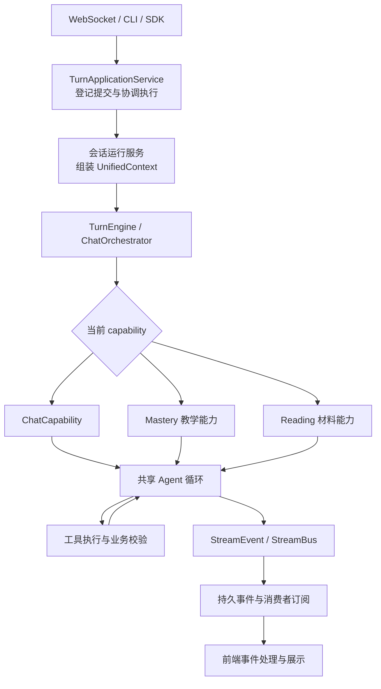
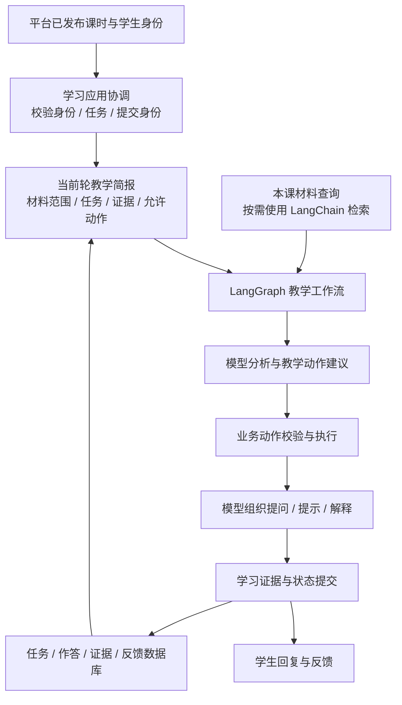

# DeepTutor 源码架构与现有学生端对照

核查日期：2026-10-29。范围：静态源码分析与方案建议；未修改业务代码，未启动 DeepTutor、本地应用、真实模型或数据库。

固定参考：上游 [commit `1ea7df155447f4caf0e3abc86b3ff5395479cd4a`](https://github.com/HKUDS/DeepTutor/tree/1ea7df155447f4caf0e3abc86b3ff5395479cd4a)，提交时间为 2026-10-29 00:36:18 +0800。这是当日 main 的源码快照，采用新的模块化目录，不是将 README 展示的最新稳定发行版与 main 等同。以下定位统一使用固定 SHA，避免旧版 `src/agents/`、早期双循环图与当前实现混用。

本地参考是当前工作区 `student_agent` 的实际代码；[dialogue-tutoring-design.md](dialogue-tutoring-design.md) v0.8 是目标方案，不能当成已实现。既有约束继续有效：整段播放；教师原版 PPT 与生成 HTML 为稳定材料；Agent 根据证据决定教学动作，程序校验并执行；当前不实施改造。

## 1. 选型结论

建议保留 FastAPI + LangGraph + PostgreSQL 与现有平台集成，参考 DeepTutor 的教学领域对象、动作校验、材料定位和交互契约。通用 Agent 循环、模型适配、结构化输出、检索组件、图执行、流式事件和 checkpoint 优先利用框架机制，按具体需要接入，不复制一套 DeepTutor 运行时。

原因是两者产品位置不同：DeepTutor 当前代码支持多个入口、多种能力、可选知识引擎和插件；本项目学生端已嵌入教师发布、选课、课时访问和学习记录链路。直接 fork 会把这些已有集成重新适配一遍，而最重要的教学设计仍需要自己确定。

“框架已有机制”只表示有可用接口和实现，不等于安装依赖后产品能力自动完成。前端传输、业务权限、任务身份、来源版本、数据事务及教学有效性仍属应用责任。

## 2. DeepTutor 当前架构怎样组织

### 2.1 按职责看源码

| 层次 | 实际源码 | 主要职责 | 对本项目的启发 |
|---|---|---|---|
| 接入 | `api/routers/unified_ws.py`、CLI、SDK | 接收命令、订阅事件 | HTTP/流式协议适配与教学实现分开 |
| 单轮应用协调 | `app/service.py::TurnApplicationService` | 提交去重、启动、取消、恢复订阅 | 把一次学生提交作为有身份的业务操作 |
| 上下文及执行准备 | `services/session/turns/`、`core/context.py` | 组装当前轮所需上下文和运行态 | 权威学习状态、历史消息、运行回调分开 |
| 路由 | `runtime/turn_engine.py`、`runtime/orchestrator.py` | 路由到选定 capability，管理流生命周期 | 选哪个教学模式不应散在页面与模型提示词中 |
| 能力 | `agents/chat/`、`capabilities/mastery/`、`capabilities/reading/` 等 | 组织一轮或多阶段业务流程 | 普通答疑、受控辅导、材料阅读可共享基础机制 |
| 工具 | `core/tool_protocol.py`、`runtime/registry/`、教学 tools | 让模型请求一次具体操作 | 读取材料、查询状态、登记题目可作为受限动作 |
| 业务事实 | `learning/models.py`、`service.py`、`policy.py` | 题目、作答、证据、进度、规则与事务 | 教学事实独立于聊天文字和 Agent 运行日志 |
| 通用基础 | `services/rag/`、`services/llm/`、session store、StreamBus | 检索、模型调用、记录、事件 | 利用成熟库承载通用部分 |
| 前端运行状态 | `web/features/chat/transport/TurnRuntimeClient.ts` 等 | 连接、命令确认、事件排序、断线补发 | 传输状态与学生看到的教学状态分开 |

直接源码：[WebSocket 接入](https://github.com/HKUDS/DeepTutor/blob/1ea7df155447f4caf0e3abc86b3ff5395479cd4a/deeptutor/api/routers/unified_ws.py#L220)、[应用服务](https://github.com/HKUDS/DeepTutor/blob/1ea7df155447f4caf0e3abc86b3ff5395479cd4a/deeptutor/app/service.py#L113)、[路由器](https://github.com/HKUDS/DeepTutor/blob/1ea7df155447f4caf0e3abc86b3ff5395479cd4a/deeptutor/runtime/orchestrator.py#L54)、[前端客户端](https://github.com/HKUDS/DeepTutor/blob/1ea7df155447f4caf0e3abc86b3ff5395479cd4a/web/features/chat/transport/TurnRuntimeClient.ts#L94)。

### 2.2 一次聊天的实际链路

该图表示核心职责，省略了可选引擎与各能力内部专用流程；不是所有能力都只有同一种循环。`ChatOrchestrator` 选择 `active_capability`，未指定时使用 chat。`ChatCapability.run()` 创建 `AgenticChatPipeline`；该类继承 `AgenticLoopPipeline`，后者默认创建自有 `AgentLoop` 执行模型与工具循环，还存在显式启用的 TypeScript native 分支。这条默认聊天链路不是用 LangGraph 图实现的。

来源：[默认能力路由](https://github.com/HKUDS/DeepTutor/blob/1ea7df155447f4caf0e3abc86b3ff5395479cd4a/deeptutor/runtime/orchestrator.py#L103)、[ChatCapability](https://github.com/HKUDS/DeepTutor/blob/1ea7df155447f4caf0e3abc86b3ff5395479cd4a/deeptutor/agents/chat/capability.py#L12)、[共享 pipeline 的执行分支](https://github.com/HKUDS/DeepTutor/blob/1ea7df155447f4caf0e3abc86b3ff5395479cd4a/deeptutor/agents/loop/pipeline.py#L397)。

这里重要的架构思想是复用运行机制、为不同学习能力定制上下文与工具。能力名、Agent 类名的数量不能直接证明采用了多个自主 Agent，也不能据此证明教学效果更好。

### 2.3 Tools 与 Capabilities 的区别

Tool 是一次具体操作，例如读取当前学习状态、检索片段或登记一道题。Capability 拥有当前轮的业务流程与提示策略，例如材料阅读或掌握练习。对应协议分别是 `BaseTool` 与 `TurnCapability.run(context, stream)`。

来源：[工具协议](https://github.com/HKUDS/DeepTutor/blob/1ea7df155447f4caf0e3abc86b3ff5395479cd4a/deeptutor/core/tool_protocol.py#L261)、[能力协议](https://github.com/HKUDS/DeepTutor/blob/1ea7df155447f4caf0e3abc86b3ff5395479cd4a/deeptutor/core/capability_protocol.py#L46)。

本项目可以保留这个职责区分：课堂辅导/课后补完是流程，取资料/读状态/登记任务是操作。初期用普通函数与 LangGraph 节点就能实现，无须先引入动态插件、反射导入和全局注册器。

## 3. 我们学生端已经做了什么

当前课堂是每轮调用一次 `evaluate → route → respond`；`route()` 调用 `progression.advance()`，首轮、加强和讨论的推进由确定性 Python 规则控制。课后有另一张类似图，先完成待办再进入自由提问。v0.8 方案中的显式教学动作选择尚未进入这些图。

来源：[课堂图](E:/LMS系统参考/项目/agentic-class-pilot-running/student_agent/agent/graph.py:174)、[推进规则](E:/LMS系统参考/项目/agentic-class-pilot-running/student_agent/agent/progression.py:115)、[课后图](E:/LMS系统参考/项目/agentic-class-pilot-running/student_agent/agent/postclass.py:131)。更多具体行号见[学生端核查笔记](student-source-comparison-notes.md)。

现有实现有六项应当保留：

1. 开课前校验学生、课程、发布版本和课时，其他课时正文不混入当前会话。
2. 知识点有场景和原文校验，不完全依赖模型自报来源。
3. 概念复述与应用讨论结果分开，讨论答错不直接抹掉概念理解记录。
4. 课堂反馈基于本次实际评估，不把历史最高掌握度当本次表现。
5. 课后补完更新反馈，课堂结束时的原始反馈仍保留。
6. 知识准备与视频播放可以并行；模型失败不提交本轮计数，持久化成功后再更新会话。

主要不足也比较明确：当前问题主要留在聊天中；没有显式 task/attempt 契约；帮助程度未形成同等明确的证据对象；只使用最近 8/10 条消息；无检索/工具调用主链；模型 JSON 手动解析；前端等待整轮 HTTP 响应；无图 checkpoint，但已有自己的业务快照；单进程缓存、锁和后台任务防重；未保留统一模型 usage 统计。

逐项源码依据见 [学生端源码对照笔记](student-source-comparison-notes.md)。这些是静态实现事实，不代表线上状态或学习效果已验证。

## 4. 最值得借鉴的六项教学设计

### 4.1 每轮先读取权威学习状态

DeepTutor 的 `MasteryLoopCapability.pre_loop()` 在模型调用前读取当前路径、待答任务和规则状态，复用与 `mastery_status` 相同的业务查询；快照只对本轮有效，读取期间绑定发生变化会丢弃旧结果。

来源：[pre_loop](https://github.com/HKUDS/DeepTutor/blob/1ea7df155447f4caf0e3abc86b3ff5395479cd4a/deeptutor/capabilities/mastery/loop.py#L415)。

我们应借鉴为“当前轮教学简报”：当前课时与版本、当前任务、学生原话、已提供的帮助、已有理解证据、未澄清事项和允许动作。现有图已传入部分 state，差距在权威业务对象及其生命周期，不是简单多传一段聊天记录。

LangGraph 可以保存和传递状态，LangChain 可以组织消息；哪些字段必须每轮刷新、哪些证据不能被摘要覆盖，需要我们定义。长对话可摘要，但摘要不能替代原始学习证据。上游自身也有预算化 `ContextBuilder`，不是无限堆积聊天历史。[ContextBuilder](https://github.com/HKUDS/DeepTutor/blob/1ea7df155447f4caf0e3abc86b3ff5395479cd4a/deeptutor/services/session/context_builder.py#L266)

### 4.2 Agent 请求动作，程序在执行时校验

DeepTutor 在 `TOOL_MODES` 声明 outline/study/review 的可用操作，工具执行时 `_wrong_mode_result()` 再检查当前模式。这样即使同一轮内模式发生变化，也不会只依赖轮次开始时挂载了哪些工具。

来源：[模式表](https://github.com/HKUDS/DeepTutor/blob/1ea7df155447f4caf0e3abc86b3ff5395479cd4a/deeptutor/capabilities/mastery/mode.py#L71)、[执行时校验](https://github.com/HKUDS/DeepTutor/blob/1ea7df155447f4caf0e3abc86b3ff5395479cd4a/deeptutor/capabilities/mastery/tools.py#L625)。

这与我们的 v0.8 方向吻合：模型可建议继续追问、补讲、换主题、开始独立尝试或请求收尾，程序校验课时范围、当前任务、状态版本和前置条件后执行。模型文本中写“我们进入下一阶段”不能直接更新业务状态。

机制可用 LangChain 结构化输出/工具配合 LangGraph 条件分支实现；动作集合和校验器属于本项目。必须区分教学模式约束与平台身份权限：上游为兼容旧会话，对未记录模式存在默认允许的路径，不能原样作为正式课程访问控制。

### 4.3 任务和题目从聊天文本中独立出来

DeepTutor 的 `PendingQuestion` 保存题干、选项、预期答案、解释、出处快照和帮助暴露。`public_pending_question()` 产生给学生的投影，不包含答案和参考解释。`MasteryInteraction` 有独立生命周期；`grade_interaction()` 校验题目身份，以事务保存结果，重复评分重放已有结果，避免新增第二次尝试。

来源：[PendingQuestion](https://github.com/HKUDS/DeepTutor/blob/1ea7df155447f4caf0e3abc86b3ff5395479cd4a/deeptutor/learning/models.py#L258)、[公开投影](https://github.com/HKUDS/DeepTutor/blob/1ea7df155447f4caf0e3abc86b3ff5395479cd4a/deeptutor/learning/pending.py#L249)、[幂等评分事务](https://github.com/HKUDS/DeepTutor/blob/1ea7df155447f4caf0e3abc86b3ff5395479cd4a/deeptutor/learning/service.py#L1148)。

我们当前讨论题主要隐含在最近消息中，因此最应借鉴的是稳定 taskId、题目正文、来源版本、预期观察目的、attemptId 和状态。任务可包括开放追问与独立解释，不要求把教学变成固定选择题组。具体契约要适合开放对话；上游“同题重放”也不能未经适配就用来禁止本项目所有合法重试。

LangGraph checkpoint 能恢复图执行状态，interrupt 能挂起执行；都不会自动提供答案可见性、旧任务拒绝、重复提交去重或评分事务。当前以一轮一次 HTTP 调用等待下一次学生输入，本身也不要求改成跨轮长期挂起的 interrupt；只有需要保留轮内执行位置时再使用它。

### 4.4 独立作答与受助作答分别记证据

DeepTutor 的 `QuizAttempt.independent`、`LearningEvidence` 和题目上的帮助暴露记录，把学生原话、帮助、判定、任务与轮次身份关联起来。规则层能区分已练习、受助练习和独立证明。

来源：[作答与证据对象](https://github.com/HKUDS/DeepTutor/blob/1ea7df155447f4caf0e3abc86b3ff5395479cd4a/deeptutor/learning/models.py#L122)、[帮助影响证据](https://github.com/HKUDS/DeepTutor/blob/1ea7df155447f4caf0e3abc86b3ff5395479cd4a/deeptutor/learning/service.py#L574)、[learning_stage](https://github.com/HKUDS/DeepTutor/blob/1ea7df155447f4caf0e3abc86b3ff5395479cd4a/deeptutor/learning/policy.py#L110)。

本项目已有 assessment_history，以及概念/应用结果分离的基础。建议补充“学生在得到何种帮助后说出了什么”，并把后续新任务的独立表现单独记录。是否理解仍是可校准的语义判断，不能因为结构化落库就视作确定事实。上游的分数上限和掌握阈值属于其产品策略，不直接成为我们的教育测量标准。

### 4.5 材料、题目和证据绑定版本

DeepTutor 的 `cached_lesson()/validate_evidence()` 检查目标、来源范围、索引与准备版本；语义评分链为具体题干和答案绑定来源契约，再校验指纹。partial 依据只能用于已覆盖范围。

来源：[缓存与证据](https://github.com/HKUDS/DeepTutor/blob/1ea7df155447f4caf0e3abc86b3ff5395479cd4a/deeptutor/learning/lesson_evidence.py#L165)、[validate_evidence](https://github.com/HKUDS/DeepTutor/blob/1ea7df155447f4caf0e3abc86b3ff5395479cd4a/deeptutor/learning/lesson_evidence.py#L351)、[题目绑定](https://github.com/HKUDS/DeepTutor/blob/1ea7df155447f4caf0e3abc86b3ff5395479cd4a/deeptutor/learning/semantic_assessment.py#L217)。

我们已有原文匹配校验，应继续保留，并补充资源 ID、发布版本、PPT 页/HTML 场景和内容 hash。教师重发课件后，新任务使用新材料；历史回答仍关联当时版本。PPT 与 HTML 不一致、图示无法解析或内容缺失时，要记录限制，不从未覆盖材料推出确定评价。

LangChain 提供 loader、切分、embedding、retriever 等组件；资料授权、页/场景映射、缓存失效、题目是否由材料支持，需要自己设计。短课时可以先使用有来源的片段查询，不能仅因 DeepTutor 支持多种 RAG 引擎就全部引入。它的工厂默认选 LlamaIndex，进一步说明其教学设计不依赖某一个通用框架。[RAG factory](https://github.com/HKUDS/DeepTutor/blob/1ea7df155447f4caf0e3abc86b3ff5395479cd4a/deeptutor/services/rag/factory.py#L28)

### 4.6 把学生当前看的材料位置传给导师

`ReadingCapability.pre_loop_seed()` 读取视口定位、媒体时间和选区，校验访问资格后作为当轮材料上下文；相关片段搜索与视口信息分开，即使搜索没命中，也保留当前所看位置。

来源：[材料视口](https://github.com/HKUDS/DeepTutor/blob/1ea7df155447f4caf0e3abc86b3ff5395479cd4a/deeptutor/capabilities/reading/capability.py#L354)。

这可以适配成“学生就当前 PPT 页/HTML 场景提问”。保持整段播放约束，课后回看或对话查阅时再附带位置，不要求改成分段授课。当前 iframe 适配不能假定已有任意跳转、选区同步或精准时间定位；需要后续核对并定义播放器契约。LangGraph 能传状态、LangChain 能查片段，前端联动和材料定位需要自己接入。

## 5. 通用工程设计：借鉴目标，使用框架机制

### 5.1 事件协议与恢复值得参考

DeepTutor 的 `StreamEvent` 包含 type/source/stage/content/metadata/session_id/turn_id/seq。`TurnApplicationService.subscribe_turn(after_seq)` 从持久事件和运行协调器读取后续事件。前端 `TurnRuntimeClient` 维护连接状态、序号、乱序缓冲及命令确认。开始提交还有 client_submission_id 与内容 digest 去重。

来源：[事件格式](https://github.com/HKUDS/DeepTutor/blob/1ea7df155447f4caf0e3abc86b3ff5395479cd4a/deeptutor/core/stream.py#L17)、[事件重放](https://github.com/HKUDS/DeepTutor/blob/1ea7df155447f4caf0e3abc86b3ff5395479cd4a/deeptutor/app/service.py#L248)、[提交去重](https://github.com/HKUDS/DeepTutor/blob/1ea7df155447f4caf0e3abc86b3ff5395479cd4a/deeptutor/app/service.py#L129)、[前端恢复](https://github.com/HKUDS/DeepTutor/blob/1ea7df155447f4caf0e3abc86b3ff5395479cd4a/web/features/chat/transport/TurnRuntimeClient.ts#L117)。

本项目当前是整轮 HTTP 返回和两秒准备轮询。后续可用 LangGraph 的节点/消息流作为事件来源，再用 SSE 或 WebSocket 对外发送“查阅材料、核对回答、回复片段、引用、完成”等事件。采用哪种传输协议并不决定教学架构。应展示必要进度和依据，不照搬全部内部调试或推理事件。

三种恢复不能混为一谈：

| 恢复对象 | 用途 | 可承担的机制 |
|---|---|---|
| 图执行状态 | 中断后从工作流中的某处继续 | LangGraph 持久 checkpointer、适当的节点与副作用设计 |
| 学习业务状态 | 恢复任务、作答证据、反馈和课程进度 | 业务数据库、事务、幂等身份与版本校验 |
| 浏览器展示流 | 断网后补齐未收到的回复与状态 | 应用事件序列、游标、传输恢复与前端去重 |

现有学生端已经有业务快照恢复，只是两张图没有 checkpointer。应先确定业务库和图快照的职责，避免重复维护两套权威进度。进程重启后的事件重放，也不等于任意正在调用的模型或工具都能在中途自动续跑。多 worker 的任务协调、租约和持久任务队列不能由安装 LangGraph 自动获得。

### 5.2 成本统计宜补齐，通用循环不宜重写

DeepTutor 的 `TurnUsage` 汇总调用次数、token、缓存与时延，统一能力结果携带 usage。我们的 `_completion()` 目前仅返回 content，丢弃模型响应元数据。普通教学轮次通常包含评估与回复两个逻辑模型调用，还存在失败重试或其他分支，后续动态工具循环更需要知道每轮实际调用成本。

来源：[TurnUsage](https://github.com/HKUDS/DeepTutor/blob/1ea7df155447f4caf0e3abc86b3ff5395479cd4a/deeptutor/services/llm/metrics.py#L19)、[统一结果](https://github.com/HKUDS/DeepTutor/blob/1ea7df155447f4caf0e3abc86b3ff5395479cd4a/deeptutor/agents/_shared/capability_result.py#L21)。

借鉴“所有能力统一采集调用事实”，利用模型 usage_metadata、callbacks/middleware 和图事件实现。每课/每生预算、价格映射和质量评估仍需业务统计；LangSmith 可选，不等同于 LangGraph 的内置产品能力。

## 6. 能力对照与责任表

| 能力 | 当前学生端 | 框架可提供 | 仍要自己实现 | 建议 |
|---|---|---|---|---|
| 模型接入 | 已用 ChatOpenAI | LangChain 模型适配 | 供应商能力差异、配置与调用策略 | 沿用 |
| 模型输出格式 | JSON 手动解析与字段检查 | LangChain structured output / schema | 来源、权限、语义与动作合法性 | 优先简化通用解析，保留业务验证 |
| 受控动态教学 | 现状为固定推进；v0.8 仍是方案 | LangGraph 分支/循环；工具或结构化决策 | 动作合同、证据输入、前置条件、状态版本 | 核心改造方向 |
| 开放工具调用 | 课堂主链没有 | LangChain create_agent / tools，可在图内局部使用 | 课程限定工具、预算、允许范围 | 按场景引入，不替代整课业务流程 |
| 资料检索 | 场景文字与旁白一次提取 | LangChain loader/splitter/retriever | PPT/HTML 归属、定位、版本、引用校验 | 先实现本课材料查询，按容量选检索方式 |
| 学习记忆 | assessment_history、概念/讨论结果 | State / Store、历史摘要等机制 | Task/Attempt/Evidence 含义和权威来源 | 重点借鉴 DeepTutor 领域对象 |
| 等待学生 | 请求之间等待下一条消息 | 普通多轮 invoke；需要时 interrupt | 当前任务身份、超时/退出/旧提交处理 | 不强制改成长时间挂起 |
| 图内恢复 | 无 checkpointer | LangGraph 持久 checkpointer | 节点边界、副作用幂等、图版本策略 | 有轮内恢复需求时接入 |
| 会话恢复 | 自有业务快照，默认浏览器恢复 | checkpointer 可补执行状态 | 跨设备策略、业务事实与快照协调 | 保留已有能力后再收敛 |
| 实时展示 | HTTP 整轮响应 | LangGraph/LangChain stream | SSE/WS、事件投影、前端交互 | 第二优先级 |
| 断线补发 | 无可重放生成事件 | 框架事件可作输入 | turn/seq 游标、持久化、重连去重 | 借鉴协议，不照抄完整运行时 |
| 重复提交与评分 | 请求只有 text，单进程锁 | 框架提供执行挂点 | attemptId/幂等键、事务、并发冲突 | 第一优先级 |
| 成本与追踪 | 错误/部分耗时日志 | usage 元数据、callbacks、可选 LangSmith | 预算、费用账本、教学质量评估 | 尽早采集调用事实 |
| 插件市场/多入口/多检索引擎 | 当前非核心目标 | 多种扩展机制可选 | 产品集成与生命周期 | 暂缓 |

框架来源：[LangChain Agents](https://docs.langchain.com/oss/python/langchain/agents)、[结构化输出](https://docs.langchain.com/oss/python/langchain/structured-output)、[检索组件](https://docs.langchain.com/oss/python/deepagents/retrieval)、[中间件](https://docs.langchain.com/oss/python/langchain/middleware/overview)、[LangGraph 概览](https://docs.langchain.com/oss/python/langgraph/overview)、[持久化](https://docs.langchain.com/oss/python/langgraph/persistence)、[中断](https://docs.langchain.com/oss/python/langgraph/interrupts)、[流式](https://docs.langchain.com/oss/python/langgraph/streaming)。框架能力受版本、模型/网关和配置影响；中断恢复的节点重执行与副作用设计需按文档处理。

## 7. 面向我们学生端的职责建议

以下是逻辑职责建议，不是已创建的文件结构，也不要求每一项变成独立服务或独立 Agent。

图中分析、动作选择和内容生成是逻辑职责，可以共用模型、合并某些调用或根据阶段省略，不要求每轮固定调用三次，更不要求三个自主 Agent。具体合并方式需要以后用真实课件与学生表达验证。

关键职责如下：

- 学习应用协调：把 FastAPI 入口中的会话、提交去重和事务协调收拢；入口负责协议，不直接承担所有教学规则。
- 教学工作流：继续由 LangGraph 承载；允许模型选择局部分支，代码拥有实际状态和执行权。
- 教学策略与校验：沿用 progression.py 规则集中维护的优点，替换机械轮次触发的教学调度；不把关键推进规则只写在提示词里。
- 课程材料：只暴露本课允许范围，保留 PPT/HTML 来源身份、版本和缺口。
- 学习事实：任务、尝试、帮助暴露、理解证据与反馈独立保存；聊天历史是交互记录，不能承担全部事实。
- 执行与展示：图执行、业务提交和浏览器流各有清楚职责，需要时通过统一事件联动。

## 8. 用一个例子说明分工

以下是本项目的建议示例，不是 DeepTutor 某个课程的实测流程。

当前课时讲解平均数，学生说：“每个人实际都得到平均数那么多。”

1. 应用读取当前题目、来源页/场景和帮助记录，把原话交给模型。
2. 模型观察到学生可能混淆代表值与实际个体值，建议用本课案例追问；不直接改写掌握结论或数据库阶段。
3. 程序检查动作属于本课允许范围，绑定具体任务和状态版本，再生成或返回该问题。
4. 如果提供过例子或关键提示，本次回答记录为受助情境；随后另一道适合本课的新问题观察独立表现。
5. 网络中断后以相同提交身份重发，返回已有结果，不把同一回答计算成两次进步。后续合法的新尝试使用新的尝试身份。
6. 反馈能说明“在提示后解释清楚；新问题中独立完成”，而非仅显示一个笼统 mastered 标签。

LangChain 可承担结构化观察、工具与模型调用；LangGraph 可承担分支执行和状态流。题目来源、帮助含义、动作前置条件、幂等提交及反馈口径由我们定义。DeepTutor 最有价值的参考在这些领域对象和执行约束上。

## 9. 不宜直接照搬的部分与优先级

不建议当前迁入：

- 整套自有 AgentLoop、provider 兼容与 context-budget 管线；我们可优先使用框架，在真实缺口出现时再补适配。
- 动态插件市场、多入口发布、伙伴/外部子 Agent 接入、多检索引擎全家桶；现阶段会扩大维护范围。
- 自动重建学习大纲和任意扩展课程目标；我们的正式课时由教师发布，Agent 只能在授权材料与允许主题内安排教学。
- 上游的固定掌握阈值、最近若干次加权和自报掌握覆盖；可以参考规则集中维护的方式，不能直接视为本平台的掌握或完成标准。
- 为兼容旧入口而默认放行的教学模式逻辑；应与本平台学生身份和课程访问校验分开设计。
- 认为“使用了语义评估、出处合同或多 Agent”就证明评分可靠；上游同时存在规则/兼容评分与模型语义评分，仍需课程样例校准。

后两项有直接来源：[模式兼容行为](https://github.com/HKUDS/DeepTutor/blob/1ea7df155447f4caf0e3abc86b3ff5395479cd4a/deeptutor/capabilities/mastery/mode.py#L95)、[掌握来源与自报覆盖](https://github.com/HKUDS/DeepTutor/blob/1ea7df155447f4caf0e3abc86b3ff5395479cd4a/deeptutor/learning/policy.py#L140)。更多限制见 [DeepTutor 教学源码核查笔记](deeptutor-learning-source-notes.md)。

| 优先级 | 建议先解决什么 | 完成后能检查什么 |
|---|---|---|
| 第一批 | 稳定任务/尝试/证据对象，帮助暴露与来源版本，受限动作校验，提交幂等 | 不会忘当前题、重复计分或把提示后答对冒充独立表现；Agent 决策受合法状态约束 |
| 第二批 | 每轮教学简报、必要结构化输出、本课材料查询、进度与引用、调用统计 | 下一问回应具体表达；材料可追溯；调用次数与等待原因可见 |
| 按运行需求 | 持久 checkpoint、跨设备续学、流事件重放、多 worker 任务协调 | 明确恢复哪个层次，验证失败和重试后的业务一致性 |
| 后续 | 跨课长期个性化、间隔复习、更多教学能力 | 本课辅导质量稳定后再验证长期价值 |

顺序是讨论建议，不是已批准实施计划。具体轮次、掌握阈值、题型题量和动作合同仍需用真实课件与学生回答确认。当前没有做代码改造，因此未运行实现测试；交付检查只覆盖源码引用、文档一致性和工作区变更。

## 10. 配套核查记录

- [DeepTutor 教学业务源码笔记](deeptutor-learning-source-notes.md)：六项领域设计与上游策略限制。
- [当前学生端源码对照笔记](student-source-comparison-notes.md)：八类现状、差距与本地绝对路径行号。
- [前一轮框架选型笔记](langchain-langgraph-research.md)：概念比较。前一轮 main 链接只作背景，本次上游源码结论统一以固定 SHA 为准。

本报告区分源码事实、框架机制与工程建议；没有通过运行验证真实模型质量、教学效果、线上部署状态或全仓所有能力。
