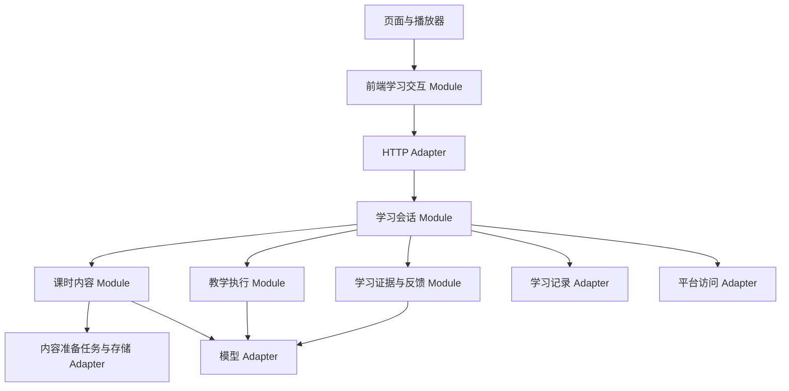
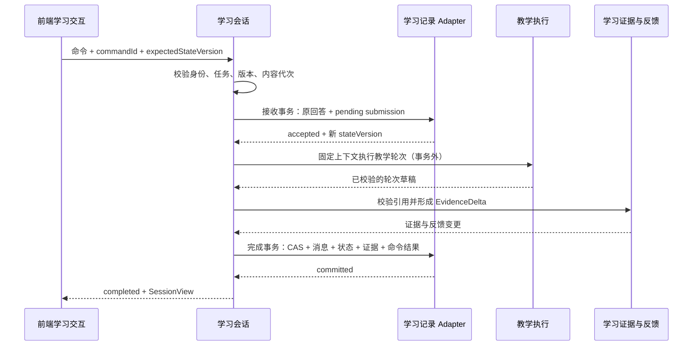

# 学生端：从需求到模块架构设计

日期：2026-11-02。版本：v1.0，待实现的设计基线。

实施进展：P1、P2、P3 已完成本地实现及回归，见 [P1](student-p1-implementation.md)、[P2](student-p2-implementation.md)与 [P3 实施记录](student-p3-implementation.md)。下文的现状分析是改造前基线，具体落地以实施记录为准；P4 已完成可关闭的本地试点执行能力及回归，见 [P4 实施记录](student-p4-implementation.md)；真实课时/真实模型的抽样质量退出条件尚未验收，未启用正式试点。P5 已完成前端交互收拢、结构化操作及本地回归，见 [P5 实施记录](student-p5-implementation.md)；真实教学试点与后续推广仍未启用。

本文依据设计时的仓库静态核查及[动态教学方向](dialogue-tutoring-design.md)编写，明确 Module、Interface、状态归属与渐进改造路线。设计阶段只交付文档；后续实施以顶部进展及分期实施记录为准。本文描述完整目标设计，已落地部分以实施记录为准；动态教学业务参数仍须通过真实课时试点验证。

现行物理目录已按会话、教学、证据、内容、基础设施整理，见 [目录与依赖说明](student-directory-layout.md)。下文原目录树保留为设计基线，不代表现在仍有并列 agent 业务层。

## 1. 设计结论与适用范围

保留 FastAPI、LangGraph、PostgreSQL、Next.js 静态前端和整段播放器。学生端先采用进程内模块化结构：以学习会话作为应用入口，将内容准备、教学执行、证据反馈的复杂性收拢到各自的小 Interface 后面。平台身份与内容查询、数据库、模型调用在实际需要替换和测试的位置设置 Seam，由生产 Adapter 与测试 Adapter 满足约定。

这里的 Module 是具有 Interface 和 Implementation 的职责集合，不等于目录、类或独立部署。Interface 包括输入输出、前置条件、失败、版本、幂等和性能约定；Depth 来自调用者不再需要理解这些内部步骤。避免只把 main.py 的函数搬进若干文件再逐层转发。

本设计支持两个连续目标：先在行为不变的情况下收拢现有复述流程，再通过同一会话入口试点动态教学。暂不引入微服务拆分、通用插件市场、事件总线、向量检索或多 Agent 协作。材料格式扩展和多实例运行分别按真实输入及并发需求推进。

## 2. 需求基线：哪些已实现，哪些属于目标

### 2.1 需求到模块与验收的映射

| ID | 需求与约束 | 当前基线 | 目标责任 Module | 可观察验收结果 |
|---|---|---|---|---|
| R01 | 平台登录与课时访问，学生/课程/发布/课堂隔离 | 已有平台令牌及上下文校验 | 学习会话，平台访问 Adapter | 错误身份、课时或发布绑定不能读写会话 |
| R02 | 保留整段播放，按所选课时取内容 | 已有播放器与课时限定内容 | 课时内容、前端学习交互 | 其他课时正文不进入当前教学；播放不被教学自动打断 |
| R03 | 同一内容版本共享准备，失败可重试 | 已有数据库知识点任务、租约与重试 | 课时内容 | 多名学生复用结果；旧任务不能覆盖新版本结果 |
| R04 | 从 PPT、HTML 与可取得的讲解建立教学依据 | 当前主要消费场景文字、speech；完整 PPT 尚未接入 | 课时内容 | 来源可定位；缺失图示、公式或冲突显式报告 |
| R05 | 单对话空间，按回答动态追问和补讲 | 当前为固定复述/加强/讨论；动态方案未实施 | 教学执行 | 同一任务因不同回答得到有依据的不同动作 |
| R06 | Agent 决定动作，程序校验执行 | 当前程序推进原则可复用，动作契约待新增 | 教学执行 | 非法、过期、越课时决策不推进 |
| R07 | 区分独立表现、受助表现、未知与未覆盖 | 已有概念/讨论结果分离，记录尚不完整 | 学习证据与反馈 | 引用学生回答和帮助记录；不把导师讲解当理解 |
| R08 | 学生可求助、暂停、提前结束 | 已有提前结束；结构化求助、暂停待补 | 学习会话、教学执行 | 求助能记录帮助；结束不以答对为条件 |
| R09 | 重登、跨设备恢复与内容换版 | 已有鉴权后数据库恢复、进入时换版处理 | 学习会话 | 浏览器旧记录不能覆盖数据库；换版不复用旧教学状态 |
| R10 | 课后继续、回看、个人反馈 | 已有课后队列、回看及实际评估反馈 | 学习会话、教学执行、学习证据与反馈 | 课后更新不覆盖课堂原反馈；回看不重启学习 |
| R11 | 失败重试、重复提交与并发一致性 | 有进程锁、先保存后更新内存；缺完整轮次事务与跨实例控制 | 学习会话、学习记录 Adapter | 相同提交只处理一次；保存失败不发布新阶段 |
| R12 | 学情同步不阻塞课堂 | 已有 BackgroundTasks 调平台 | 学习会话、平台访问 Adapter | 平台同步失败不回滚已保存学习；可追踪待同步记录 |

### 2.2 持续有效的产品约束

- 整段播放保留；本文不新增“必须播完才可讨论”的强制门槛，维持现有进入条件，后续变更需单独确定。
- 原 PPT 与生成 HTML 是内容方向，不要求教师额外维护完整目标、题库和量规。PPT 解析接入前以实际可读内容运行，不假装图像和公式已被理解。
- 播放实际呈现内容限定必答范围，原 PPT 用于核对；缺失与冲突限制评价范围。
- 不要求固定四题，不按固定等级让学生闯关；完成流程、独立表现和长期掌握是不同结论。
- Agent 在允许动作中选择策略，程序拥有实际状态和执行权；自然语言回复不能触发状态迁移。
- 学生可明确结束；未讨论内容标记未覆盖。负担限制用于停止活动，不作为掌握标准。

## 3. 当前实现与设计缺口

核查入口见 [main.py](../backend/main.py)、[StudentApp.js](../frontend/src/components/StudentApp.js)、[graph.py](../backend/teaching/graph.py)、[progression.py](../backend/teaching/progression.py)、[persistence.py](../backend/infrastructure/persistence.py)、[published_knowledge.py](../backend/infrastructure/published_knowledge.py)。

| 当前实现 | 保留价值 | 应调整的位置 |
|---|---|---|
| main.py 的平台取数、恢复、换版、commit 与路由 | 既有校验和异常行为 | 将用例编排归入学习会话，HTTP 路由只做转换 |
| progression.py 的确定性规则、历史状态规范化 | 模型不能直接推进 | 现行规则保留为旧流程实现；新动作执行规则单独演进 |
| graph.py 的 evaluate → route → respond | 每轮处理已有清晰骨架 | 不将 LangGraph 状态作为跨模块公共结构 |
| postclass.py 导入 graph.py 的私有模型与解析函数 | 可复用模型调用能力 | 在教学执行内部共享模型 Adapter，取消私有函数跨流程引用 |
| feedback.py 从评估记录形成反馈 | 有事实依据，概念与应用分开 | 增加消息、任务、帮助与观察的稳定引用 |
| persistence.save 分别保存会话、消息、掌握结果和快照 | 已先保存再更新内存 | 普通轮次并非一个事务；目标由一次提交统一保存 |
| 完成反馈、快照与结束标记已有专门事务 | 完成结果的一致性 | 迁移后纳入同一提交约定 |
| sessions 与 session lock 在进程内 | 单进程串行保护 | 不能作为多实例一致性依据；引入数据库版本校验 |
| 共享知识点任务已有 SKIP LOCKED、租约与 claim token | 可恢复任务与跨 worker 领取 | 继续复用，新增内容地图按版本独立存储 |
| 前端已有 session-recovery.mjs | 正式恢复以服务端为准 | 将请求、轮询与学习视图协调从大页面中收拢 |

[2026-10-26 现状说明](student-architecture-current.md)的部分结论已经过时，尤其是共享知识点准备、跨设备恢复和学情同步；本文以当前源码为准。历史教学稿中的固定题组不作为实现依据。

## 4. Module 职责与依赖



箭头表示允许依赖，不表示每次请求都调用所有节点。证据反馈的模型调用仅用于可选总结措辞；事实汇总和保底反馈不依赖模型成功。内容准备任务是独立后台路径，不经每名学生的教学轮次重复生成。

### 4.1 学习会话 Module：应用入口与唯一提交协调者

负责身份范围绑定、开始/恢复、学习操作调度、版本检查、结束/重置、课后入口、提交和对外 SessionView。正式课堂的数据以数据库为依据，内存仅作缓存。它协调其他模块产生的结果，只有它通过学习记录 Adapter 提交会话事实；其他业务模块不直接修改共享会话字典。

Interface 按用例收敛为：

```text
openLesson(accessGrant, lessonId) -> SessionView
execute(accessGrant, sessionId, LearningCommand) -> CommandResult
read(accessGrant, sessionId) -> SessionView
```

`LearningCommand` 是封闭的带类型命令：start_discussion、submit_answer、request_help、ask_question、pause、resume_activity、finish、continue_after_class、reset_lesson。回看授权刷新可作为 readPlayback 查询，与推进命令分开。枚举允许独立校验命令输入，不能用任意字符串和任意字典绕过约束。

鉴权由平台可信上下文建立，所有读写均校验 session 归属。目标设计复用现有平台令牌能力；若后续引入学生端授权凭据，其签发/撤销必须单独设计，不在本次假定已具备。首次实现可在每次请求用现有令牌确认身份；平台不可用时返回可重试错误，不把会话判空。具体缓存授权时长待实现阶段确定。

### 4.2 课时内容 Module：可用于教学的版本化依据

负责发布材料规范化、文字与来源定位、内容地图生成、缺口和冲突校验、共享准备与重试。课程资格由平台验证；本模块只接受已经授权的课时材料，不自行扩大范围。

```text
ensureContent(authorizedLessonSource) -> PreparationView
getContent(contentRef) -> LessonContent | ContentNotReady
retryContent(authorizedLessonSource) -> PreparationView
```

`LessonContent` 包含 contentRef、来源清单、主题、原文引用、可选入口问题、coverageGaps、validationStatus。内部保留准备任务，调用者不需要知道租约、轮询或重试 SQL。页面仅取得准备状态与安全来源摘要，不整体取得内部答案、判断依据或模型提示词。

共享内容键：courseId + lessonId + videoRevision/sourceManifestHash + compilerVersion。输入材料变更产生新版本；生成器版本变更产生新的准备结果。已开始会话固定 contentRef，不因后台生成器升级静默切换。当前 extractor_hash 的结果失效机制需在迁移时调整为版本并存，旧会话才可继续读取旧内容。

### 4.3 教学执行 Module：从输入到合法教学结果

负责当前任务内的观察、Agent 动作选择、合法动作计算、决策校验、任务创建、受控推进与教学回复。内部可沿用 LangGraph，外部不暴露节点、提示词、evaluation 临时字段或图专用状态。

```text
planTurn(TurnContext, LearnerInput) -> TeachingTurnDraft
```

`TurnContext` 只含绑定的内容、TeachingState、相关证据与近期消息、规则配置和状态版本，不含平台密钥、数据库连接或所有课程材料。输出包括 observationDrafts、validatedDecision、taskChanges、teachingStateAfter、assistantMessage、assistanceProvided、completionIntent。输出为候选结果，数据库提交成功前不对外宣称生效。

内部顺序为“观察回答 → 提出动作 → 程序校验 → 生成任务与回复 → 校验回复绑定”。同一模型可承担观察、决策和措辞职责，不要求多 Agent；具体调用次数按质量与延迟试点决定。非法决策允许至多一次修复；仍不合法则返回失败并保留已接收的输入，不自行选择更激进的动作。

初期保留 `legacy_recall_v3` 与 `dynamic_dialogue_v1` 两个实际流程实现，在学习会话开课时固定 flowVersion，构成有真实差异的 Seam。禁止在每个路由中散布新旧流程判断。

### 4.4 学习证据与反馈 Module：事实记录与可解释输出

负责校验观察的消息引用、帮助关系、内容范围，构建可追踪证据及反馈。它不调度下一主题、不修改会话阶段、不直接写库。语义判断由模型提出，引用与归属可由程序校验；程序无法证明理解判断必然正确。

```text
recordEvidence(existingEvidence, turnDraft, sourceMessages) -> EvidenceDelta
buildFeedback(EvidenceSnapshot, scope) -> Feedback
```

输出区分学生表达、解释性观察、已提供帮助、独立尝试结果、疑问与未覆盖范围。保留原始表达和相反证据，不因新的总结覆盖旧事实。课堂结束保存不可变 classroomFeedback；课后继续产生新证据和新的 currentFeedback。学生更正追加 correction 记录，关联原观察，不静默抹除原记录。

可选模型总结必须引用现有证据 ID；不合格或调用失败时使用确定性事实摘要。反馈模块对外隐藏旧星级兼容映射，新教学逻辑不读取历史最高星级作为本次表现。

### 4.5 前端学习交互 Module：业务视图与交互协调

```text
loadLesson(lessonId) -> LearningView
dispatch(LearnerAction) -> LearningView
subscribe(listener) -> unsubscribe
```

这是行为约定，可用一个 hook 与内部函数实现，不要求新建状态管理框架。负责请求、提交标识、失败重试、状态刷新、准备轮询、恢复提示和播放器 Adapter 协调。页面负责布局、输入框、弹窗和展示，直接消费 LearningView。

后端 SessionView 决定业务状态；前端本地只维护输入草稿、弹窗、滚动、尺寸、播放器连接/播放状态及请求中状态。后端允许动作驱动操作可用性，点击后仍由后端重新校验。浏览器记录仅定位课时、保留草稿和重试标识，不能恢复权威教学状态。正式会话不再向浏览器快照发送内部证据、量规、提示词或完整教学状态；演示模式保留隔离的本地恢复实现。

## 5. Interface 公共数据契约

### 5.1 关键对象与关联

| 对象 | 最小字段与用途 | 归属 |
|---|---|---|
| AccessScope | userId、courseId、lessonId、publicationId/version、classroomId | 学习会话；来自平台验证 |
| ContentRef | 来源修订、sourceManifestHash、compilerVersion、contentId | 课时内容；会话固定引用 |
| SessionRecord | sessionId、scope、contentRef、flowVersion、schemaVersion、stateVersion、contentGeneration、lifecycle、activityStatus | 学习会话 |
| TeachingState | stage、currentTaskId、focusTopicId、topicCoverage、returnPoint、policyRef | 教学执行 |
| Task | taskId、type、topicRefs、question、purpose、sourceRefs、criteriaRef、status | 教学执行；问题发出前固定观察目的与依据 |
| Submission | submissionId、commandId、taskId、原回答、receivedAt、处理状态 | 学习会话；回答原文不可被模型重写 |
| Message | messageId、role、text、taskId、episodeId、createdAt | 学习会话；稳定 ID 替代只靠数组下标关联 |
| Observation | observationId、studentMessageIds、excerpt、supportedUnderstanding、uncertainties、limitations、sourceRefs | 学习证据与反馈 |
| Assistance | assistanceId、taskId、assistantMessageId、kind、providedAt | 学习证据与反馈；记录已实际发出的帮助 |
| TeachingDecision | decisionId、basedOnStateVersion、taskId、action、targetTopicId、reasonEvidenceIds、policyVersion | 教学执行 |
| Feedback | feedbackId、scope、evidenceRevision、supported/assisted/unresolved/uncovered、sourceRefs | 学习证据与反馈 |

稳定 ID 是后续关联与重试的基础；历史数据转换可生成确定性 ID，但不得伪造旧数据没有的帮助等级或独立表现。未知字段明确 unknown。所有 topic/task/source 引用必须属于固定 contentRef，不能仅检查字符串存在。

### 5.2 命令与返回

```text
LearningCommand
  commandId                 同一次意图重试复用；不同内容不得复用
  expectedStateVersion      单调递增数据库版本，不等于消息数量
  contentGeneration         防止重置/换版前的迟到结果写回
  type / typedPayload       如 submit_answer: {taskId, text}

CommandResult
  commandId / status         accepted | processing | completed | failed
  sessionView
  failure?                   {code, retryable, requestId}

SessionView
  sessionId / stateVersion / contentGeneration
  lifecycle / activityStatus / episodeKind / teachingStage
  currentTaskPublic / messages / preparation / allowedCommands
  progressSummary / feedback / playback / pendingSubmission
```

SessionView 是有目的的投影，不是数据库快照。`progressSummary` 表达活动覆盖，不输出未经验证的整课掌握百分比。currentTaskPublic 不含答案和内部量规；教学决策仅返回适合学生理解的简短说明。

### 5.3 失败与幂等约定

| code | 语义 | 调用者处理 |
|---|---|---|
| ACCESS_DENIED / ACCESS_EXPIRED | 身份或访问资格失败 | 引导平台重新进入；不得新建匿名正式会话 |
| HISTORY_NOT_FOUND | 可信范围内确无历史 | 允许开始新学习 |
| CONTENT_NOT_READY / CONTENT_UNAVAILABLE | 准备中，或材料无法用于教学 | 展示准备/缺口；只在允许时重试 |
| VERSION_CONFLICT / CONTENT_CHANGED | 状态竞争或已换版 | 刷新视图；不得盲目重放旧任务答案到新任务 |
| INVALID_ACTION / INVALID_DECISION | 命令不允许或模型决策不合规 | 保持业务阶段；模型错误不归责学生 |
| MODEL_UNAVAILABLE / STORAGE_UNAVAILABLE | 外部处理或保存暂时失败 | 保留输入；同一 commandId 重试或查询结果 |
| SESSION_RESET | 旧会话已被重置 | 丢弃旧操作上下文，返回课时入口 |

正式处理超时/数据库故障不能转成“没有历史”。错误码与 HTTP 状态由 HTTP Adapter 映射，业务模块不依赖 HTTPException。第一阶段保持旧路由和返回兼容，新字段逐步添加；尚未落地的新错误语义仅用于新命令入口。

## 6. 状态归属与合法迁移

### 6.1 唯一责任与事实来源

| 状态 | 决定/计算责任 | 权威存储与写入 | 前端角色 |
|---|---|---|---|
| 身份与发布访问资格 | 平台 | 平台；会话保存可信范围绑定 | 提供令牌，不能指定可信 userId |
| 内容准备 pending/running/ready/failed | 课时内容 | 数据库任务；内容 worker 用租约提交 | 显示、轮询、发起重试 |
| lifecycle | 学习会话 | 学习记录 Adapter 事务写入 | 只读 |
| 教学阶段、任务、主题、返回点 | 教学执行校验并产生变更 | 学习会话统一提交 | 只读 |
| activityStatus active/paused | 学习会话 | 数据库 | 发起暂停/恢复，不本地伪造 |
| 学生原回答、提交处理状态 | 学习会话 | 数据库接收事务 | 保留未确认草稿与 commandId |
| 观察、帮助、反馈 | 学习证据与反馈 | 学习会话统一提交 | 显示及提交更正 |
| stateVersion/contentGeneration | 学习会话与记录 Adapter | 数据库原子递增/比较 | 提交携带，冲突后刷新 |
| 输入草稿、弹窗、尺寸、滚动 | 前端 | 本地；必要时浏览器缓存 | 自己维护 |
| 播放位置与 ended 事件 | 播放器 | 当前浏览器；需要持久化时走明确命令 | 不能据此直接推进教学 |

“计算责任”和“写入责任”分开：教学执行负责判断合法迁移，学习会话负责把迁移、消息与证据一起提交，不能让两个模块分别写同一份状态。

### 6.2 外层生命周期

保留 `idle → video → discussion → done`。`idle` 是已进入课程但未开始课时的入口状态。`done` 表示课堂已结束；回看只是前端视图。课后活动在 done 下建立 episodeKind=after_class 与独立 TeachingState，不把课堂改回 discussion。课堂消息和原反馈继续保留，课后新消息用 episodeId 区分。

暂停使用 activityStatus=paused，不另造与教学阶段组合爆炸的生命周期状态。暂停保存任务与返回点，允许恢复、查询和结束，不继续模型教学；不将暂停时长当作有效教学时长。

内容更新仍在进入/恢复时检查，不在每次回答额外向平台取材料。变化后递增 contentGeneration、回到 video、清除当前会话旧学习状态并初始化新版，保持当前产品行为。平台不可用则保留原数据并报错。未来若希望保留旧版本学习档案，应单独改变产品与存储策略，不能在本次模块迁移中隐式改变清理语义。

### 6.3 动态教学内部阶段

`opening → tutoring ↔ independent_attempt → summary → completed`。opening 可在已有合法任务绑定后进入独立尝试；不是每个主题必须走满所有阶段。所有阶段都接受明确的 finish 命令进入 summary；程序仅在反馈已持久化后标记 completed/done。

| Agent 动作/学生命令 | 合法位置 | 必要条件与结果 |
|---|---|---|
| continue_topic | opening/tutoring/independent_attempt | 当前任务与引用有效；独立阶段内提供提示时同步标记受助，不能仍称无帮助 |
| switch_topic | opening/tutoring/independent_attempt | 新主题在内容范围内；当前任务留有完成/暂缓原因和待办，不要求答对 |
| start_independent_attempt | opening/tutoring | 有目标、来源、观察目的与预先固定依据；创建新 taskId，初始不附解题提示 |
| request_summary | 有教学活动的阶段 | 已接收输入都已处理或明确取消；达到配置的收尾条件；未覆盖项保留 |
| request_help / ask_question | opening/tutoring/independent_attempt | 创建教学请求；跨主题答疑保存 returnPoint；实质帮助留下 Assistance |
| pause / resume_activity | 非 completed 的活动 | 保留 taskId；暂停期间禁用教学处理，恢复不重复发题 |
| finish | video/discussion 或课后活动 | 停止/取消待处理轮次，记录提前结束与未完成项；视频阶段结束不生成虚构理解结论 |

其中视频阶段主动结束、暂停与结构化求助属于目标新增能力，当前旧流程不具备全部行为；P1 必须保持现有行为，新增命令仅在后续阶段启用，不能在模块提取时顺便改变产品规则。

`allowedActions` 由教学执行根据阶段、任务、记录、负担配置计算；模型输出仍需重新校验。reasonEvidenceIds 必须真实存在并属于当前会话，缺证据时可引用当前输入并表达不确定，不允许伪造。程序验证结构和状态条件，不把合法动作等同于教学策略正确。

独立尝试问题和观察标准在学生回答前固定；帮助一旦实际给出，就关联到该任务。学生“嗯”“懂了”、导师解释或回答后的标准调整都不能自动产生独立理解证据。

## 7. 一轮处理、事务与并发

### 7.1 目标执行时序



接收事务已保存回答，但尚不计为成功教学轮次、不增加既有复述次数、不推进教学阶段。模型失败标记 submission=failed，保留原回答；同 commandId 重试接续处理，不插入第二条学生消息。若数据库接收失败则无 accepted，浏览器保留草稿。

完成事务原子保存助手消息、决策、任务、观察、帮助、教学状态、stateVersion 和 command 结果。正常轮次、结束与课后更新都遵守这项约定。完成保存失败时不展示草稿回复；网络断开但事务已成功时，重试读取原结果。

### 7.2 记录 Adapter 的内部 Seam

```text
findLatest(scope) -> SessionRecord | NotFound
load(scope, sessionId) -> SessionSnapshot
acceptCommand(scope, command, expectedVersion) -> Accepted | ExistingResult | Conflict
claimSubmission(submissionId, workerId) -> ProcessingLease | NotClaimed
completeTurn(scope, lease, expectedVersion, contentGeneration, TurnCommit) -> SessionSnapshot
failSubmission(lease, failure) -> SubmissionStatus
replaceContent(scope, expectedVersion, newContentRef) -> SessionSnapshot
resetLesson(scope, commandId) -> ResetResult
```

这些方法是学习会话内部依赖，不暴露给页面或教学模块。PostgreSQL Adapter 负责唯一约束、事务和版本比较；测试 Adapter 用于业务失败情景，关键并发与事务必须另用隔离 PostgreSQL 验证，内存替身不能证明数据库一致性。

### 7.3 竞争、恢复与性能约定

- `(sessionId, commandId)` 唯一，同时记录 payloadHash；相同 ID 不同载荷返回冲突。完成命令重试返回原结果；失败命令可重新领取同一 submission。
- 同一学习活动最多一个 pending/processing 教学提交；第二个不同回答返回 busy/conflict，不能并行推进同一任务。结束和重置可取消待处理提交并递增版本，使在途结果失效。
- 每次权威变更递增 stateVersion；完成事务比较接收后的版本、contentGeneration 和处理租约。任一变化都拒绝迟到结果，不把旧回复挂到新任务。
- 模型调用不占数据库长事务；进程内锁只减少竞争，数据库 CAS 与唯一约束才是跨设备/跨实例保障。
- 初期可同步等待已领取任务，超时返回 processing，前端查询 read；pending 原回答和状态必须先持久化。处理租约建议默认 180 秒，运行中每 30 秒续租，具体值随实际模型耗时校准。租约过期后由扫描器或查询触发重新领取；claim token 防止旧 worker 提交。
- 准备查询与只读学习查询不调用模型；每次读到 pending 不重复启动同一模型任务。教学轮次总超时、最大修复次数与轮次负担配置可观测，不承诺尚未实测的延迟指标。
- 学情同步在成功提交后执行。目标以同事务 sync intent 记录待同步项，通过唯一 eventId 重试；无需引入消息队列。平台重复投递需幂等确认，未支持前只承诺最终刷新最新状态，不宣称恰好一次同步。

## 8. 数据落地与兼容

先复用 student schema，避免同时改变部署形态。表名以下均为候选，需实现时结合现有迁移确认：

| 数据 | 渐进落地方式 |
|---|---|
| 会话版本、流程类型、内容引用 | student_sessions 增加 state_version、flow_version、schema_version、content_generation、content_ref 或等效字段 |
| 原始消息 | student_messages 增加稳定 message_id、task_id、episode_id；旧序号保留 |
| 命令、原回答、处理租约与结果 | 新 student_commands，唯一 session_key+command_id，保存 payloadHash、submission 与处理状态 |
| 任务、决策、观察和帮助 | 初期可作为有 schemaVersion 的结构化 learning_events；按稳定 eventId 唯一、按会话与类型查询，不把它们仅藏在聊天文本中 |
| 完整恢复快照 | agent_state 继续保留；与事件及消息同事务提交。快照版本需与 SessionRecord 一致 |
| 内容地图与生成器版本 | 在已发布知识点任务基础上增加可并存的内容版本表/记录；不覆盖活跃会话固定的 contentRef |
| 学情待同步 | 单独 pending_sync 表或可索引事件记录；不依赖内存 BackgroundTasks 作为唯一重试依据 |

普通轮次完成用一个连接、一个事务；不能继续调用各自自行提交的 database 函数来假装已经原子化。重置需覆盖新增命令、任务、证据、快照和缓存失效标记，按当前用户与课时限定。为拒绝重置前迟到请求，保留不含回答正文的撤销标记/代次记录；不能仅删除缓存后又被旧快照复活。

恢复策略：旧快照解码 → 按旧 flowVersion 规范化 → 绑定现有身份与内容 → 输出新 SessionView。缺失的 task/assistance 信息保持 unknown，旧会话继续旧流程；新开课会话才选择动态流程。后台 compiler 升级不得改写已绑定内容；源发布变化则按进入时换版规则处理。

数据库迁移采用先扩展、再迁移读写、最后清理旧字段。旧流程与新流程并行期，不删除旧快照字段和旧恢复实现。动态流程开关关闭只影响新建会话；已有动态会话必须继续由支持该 schema 的版本处理，不能回滚到完全不认识新数据的旧二进制。

## 9. 渐进改造顺序与退出条件

| 阶段 | 具体改动 | 完成标准 | 回退方式 |
|---|---|---|---|
| P0 设计基线（本次） | 本文与需求追踪；识别待验证参数 | Interface、状态归属、事务及迁移规则可评审 | 仅文档修改 |
| P1 收拢现有用例 | 提取学习会话入口；平台访问与模型 Adapter；旧 HTTP 路由转入用例；隐藏图状态 | 旧课堂、课后、恢复、换版、回看与反馈行为一致；路由不再编排教学细节 | 恢复旧路由调用路径；无数据语义变更 |
| P2 可靠命令与提交 | 新版本字段、commandId、接收/完成事务、租约、CAS、同步意图；先用于旧流程 | 重复、失败、重启与两端竞争不丢回答、不重复计轮；事务与并发验证通过 | 关闭新命令入口但保留兼容读取和处理器，先处理完在途提交 |
| P3 证据与内容模型 | 稳定任务/消息 ID、帮助与观察；内容地图版本；PPT Adapter 按实际接入 | 旧字段可读、未知不伪造；帮助可追溯；旧内容与新内容可并存 | 新准备停用，已有绑定版本继续可读 |
| P4 动态教学小范围试点 | 实现受限动作、任务循环、独立尝试和证据反馈；新会话固定 dynamic 流程 | 非法动作不推进；不同回答触发合理追问；真实课时抽样质量通过 | 新会话退回 legacy；已有 dynamic 会话继续兼容处理 |
| P5 前端交互收拢与推广 | 请求/恢复/轮询集中；页面消费 LearningView；结构化求助/暂停/继续 | 跨设备一致、失败可恢复、课堂原反馈保留；无前端业务推进规则 | 路由/视图渐进切换，继续保留新命令和数据兼容 |
| P6 按需扩展 | 新材料格式、计算校验、多 worker、多实例 | 对应扩展场景证明改动集中且一致性成立 | 分别关闭新增能力，不切断旧会话 |

P5 的前端基础封装可在 P1 同步开始，但新动态操作必须在 P2–P4 契约稳定后接入。PPT 完整解析可独立推进；不作为纯文字可用课时试点的硬前置。每期以可交付的学习场景切片推进，不进行全仓同时搬目录。

后续目录可随模块职责安排为 backend/learning_session、content、teaching、evidence、adapters 与 frontend 的 learning 入口；只在对应阶段建立。先明确谁拥有行为和数据，再决定物理文件布局。

## 10. 验证设计与扩展性验收

### 10.1 复用现有行为基线

现有测试入口为 [backend/tests](../backend/tests) 和前端 tests：history_recovery、lesson_video_update、platform_lesson_contract、browser_local_session、published_knowledge、postclass、replay_playback、database_writes、knowledge_evidence。它们是迁移行为基线；其中大量替换内部函数的用例应逐步迁到新 Module 的 Interface，不把实现搬家造成的断言失败当作产品行为变化。

### 10.2 各阶段新增的必要验证

| 范围 | 必须验证的行为 | 验证方式 |
|---|---|---|
| 学习会话 Interface | 原范围恢复、错误身份拒绝、重置不可复活、换版失效 | 平台测试 Adapter + 存储替身；跨表行为用隔离库 |
| 命令事务 | 重复 ID、不同载荷、CAS 冲突、接收后崩溃、完成提交后断网 | 真实隔离 PostgreSQL 并发/故障注入；不能连接正式数据库 |
| 教学执行 Interface | 伪造证据、非法/过期动作、越课时任务、模型失败、提示后独立标记 | 固定模型 Adapter 输出，不断言图节点或私有函数 |
| 证据反馈 Interface | 引用学生原话、帮助顺序、相反观察、未覆盖、课后与原反馈分离 | 确定性输入输出；可选模型摘要失败回退 |
| 内容 Interface | 并发领取、过期租约、旧 claim、来源变更、生成器升级固定旧版本 | 隔离库与材料样本；规则校验加真实内容抽查 |
| 前端用户链路 | 刷新/重登、pending 重试、冲突刷新、回看、暂停、提前结束 | 模拟接口浏览器用例；真实鉴权与发布链单独集成验收 |
| 教学质量 | 回应实际表达、合理追问、无越范围结论、独立与受助分离 | 一节真实课时及不同学生回答抽样；模拟测试不能证明学习收益 |

现有命令可用于实施阶段回归：`python -m pytest -q student_agent/backend/tests`；在 frontend 下运行 `npm run test:unit`、`npm run test:e2e` 和必要的 `npm run build`。本次只写文档，未运行这些测试，也未宣称现有测试证明新设计已可用。

### 10.3 扩展性用变化范围衡量

| 扩展场景 | 预期主要改动 | 不应重复出现的改动 |
|---|---|---|
| 新增一种 PPT/HTML 输入 | 内容解析 Adapter 和来源校验 | 各路由、页面和  教学阶段分别解析材料 |
| 修改换主题/独立尝试策略 | 教学执行内部规则与模型提示 | 恢复、数据库和页面重写阶段逻辑 |
| 新增计算题校验 | 教学执行内部验证能力；确有第二实现再设 Seam | 新建一整套学习会话与存储流程 |
| 新增课后活动 | 教学执行中的活动定义及必要显示 | 复制身份校验、恢复、命令幂等和提交逻辑 |
| 换模型提供方 | 模型 Adapter 与能力配置 | 每个工作流自行读取密钥和处理响应格式 |
| 多实例运行 | 数据库并发保障、任务领取与缓存策略 | 依赖单进程锁维持正确性 |

删除某 Module 后，如果其复杂性重新散落到路由、页面与多个调用者，说明它提供了 Depth；如果只少一层转发，应合并。暂不对没有真实变化的地方增加抽象层。

## 11. 设计决策与待确定项

### 11.1 本设计采用的决策

- D01：进程内模块化，保留现有技术与部署形态，优先收拢用例。
- D02：学习会话统一提交；教学执行决定合法变更，证据反馈构建可解释结果。
- D03：原回答接收与教学轮次完成分为两次事务，接收成功不等于教学成功。
- D04：数据库 stateVersion、commandId、处理租约和 contentGeneration 共同防重与防迟到；消息数量不能充当版本。
- D05：新旧教学流程与历史 schema 并存；每个会话固定流程及内容版本。
- D06：生命周期、教学阶段、暂停状态和前端视图分离；课后是新活动，保留课堂结果。
- D07：来源存在、动作合法和语义正确分别验证，不把程序校验包装成学习效果证明。

### 11.2 实施前或试点中确定

| 项目 | 本文默认/限制 | 何时确定 |
|---|---|---|
| 动作条件、独立尝试和收尾策略 | 已给程序条件骨架；不固定题数或掌握标签 | P4 先选真实课时试点配置并保存 policyVersion |
| 轮次/时长负担、修复与超时 | 有上限且会话固定配置；数值按试点 | P2 定技术超时，P4 定教学负担 |
| PPT/图示/公式可用性 | 只评价实际可读取并校验的材料 | P3 对接平台真实发布样本 |
| 授权校验性能 | 先复用平台验证；不自行假定长期授权缓存 | P1 确定令牌有效期与平台故障行为 |
| 证据更正入口与细节 | 先支持追加更正数据，不自动改历史原话 | P4/P5 确定学生展示方式 |
| 多实例容量与延迟目标 | 不给尚未测试的容量承诺 | P6 有实际负载需求时压测 |

本文已将职责、Interface、状态归属与迁移顺序具体化；上述参数无需阻塞 P1 行为保留的收拢，但不得在实现时当作用户已确认的产品数值。
