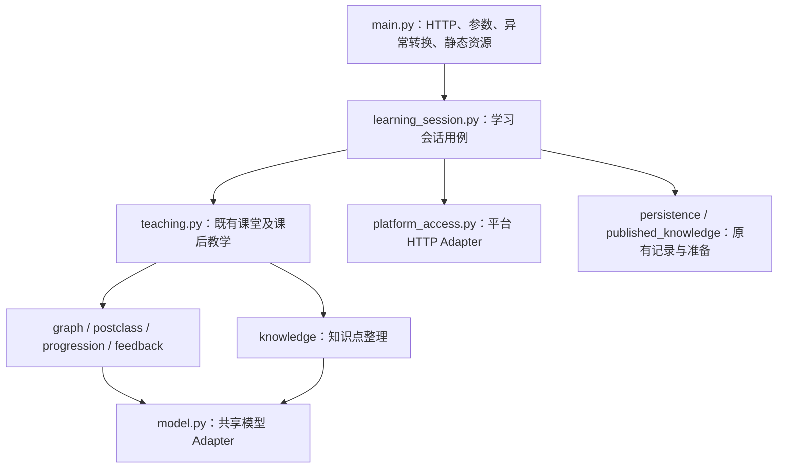

# 学生端 P1 实施与回归记录

日期：2026-11-02。范围：按[模块架构设计](student-module-architecture-design.md)收拢现有学习用例和适配逻辑，保留当前产品行为。本次完成本地实现与离线回归，未部署线上。

## 实际模块与调用关系

| 文件 | P1 职责与 Interface |
|---|---|
| [main.py](../backend/main.py) | 保留原请求模型、路由顺序、路径、参数、响应、健康检查、生命周期与静态资源；只转换参数并调用学习会话用例 |
| [learning_session.py](../backend/session/service.py) | start/resume/browser_restore/read/begin/discussion/message/end/reset_lesson/feedback/课后与回看等既有用例；集中会话缓存、锁、准备协调、身份绑定、内容换版和 commit |
| [teaching.py](../backend/teaching/service.py) | prepare/new_dialogue、describe/current_feedback、classroom_turn/finish/start_postclass/postclass_turn；返回候选变更，由学习会话持久化后生效，隐藏图节点与消息阶段处理 |
| [platform_access.py](../backend/infrastructure/platform_access.py) | platform_context、report_learning_progress；集中平台 URL 规范化、请求、超时与现有失败行为 |
| [model.py](../backend/infrastructure/model.py) | complete、json_object；课堂、课后与知识点准备共用；保留配置优先级、模型参数、超时、重试与解析规则 |
| [errors.py](../backend/contracts.py) | SessionError 表达用例失败，由 main 统一转换为原有状态码及 `{"detail": ...}`；业务模块不再导入 FastAPI |

后台调度通过 BackgroundWork 的 add_task 约定与 HTTP 层衔接，运行时仍由原 BackgroundTasks 执行；没有增加持久任务机制。平台与模型 Adapter 的函数可在测试中替换；学习会话不自行实现网络传输。

保留多个具体用例函数，便于旧 HTTP 路由逐一迁移；尚未引入设计稿 P2 的通用 LearningCommand、commandId、版本 CAS 或两段事务。当前的 dict 状态结构仅在后端内部保留，以兼容原快照与恢复；页面仍获得原有视图。

## 保留的业务行为

- 初始复述 8 轮、加强 4 轮及原配置范围；后期掌握需要加强确认。
- 深入讨论答对才推进，概念掌握和讨论结果分开保存。
- 学生提前结束、逐点反馈、课后待办补完后自由提问；课堂原反馈保留。
- 正式身份下数据库历史优先，浏览器快照只是恢复线索；重置和进入时换版的清理范围保持原样。
- 模型失败不提交本轮消息、计数或阶段；保存失败不发布候选变更。原先多次数据库写入的事务限制仍然存在，P1 不宣称已经解决。
- 平台上下文失败仍返回原有错误，学情同步仍为不阻塞课堂的尽力发送。
- 无新增数据库迁移、部署方式、前端学习流程、提示词或教学阶段；原 apps/server.py、apps/start.py 及 backend.main:app 启动入口继续使用。

## 验证结果

| 验证 | 结果与覆盖 |
|---|---|
| 改造前后端基线 | 项目 `.venv/Scripts/python.exe -m pytest -q student_agent/backend/tests`：73 项通过 |
| 改造后完整后端 | 同命令：86 项通过；原 73 项按新 Seam 调整依赖替换位置，新增 13 项行为回归 |
| 新增行为回归 | 经 HTTP 和真实 LangGraph 执行，覆盖概念/讨论分离、8/4 轮上限、第 6 轮掌握确认、提前结束、课后概念与讨论补完、重复进入、模型评估/回复失败、保存失败及请求长度校验 |
| HTTP 契约对照 | 与本轮修改前的 main.py 在同一依赖环境比较，OpenAPI 完全一致；固定时钟、会话 ID 和外部返回后，20 次连续请求的状态码、响应与签名快照逐一一致 |
| 前端单测 | frontend 下 `npm run test:unit`：10 项通过 |
| 浏览器回归 | frontend 下 `npm run test:e2e`：9 项通过，含回看、重登恢复、播放失败重试及历史保留 |
| 生产静态构建 | frontend 下 `npm run build`：成功 |
| 差异检查 | `git diff --check` 通过 |

浏览器第一次运行首个用例停在加载画面并超时；其他 8 项通过。未修改前端实现或增加等待时间；该项单独复跑通过，随后全量 9 项通过。新增课后用例最初漏掉“概念补完后仍要完成讨论”这一原规则，已更正测试预期，未改变业务规则。

系统默认 Python 缺少 langchain_core，初始收集失败；改用项目现有虚拟环境完成验证，未修改系统 Python 依赖。浏览器测试期间 Next.js 自动生成的 frontend/AGENTS.md 已作为本次运行生成物移除，未纳入改造。

以上后端测试替换平台、数据库和模型等外部 I/O；真实教学图和规则仍执行。浏览器用例使用模拟接口。未连接正式数据库或真实模型，也未验证线上学习效果或多实例容量。

## 后续接续与回退

P2 从 learning_session 的 commit 与 persistence 接口接续可靠命令、版本比较及事务；教学策略从 teaching Interface 内部演进，HTTP 路由不再复制这些步骤。动态教学仍需 P3/P4 的任务、证据和动作契约，不在 P1 中启用。

P1 没有数据格式迁移，可通过整体恢复本轮模块与调用变更回退；不能只恢复 main.py 而保留依赖新模型位置的部分代码。历史教学规则、提示词及数据库结构不需要回填或转换。
