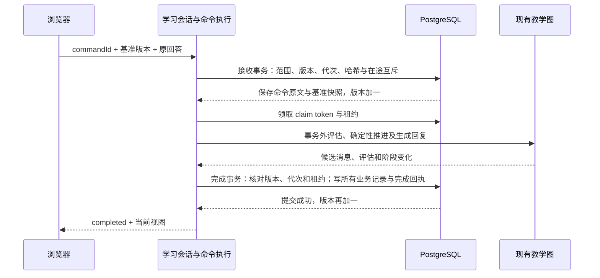

# 学生端 P2：可靠命令、版本与事务实施记录

日期：2026-11-02。基于 [模块架构设计](student-module-architecture-design.md) 与 [P1 实施](student-p1-implementation.md)。本次完成本地实现和隔离环境验证，未部署线上、未操作正式数据库。

## 1. 已落实的职责

| Module / Adapter | P2 的职责 |
|---|---|
| [commands.py](../backend/infrastructure/commands.py) | PostgreSQL 命令日志、载荷哈希、领取租约、续租、版本检查、完成/失败/取消、重置回执与同步意图领取 |
| [persistence.py](../backend/infrastructure/persistence.py) | 权威快照、单连接业务事务、普通写入的版本检查、恢复、内容换版、课时范围清理与撤销标记 |
| [command_runtime.py](../backend/session/command_runtime.py) | 身份确认、合法操作校验、事务外运行现有教学、租约心跳、重启恢复及学情同步重试 |
| [learning_session.py](../backend/session/service.py) | 保留原用例；旧 HTTP 入口的写入也经过同一事务和版本约束；内存缓存读取正式会话时刷新数据库 |
| [session-commands.mjs](../frontend/src/integration/session-commands.mjs) | 保留 commandId、原回答、基准版本与内容代次；确认丢失回执；恢复在途命令；冲突后刷新视图 |
| [cmd11 迁移](../../platform/backend/app/alembic/versions/cmd11_reliable_student_commands.py) | 平台继续拥有 DDL，增加版本/快照/撤销字段、命令表、同步意图表及索引权限 |

模型、提示词、复述 8 轮/加强 4 轮规则、后期掌握确认、讨论答对推进、概念与应用结果分离、课后待办和课堂原反馈规则保持原样。本期未启用动态教学，也没有提前引入 P3 的稳定教学任务、独立证据结构或 P4 的教学动作选择。

## 2. 命令 Interface

新增 `POST /api/session/{sid}/commands`：

```json
{
  "launch_token": "平台签发的令牌",
  "commandId": "同一意图重试保持不变的标识",
  "expectedStateVersion": 5,
  "contentGeneration": 0,
  "type": "submit_answer",
  "payload": {"text": "学生原始回答"}
}
```

操作类型：start_discussion、submit_answer、finish、continue_after_class、postclass_answer、reset_lesson。回答仍受 1–2000 字符限制；无载荷操作必须传空对象。类型与当前阶段的合法性由程序校验，不执行模型自由文本中的流程指令。

返回 commandId、status、appliedStateVersion、sessionView、failure。status 包括 pending、processing、completed、failed、cancelled；failed 返回 HTTP 503，pending/processing 返回 202。非法阶段或载荷在接收前返回 409/422。模型调用保持同步等待；进程中断或另一请求已领取时，可返回在途状态。

`POST /api/session/{sid}/commands/{commandId}/status` 在请求体接收 launch_token，只查询结果，不新建教学提交。失败回执也可用该查询以 HTTP 200 读取。

每次命令或状态查询使用平台已有 `/internal/student/authorize` 验证令牌和当前选课资格，不重复获取课时全文。会话归属、课程和签名令牌中的发布绑定必须匹配；平台现有 publicationId 与学习上下文 id 两种命名均支持。令牌过期需从平台重新进入，新令牌可查询或重试同一命令，因为身份凭据不参与命令载荷哈希。

sessionView 新增 stateVersion、contentGeneration、pendingSubmission。appliedStateVersion 表示该命令完成时的版本，sessionView 返回当前可用视图：旧回执不能把页面回退到较早状态。内部完成结果仍保存在命令记录中。pendingSubmission 提供本人的原回答及原始命令元数据，支持新设备恢复。

原 HTTP 路径与参数继续可用。当前前端在正式平台身份和新版本元数据可用时，将原操作映射为可靠命令；演示模式和旧后端视图继续使用旧路径。没有提交 commandId 的兼容请求无法区分重复意图，但仍受数据库版本检查、在途互斥和原子保存保护。

## 3. 两段事务与唯一事实来源



接收时，回答原文写入 student_commands.payload，尚不成为成功教学轮次，也不加入已完成的消息序列。现有次数和阶段保持不变。处理失败后原文仍可恢复；同 commandId 重试复用该接收记录和基准快照。

完成时，学生/导师消息、知识点结果、评估所在的教学快照、反馈、结束标记、权威快照、同步意图和命令完成结果由一个连接、一个事务写入。旧 database 辅助函数支持借用调用者连接，借用时不自行提交。完成保存失败会整体回滚，不能留下部分消息、掌握结果或结束反馈。

student_sessions.snapshot、state_version、content_generation 是恢复的权威记录，learning_events 继续保留历史快照和反馈兼容记录。stateVersion 与消息数量分开，接收与完成各自递增；租约和处理失败属于命令执行状态，不推进教学。旧快照的 version 字段仍表示消息数量，不参与并发控制。

旧会话先由 cmd11 从最新 agent_state 回填；缺少 stateVersion 时从零开始；历史 postclass/replay 视图状态按已结束课堂恢复。恢复仍支持尚未回填 snapshot 的历史事件读取。正式身份下浏览器签名快照只能定位历史，不能覆盖数据库。

## 4. 并发、失败与撤销

- 同一 sessionId + commandId 唯一，哈希包含操作、载荷、基准版本和内容代次；相同编号不同内容返回 COMMAND_REUSED。
- 会话行先于命令行加锁；同一会话只允许一条 pending/processing 命令。独立进程间依靠数据库锁、唯一索引和版本检查协调。
- 默认处理租约 180 秒，每 30 秒续租。领取凭据改变、租约过期、版本或内容代次变化，都会拒绝迟到结果。旧 worker 的失败回执也不能覆盖新 worker 的结果。
- 后台循环在空闲时每 2 秒检查 pending 或租约过期的 processing；failed 不自动无限重试，保留回答等待学生重试。模型计算在租约恢复时可能重复，业务提交只会生效一次。
- 连接在数据库提交后丢失时，完成回执仍存在；重复请求读取结果，不再次运行教学。前端刷新后先查询已保存命令，确认丢失的回执。
- VERSION_CONFLICT、CONTENT_CHANGED 等冲突刷新权威视图，不自动把旧回答重放到新任务。模型失败可以用原命令重试；修改回答构成新意图，原失败记录标为取消并保留原文。
- 明确的 finish 可以取消在途回答；被取消的回答不计轮次。普通兼容消息入口不能取消在途命令，课后消息也遵守此约束。
- 换版仍发生在进入/恢复课时时：清除旧学习记录、递增版本及内容代次，初始化新版，删除旧命令并阻止其结果写回。
- 重置删除本人本课的学习正文和命令数据，保留没有正文的撤销行；重置命令只留下不含旧回答的回执。原会话编号和签名快照不能重建已撤销记录，其他学生与课时保持原样。重置后的入口直到开始新课才确定新的学习开始时间与发布绑定；换版会清除旧结束标记。

平台学情查询已相应排除 revoked_at 非空和 classroom_id 为空的入口记录，重置不会因为保留撤销行而继续计入学习进度。

## 5. 学情同步

started、ended、reset 的同步意图和对应学习状态在同事务保存。后台领取同步意图，失败后保留并延迟重试；过期领取也可被接管。同步故障不会撤销已经完成的学习提交。

沿用平台现有学习进度计算与教师推送协议，提供至少一次尝试和失败重试，不宣称跨平台/教师端分布式事务或恰好一次投递。reset 会清除该课时旧同步意图，再写入 reset 意图。

## 6. 发布、维护与回退约定

本次仅实现和测试，以下为后续发布操作顺序：

1. 暂停旧学生进程写入并等待其在途请求结束。P1 旧二进制不会维护新权威快照，不能与 P2 同时写同一数据库。
2. 在平台正常迁移环境执行 `python -m alembic upgrade head`，应用 cmd11；确认 student 角色可对新表进行 DML。数据库 DDL 仍由平台管理，学生运行时不建表。
3. 发布包含撤销过滤的平台版本，再发布 P2 学生后端与其前端构建，启动命令恢复和同步 worker，随后恢复入口。
4. 维护时可设置 `STUDENT_COMMAND_ACCEPT_NEW=0` 并重启/重载对应实例：拒绝新命令，已有回执、已接收命令重试及后台恢复仍可用。默认值为 1。

回退必须保留能识别 P2 数据和命令状态的读取/处理能力。不能直接启用 P1 旧写入实现，也不能删除新增表来回退；迁移 downgrade 不自动销毁回答、版本与撤销标记。先处理在途提交，再切换兼容实现。

## 7. 回归结果与复现

最终验证结果：后端 114 项、前端单测 19 项、浏览器 12 项通过，生产静态构建成功，差异格式检查通过。

后端包括 83 项离线行为回归和 31 项真实 PostgreSQL 场景。原三项基于浅数据库替身的持久化测试，已由真实事务/范围清理测试替换。真实数据库覆盖：

- 相同命令、不同载荷、同基准版本竞争、在途互斥及旧入口竞争。
- 评估失败、回复失败、写入中断、反馈写入中断的整体回滚和原回答重试。
- 提交成功但确认丢失；进程内存清空；独立子进程领取后崩溃与新进程恢复。
- 过期租约、续租、旧领取凭据、结束取消及换版迟到结果。
- 重置幂等、原文删除、其他学生/课时隔离、旧快照拒绝和平台进度清零。
- 迁移回填与重复执行、维护排空模式、同步意图重试、真实教学图的 8/4 轮和课后原反馈保留。

PostgreSQL 测试必须显式配置隔离管理连接；不读取正式/开发数据库配置。测试仅接受回环主机、用户名 student_p2_test、管理库 postgres，然后自动创建随机 student_p2_test_* 数据库，完成后删除该测试库。

```powershell
# 指向自行准备的专用隔离 PostgreSQL；替换 TEST_PORT。
$env:STUDENT_TEST_DATABASE_URL = 'postgresql://student_p2_test@127.0.0.1:TEST_PORT/postgres'
.venv/Scripts/python.exe -m pytest -q student_agent/backend/tests

# 在 student_agent/frontend 下运行。
npm run test:unit
npm run test:e2e
npm run build
```

没有 STUDENT_TEST_DATABASE_URL 时，仅运行离线用例，真实数据库用例会明确标记跳过，不能据此宣称并发与事务验证通过。本次 Docker 引擎未运行，使用从 [EDB 二进制下载](https://www.enterprisedb.com/download-postgresql-binaries)取得的 PostgreSQL 17.6 便携程序，建立独立数据目录与回环端口运行全部数据库用例；临时集群在交付前停止。

浏览器新增用例验证了丢失响应后复用命令、刷新确认完成结果、模型失败后刷新并重试。开发模式可能重复读取状态，断言检查查询同一命令且教学写入只生效一次，不要求只读请求恰好一次。

平台权限检查和模型输出在测试中替换；教学图和 PostgreSQL 事务真实执行。平台进度聚合的真实函数通过独立载入，在同一隔离 PostgreSQL 执行学生数据查询，教师发布课时总数使用固定输入；未运行整个平台应用测试或连接教师端。未验证生产容量、真实模型教学质量或跨服务投递的恰好一次语义。
